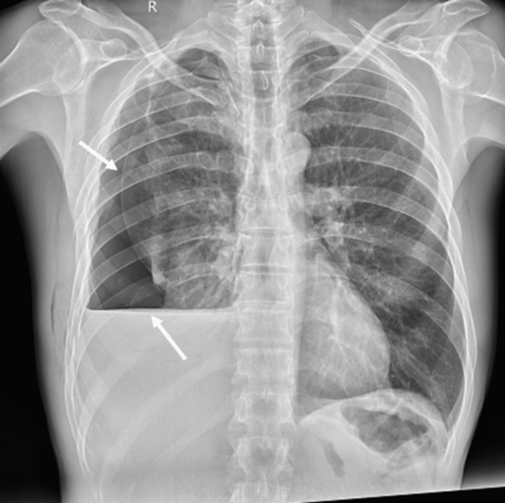

## 문제
52세 남자가 하루 전 사다리에서 떨어져 오른쪽 가슴을 부딪친 뒤 오른쪽 가슴 통증과 숨참이 점점 심해져 응급실에 왔다. 혈압 128/80 mmHg, 맥박 98회/분, 호흡 22회/분, 체온 36.8 °C, 산소포화도 94 %(실내 공기)이다. 기관은 가운데에 있고 목정맥 확장은 없다. 오른쪽 아래 갈비뼈 부위에 압통이 있고, 오른쪽 위쪽 가슴은 타진에 과공명, 아래쪽은 둔탁하며 오른쪽 호흡음이 감소하였다. 혈색소는 12.1 g/dL 이다. 선 자세에서 찍은 흉부 X선 사진은 그림과 같다. 진단은?

- A. 오른쪽 폐좌상
- B. 오른쪽 혈기흉
- C. 오른쪽 단순 혈흉
- D. 오른쪽 긴장성 기흉
- E. 오른쪽 외상성 가로막 탈장

_직립 전후 흉부 X선, 흰 화살표와 R 표지는 원 그림의 것 — 출판된 증례 그림 한 컷 그대로 (PMC Open Access Subset, CC BY — 크롭·보정 없음)_

## 정답 및 해설
> 정답: B

- **정답 핵심**: 선 자세 흉부 X선에서 오른쪽 흉곽 가운데 높이에 곧고 수평인 공기-액체 경계면이 있고, 그 위 바깥쪽에는 혈관 음영이 없는 공기와 안쪽으로 밀린 장측 흉막선이 보인다. 흉막강 안에 공기와 액체(외상 뒤이므로 피)가 함께 있다는 뜻이므로 오른쪽 혈기흉이다. 타진의 위쪽 과공명·아래쪽 둔탁도 같은 분포를 가리킨다.
- **원리**: <b>왜 경계면이 곧은 수평선이 되는가</b>: 흉막강에 액체만 있으면 폐는 탄성 반동으로 안쪽으로 당기고 액체는 표면장력으로 흉벽을 따라 올라가므로, 선 자세 사진에서 바깥쪽이 높고 안쪽이 낮은 오목한 곡선(메니스커스)이 생긴다. 공기가 함께 들어오면 액체 위의 공간이 공기로 채워져 액체 표면이 흉벽에 끌려 올라가지 않고 중력대로 평평해진다. 그래서 <b>수평 경계면 = 같은 공간 안의 공기 + 액체</b>다.  <b>왜 선 자세가 필요한가</b>: 누운 자세 전후 사진에서는 액체가 등 쪽으로 퍼지고 공기는 앞쪽으로 모여 경계면이 X선과 평행하지 않으므로 수평선이 보이지 않는다. 외상 환자의 첫 사진이 누운 자세라면 혈기흉도 한쪽 폐야가 뿌옇게 보이는 것만으로 나타날 수 있다.  <b>처치로 이어지는 의미</b>: 혈기흉은 흉관으로 공기와 피를 함께 뺀다. 첫 배액이 1,500 mL 이상이거나 시간당 200 mL 이상이 2~4시간 이어지면 개흉술을 고려한다.
- **비교**: <table><thead><tr><th style="width:22%">구분</th><th style="width:39%">혈기흉(정답)</th><th>단순 혈흉(가장 가까운 오답)</th></tr></thead><tbody> <tr><td>액체 윗면</td><td><b>곧은 수평선</b>(공기-액체 경계면)</td><td>흉벽 쪽으로 올라가는 <b>메니스커스</b></td></tr> <tr><td>흉막선</td><td>안쪽으로 밀린 장측 흉막선이 보인다</td><td>보이지 않는다</td></tr> <tr><td>타진</td><td>위쪽 과공명, 아래쪽 둔탁</td><td>아래쪽 둔탁만</td></tr> </tbody></table> 두 질환 모두 흉관 배액이 첫 처치지만, 사진에서 공기가 함께 있는지는 경계면의 모양이 알려 준다 — 곧으면 공기도 있다.
- **오답 이유**:
  - ① 폐좌상은 외상 뒤 24~48시간 안에 폐엽 경계와 무관한 폐 실질의 흐린 음영으로 나타나며, 흉막강의 공기나 수평 경계면은 만들지 않는다.
  - ③ 단순 혈흉은 액체 윗면이 흉벽을 따라 올라가는 오목한 메니스커스이고 흉막선과 폐 바깥 공기가 없을 때 진단한다. 이 사진은 경계면이 곧고 장측 흉막선이 보인다.
  - ④ 긴장성 기흉은 저혈압·목정맥 확장·기관 편위가 있는 불안정 상태에서 임상적으로 진단해 X선 전에 감압한다. 이 환자는 혈압이 정상이고 기관이 가운데에 있다.
  - ⑤ 외상성 가로막 탈장은 가로막 윤곽이 사라지고 흉강 안에 장관 가스나 위관 끝이 보일 때 의심하며 대개 왼쪽이다. 이 사진의 공기는 장관 모양이 아니다.
- **함정**: 오른쪽 아래가 하얗다는 것만 보고 단순 혈흉을 고르는 것 — 액체 윗면이 곧은 수평선이고 그 위에 흉막선이 보이면 공기도 함께 있다.
- **학습목표**: 흉부 둔상 뒤 흉부 X선의 곧고 수평인 공기-액체 경계면과 장측 흉막선을 혈기흉으로 읽고, 메니스커스를 보이는 단순 혈흉과 구분한다
- **근거·출처**: American College of Surgeons. ATLS Advanced Trauma Life Support, 10th ed. Chapter 4 Thoracic trauma (hemothorax, pneumothorax, indications for thoracotomy) · Fraser and Paré's Diagnosis of Diseases of the Chest — pleural effusion meniscus vs air-fluid level in hydropneumothorax · PMC13536977 Figure 2 — case report of delayed hemopneumothorax after blunt chest trauma, 52-year-old man (teacher-only) · 작성자 판독(2026-10-12): 직립 AP 흉부 X선, 오른쪽 흉곽 가운데 높이의 곧고 수평인 공기-액체 경계면, 그 위 바깥쪽의 혈관 음영 없는 공기와 안쪽으로 밀린 장측 흉막선, 오른쪽 가로막 윤곽은 액체에 가려짐, 왼쪽 폐 정상

## 출처
- Delayed Hemopneumothorax and Multiple Rib Fractures Following Blunt Chest Trauma. Cureus. 2026 Sep 2;18(9):e115642. doi: 10.7759/cureus.115642 (CC BY) — Figure 2 · CC BY · https://creativecommons.org/licenses/
