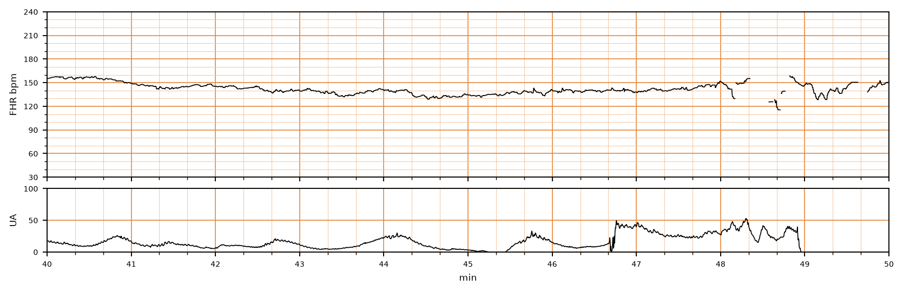

## 문제
A 38-year-old nulliparous woman at 40 weeks' gestation is admitted to the labor and delivery unit in spontaneous labor. Her pregnancy has been uncomplicated. She has not received any analgesic, sedative, or other medication. Temperature is 36.9°C (98.4°F), pulse is 84/min, and blood pressure is 122/76 mm Hg. Contractions are palpable every 2 to 3 minutes. The cervix is 6 cm dilated and 90% effaced, and the fetal vertex is at 0 station; the membranes are intact. Continuous external fetal heart rate monitoring has shown the same pattern for the past 40 minutes; a representative 10-minute segment of the cardiotocogram is shown. Which of the following is the most appropriate next step in management?

- A. Digital stimulation of the fetal scalp
- B. Immediate cesarean delivery
- C. Continued routine monitoring with no other action
- D. Initiation of oxytocin infusion
- E. Transcervical amnioinfusion

_Intrapartum fetal heart rate (top) and uterine activity (bottom), minutes 40 to 50 of the recording; bold vertical lines = 1 min (CTU-UHB Intrapartum Cardiotocography Database, PhysioNet, ODC-BY 1.0; 4 Hz raw data, no smoothing)_

## 정답 및 해설
> 정답: A

- **정답 핵심**: The baseline fetal heart rate is about 135 to 155/min (normal), but the amplitude of baseline variability is 5/min or less (minimal variability), and there are no accelerations or decelerations. A tracing with a normal baseline and minimal variability is Category II (indeterminate). Minimal variability may reflect a fetal sleep cycle, drugs, or early hypoxemia; she has received no medications and it has lasted 40 minutes. The next step is fetal scalp stimulation: an acceleration in response makes fetal acidemia unlikely (scalp pH ≥ 7.20), and labor can continue with close monitoring.
- **원리**: <b>Why variability reflects fetal oxygenation</b>: beat-to-beat variability arises from the continuous push and pull of sympathetic and parasympathetic input to the sinoatrial node, which requires a well-oxygenated fetal brainstem. When the brainstem becomes hypoxic and acidotic, this autonomic fine-tuning fades and the line flattens. Moderate variability (6 to 25/min) therefore reliably predicts the absence of metabolic acidemia at that moment.  <b>Why minimal variability is not yet an emergency</b>: the same flattening occurs in quiet fetal sleep, which usually lasts 20 to 40 minutes, and after maternal opioids, magnesium, or sedatives. Minimal variability alone is Category II, which calls for evaluation rather than immediate delivery.  <b>Why scalp stimulation works</b>: stimulating the fetal scalp produces a sympathetic surge; a fetus that is not acidotic responds with an acceleration (at ≥ 32 weeks, ≥ 15/min for ≥ 15 seconds). An acceleration has a negative predictive value for acidemia similar to a scalp pH ≥ 7.20. No acceleration does not prove acidemia, but it calls for intrauterine resuscitation and preparation for expedited delivery if the tracing does not improve.
- **비교**: <table><thead><tr><th style="width:22%">Feature</th><th style="width:39%">This tracing — Category II (correct: evaluate)</th><th>Category I (distractor: routine monitoring)</th></tr></thead><tbody> <tr><td>Baseline</td><td>110-160/min</td><td>110-160/min</td></tr> <tr><td>Variability amplitude</td><td><b>≤ 5/min (minimal)</b></td><td><b>6-25/min (moderate)</b></td></tr> <tr><td>Accelerations</td><td>Absent</td><td>Present or absent</td></tr> <tr><td>Action</td><td>Evaluate — scalp stimulation, look for reversible causes</td><td>Routine monitoring</td></tr> </tbody></table> Read variability before anything else: moderate variability reassures; minimal variability needs a test of fetal reserve; absent variability with recurrent decelerations (Category III) needs delivery.
- **오답 이유**:
  - (B) Immediate cesarean delivery is indicated for a Category III tracing — absent variability with recurrent late or variable decelerations or bradycardia, or a sinusoidal pattern; this tracing has minimal, not absent, variability and no decelerations.
  - (C) Routine monitoring alone suits a Category I tracing with moderate variability (6 to 25/min); here variability has stayed at 5/min or less for 40 minutes, so fetal reserve should be tested first.
  - (D) Oxytocin augmentation is considered for protraction or arrest of active labor once fetal status is reassuring; it increases contraction frequency and could worsen oxygenation of a compromised fetus.
  - (E) Amnioinfusion is used for recurrent variable decelerations from cord compression, usually after the membranes have ruptured; this tracing has no decelerations and the membranes are intact.
- **함정**: Calling the tracing normal because the baseline is within range and there are no decelerations — the flat line (minimal variability) itself makes it Category II.
- **학습목표**: 분만 중 태아심박동에서 기저선 정상·최소 변이도·가속과 감속 없음을 범주 II 로 읽고, 태아 산증 여부를 가리기 위해 태아 두피 자극으로 가속 반응을 확인한다
- **근거·출처**: American College of Obstetricians and Gynecologists. Practice Bulletin No. 106: Intrapartum fetal heart rate monitoring: nomenclature, interpretation, and general management principles. Obstet Gynecol 2009;114:192-202 · American College of Obstetricians and Gynecologists. Practice Bulletin No. 116: Management of intrapartum fetal heart rate tracings. Obstet Gynecol 2010;116:1232-1240 · Chudáček V, et al. Open access intrapartum CTG database. BMC Pregnancy Childbirth 2014;14:16 (CTU-UHB, PhysioNet) · 작성자 판독(2026-10-12): 40~48분 기저 약 135~155회/분, 변이도 진폭 5회/분 이하, 가속 없음, 뚜렷한 감속 없음, 48분 이후 신호 소실 구간, 자궁수축은 낮은 진폭으로 1.5~2분 간격

## 출처
- CTU-UHB Intrapartum Cardiotocography Database (PhysioNet, ODC-BY 1.0) · record 1203 · Open Data Commons Attribution License v1.0 · https://opendatacommons.org/licenses/by/1-0/
