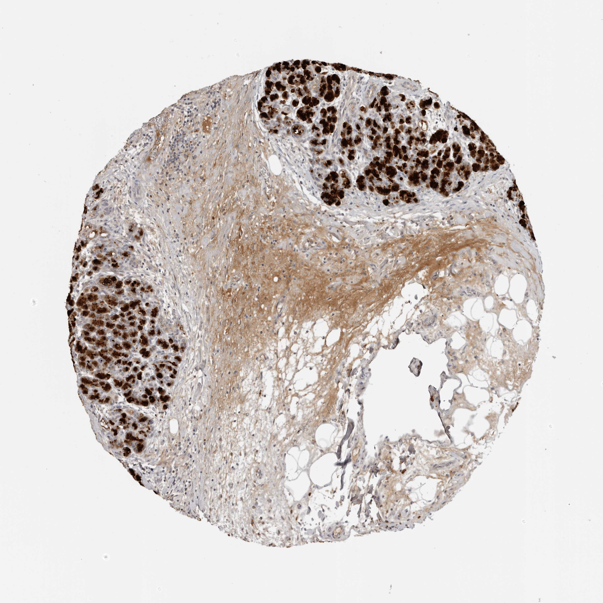

## 문제
A 63-year-old man undergoes pancreaticoduodenectomy for a 3-cm mass in the head of the pancreas found during evaluation of a 2-year history of recurrent epigastric pain, a 9-kg weight loss, and greasy, foul-smelling stools. He has drunk 6 to 8 cans of beer daily for 30 years. CT had shown multiple calcifications throughout the pancreas and a dilated main pancreatic duct. Histologic examination of the resected specimen shows chronic pancreatitis without malignancy. A photomicrograph of a section of the pancreas stained by immunohistochemistry with an antibody against the zymogen whose premature activation within the gland initiates pancreatitis is shown. Which of the following normally converts this protein to its active form?

- A. Pepsin secreted by gastric chief cells
- B. Enteropeptidase on the duodenal brush border
- C. Cholecystokinin released from duodenal I cells
- D. Hydrochloric acid secreted by gastric parietal cells
- E. Bile salts released from the gallbladder

_Immunohistochemical stain of a tissue microarray core (DAB brown chromogen, hematoxylin counterstain), original magnification (Human Protein Atlas, CC BY 4.0; no cropping or color adjustment)_

## 정답 및 해설
> 정답: B

- **정답 핵심**: The brown granular staining fills the cytoplasm of the surviving acinar lobules, while the fibrotic stroma and fat between them stain weakly — the acinar cells make the zymogen trypsinogen. Trypsinogen is first activated in the duodenal lumen by enteropeptidase (enterokinase), a brush-border enzyme of duodenal enterocytes that cleaves off the trypsinogen activation peptide. The resulting trypsin then activates more trypsinogen and the other pancreatic proenzymes (chymotrypsinogen, procarboxypeptidase, proelastase, prophospholipase).
- **원리**: <b>Why the gland stores inactive enzymes</b>: acinar cells pack proteases as inactive zymogens in granules so that they cannot digest the cell that made them. Activation is deliberately placed outside the gland: enteropeptidase sits on the brush border of the duodenum, where food arrives. One cut by enteropeptidase removes the N-terminal activation peptide (TAP), and trypsin then becomes the master switch that activates every other zymogen.  <b>Safeguards inside the gland</b>: SPINK1 (pancreatic secretory trypsin inhibitor) binds any trypsin formed by accident, trypsin destroys itself by autolysis, and low intra-acinar calcium keeps trypsinogen from autoactivating. When these fail — <b>PRSS1</b> gain-of-function mutations that resist autolysis, SPINK1 loss-of-function mutations, or alcohol and hypercalcemia that promote activation (cathepsin B colocalizing with zymogens) — trypsin is activated inside the acinar cell and pancreatitis begins.  <b>Why this patient has steatorrhea</b>: repeated injury replaces acini with fibrosis and fat, as seen between the stained lobules. Once lipase output falls below about 10% of normal, fat malabsorption appears.
- **비교**: <table><thead><tr><th style="width:22%">Feature</th><th style="width:39%">Enteropeptidase (correct)</th><th>Cholecystokinin (closest distractor)</th></tr></thead><tbody> <tr><td>What it is</td><td>Serine protease on the duodenal brush border</td><td>Peptide hormone from duodenal I cells</td></tr> <tr><td>Action on trypsinogen</td><td><b>Cleaves</b> the activation peptide — converts it to trypsin</td><td><b>Stimulates secretion</b> of zymogens from acinar cells</td></tr> <tr><td>Deficiency</td><td>Congenital enteropeptidase deficiency — diarrhea, failure to thrive, hypoproteinemia</td><td>Reduced pancreatic and gallbladder response to meals</td></tr> </tbody></table> Secretion and activation are different steps: hormones (CCK, secretin) control how much is released, and only a protease (enteropeptidase, then trypsin) switches the zymogen on.
- **오답 이유**:
  - (A) Pepsin is activated by gastric acid and digests proteins in the stomach; it is inactivated in the alkaline duodenum and does not cleave pancreatic zymogens.
  - (C) Cholecystokinin stimulates acinar cells to secrete zymogens and the gallbladder to contract; it would be the answer to a question about what releases trypsinogen, not what activates it.
  - (D) Hydrochloric acid activates pepsinogen to pepsin in the stomach and is neutralized by bicarbonate in the duodenum, where trypsinogen activation actually takes place at near-neutral pH.
  - (E) Bile salts emulsify fat and act as a cofactor that lets colipase anchor lipase to fat droplets; they would be the answer for a question on lipid digestion, not protease activation.
- **함정**: Confusing the hormone that releases the zymogen (cholecystokinin) with the enzyme that activates it (enteropeptidase).
- **학습목표**: 췌장 샘꽈리세포가 분비하는 트립시노겐이 십이지장 솔가장자리의 엔테로펩티데이스로 처음 활성화되고, 트립신이 다른 효소원을 연쇄 활성화함을 안다
- **근거·출처**: Barrett KE, et al. Ganong's Review of Medical Physiology, 26th ed. Ch. Digestion and absorption — pancreatic proteases and enteropeptidase · Whitcomb DC, et al. Hereditary pancreatitis is caused by a mutation in the cationic trypsinogen gene. Nat Genet 1996;14:141-145 · Human Protein Atlas — PRSS1 (serine protease 1, cationic trypsinogen) pancreas tissue image (teacher-only) · 작성자 판독(2026-10-12): 췌장 TMA 코어, 두 곳의 샘꽈리 소엽 세포질이 진한 갈색 과립상으로 염색, 소엽 사이는 넓은 섬유화 기질·지방·부종성 기질로 염색 약함

## 출처
- Human Protein Atlas, PRSS1 / Pancreas (CC BY 4.0), https://images.proteinatlas.org/25487/58185_A_2_3.jpg · Creative Commons Attribution 4.0 International · https://www.proteinatlas.org/about/licence
