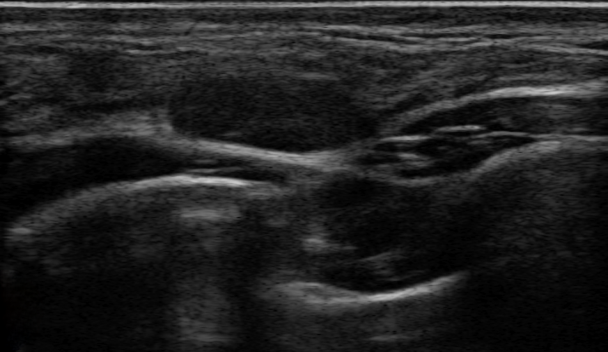

## 문제
21세 여자가 입사 건강검진에서 시행한 유방 초음파에서 오른쪽 유방의 종괴가 발견되어 왔다. 통증이나 유두 분비물은 없고 스스로 만져 본 적도 없다. 월경은 규칙적이고 복용하는 약은 없다. 가족 중 유방암 환자는 없다. 진찰에서 양쪽 유방의 피부 변화는 없고 뚜렷한 종괴가 만져지지 않으며 겨드랑이 림프절도 만져지지 않는다. 오른쪽 유방 초음파 사진은 그림과 같다. 가장 가능성 높은 진단은?

- A. 침윤성 유관암종
- B. 유관내 유두종
- C. 섬유샘종
- D. 단순 낭종
- E. 엽상종양

_회색조 초음파 한 컷, 표시 없음 (TCIA, CC BY 4.0 — 크롭·보정 없음)_

## 정답 및 해설
> 정답: C

- **정답 핵심**: 초음파에서 피부와 평행한(가로가 세로보다 긴) 작은 타원형 종괴가 있고, 외곽이 매끈하고 명확하며 내부는 균일한 저에코이고 후방 음향 변화가 없다. 무에코가 아닌 고형 종괴이면서 양성 모양(타원·평행·외곽 명확)을 모두 갖추었고, 21세 무증상 여성이므로 섬유샘종이 가장 가능성 높다(BI-RADS 3).
- **원리**: <b>왜 모양이 양성·악성을 가르는가</b>: 섬유샘종은 샘과 기질이 함께 자라는 양성 종양으로 주변 조직을 밀어내며 자란다. 그래서 피막처럼 매끈한 경계를 만들고, 유방 조직의 층을 따라 옆으로 자라 피부와 평행한 타원이 된다. 반대로 암은 주변 조직을 파고들며 자라 경계가 각지거나 침상이 되고, 조직면을 가로질러 세로로 자라 「키가 큰(비평행)」 모양과 뒤쪽 음영(섬유화 반응)을 만든다.  <b>왜 낭종이 아닌가</b>: 단순 낭종은 액체라 초음파가 반사 없이 지나가므로 내부가 완전히 검고(무에코) 뒤쪽이 밝아진다(후방 증강). 이 종괴는 내부 에코가 있는 고형이다.  <b>처치로 이어지는 의미</b>: 전형적인 섬유샘종 모양(BI-RADS 3)은 악성 가능성이 2 % 이하라 6개월 뒤 추적 초음파로 크기 변화를 보며, 커지거나 환자가 원하면 중심부 바늘생검을 한다. 30세 미만에서는 유방촬영술보다 초음파가 일차 검사다.
- **비교**: <table><thead><tr><th style="width:22%">구분</th><th style="width:39%">섬유샘종(정답)</th><th>엽상종양(가장 가까운 오답)</th></tr></thead><tbody> <tr><td>호발 나이</td><td><b>15~35세</b></td><td><b>40~50대</b></td></tr> <tr><td>크기·성장</td><td>대개 2~3 cm 이하, 성장 느리거나 멈춤</td><td>흔히 큼, 몇 주~몇 달 사이 빠르게 커짐</td></tr> <tr><td>초음파</td><td>작은 타원, 균일한 저에코, 외곽 명확</td><td>크고 분엽상, 내부에 갈라진 틈·낭성 공간</td></tr> </tbody></table> 두 질환 모두 경계가 명확한 섬유상피 종양이다 — 나이, 크기, 빠른 성장 여부와 내부 갈라진 틈이 가른다.
- **오답 이유**:
  - ① 침윤성 유관암종은 경계가 각지거나 침상이고 세로로 긴(비평행) 모양에 뒤쪽 음영을 보일 때 의심한다. 이 종괴는 평행한 타원에 외곽이 명확하다.
  - ② 유관내 유두종은 피 섞인 유두 분비물과 함께 확장된 유관 안의 고형 결절로 보일 때 의심한다. 이 환자는 분비물이 없고 종괴가 유관 밖에 있다.
  - ④ 단순 낭종은 내부가 완전히 검은 무에코이고 뒤쪽이 밝아지는 후방 증강이 있을 때 진단하며 40대 폐경 전 여성에 흔하다. 이 종괴는 내부 에코가 있는 고형이다.
  - ⑤ 엽상종양은 40~50대에서 크고 빠르게 자라며 내부에 갈라진 틈이나 낭성 공간을 보일 때 의심한다. 21세의 작고 균일한 종괴에서는 가능성이 낮다.
- **함정**: 저에코라는 말만 보고 암을 고르는 것 — 모양(타원·평행)과 외곽(명확)이 양성의 표지다.
- **학습목표**: 젊은 여성의 유방 초음파에서 피부와 평행한 타원형·외곽 명확·저에코 고형 종괴를 섬유샘종으로 판단하고 낭종·엽상종양·암과 구분한다
- **근거·출처**: American College of Radiology. ACR BI-RADS Atlas, 5th ed. Ultrasound — mass shape, orientation, margin, posterior features · Stavros AT, et al. Solid breast nodules: use of sonography to distinguish between benign and malignant lesions. Radiology 1995;196:123-134 · Pawłowska A, et al. Curated benchmark dataset for ultrasound based breast lesion analysis (BrEaST-Lesions_USG). Sci Data 2024 — case 202, biopsy-confirmed fibroadenoma (teacher-only) · 작성자 판독(2026-10-12): 유방 초음파, 피부와 평행한 작은 타원형 저에코 고형 종괴, 외곽 명확, 후방 음향 변화 없음, 주변 조직 왜곡 없음

## 출처
- BrEaST-Lesions-USG, The Cancer Imaging Archive (CC BY 4.0) · case202 · Creative Commons Attribution 4.0 International · https://www.cancerimagingarchive.net/data-usage-policies-and-restrictions/
