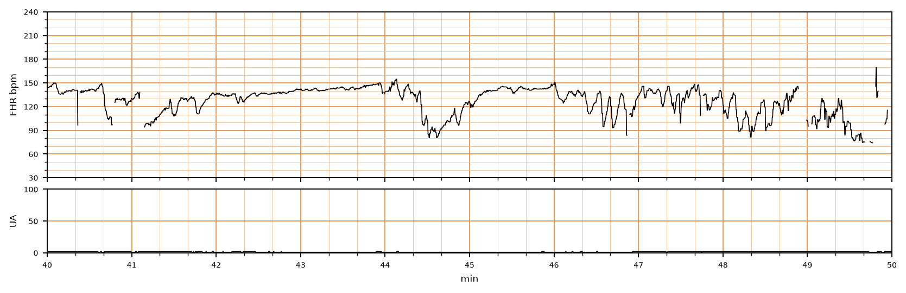

## 문제
27세 초산부가 임신 40주에 진통으로 입원하였다. 임신 경과는 정상이었다. 입원 6시간째 자궁경부는 7 cm 열렸고 2시간 전 자연적으로 양막이 터져 맑은 양수가 나왔다. 체온 36.8 °C, 혈압 118/72 mmHg, 맥박 88회/분이다. 진통은 손으로 만져 2~3분 간격이다. 외부 자궁수축 탐촉자가 미끄러져 자궁활동은 기록되지 않았다. 지속 태아심박동 감시 기록의 10분 구간은 그림과 같다. 반복되는 감속의 기전으로 가장 적절한 것은?

- A. 자궁태반 관류 저하
- B. 태아 빈혈
- C. 태아 수면 주기
- D. 탯줄 압박
- E. 태아 머리 압박

_분만 중 태아심박동(위)과 자궁활동(아래), 기록 40~50분 구간, 굵은 세로선 = 1분 (PhysioNet CTU-UHB, ODC-BY 1.0 — 4 Hz 원자료, 평활화 없음)_

## 정답 및 해설
> 정답: D

- **정답 핵심**: 기저 태아심박동은 약 140회/분이다. 감속은 몇 초 만에 80~95회/분까지 떨어졌다가(시작에서 최저점까지 30초 미만) 다시 급격히 회복하는 V·U 모양이고, 46분 이후 거의 매분 반복된다. 이처럼 하강이 급격한 감속은 자궁수축과의 시간 관계와 무관하게 변이감속으로 정의하며, 양막이 터진 뒤 탯줄이 눌려 생기는 반사 반응이다.
- **원리**: <b>왜 모양만으로 갈리는가</b>: 감속의 종류는 원인 반사의 속도가 다르기 때문에 하강 속도로 나뉜다. 탯줄이 눌리면 먼저 얇은 벽의 정맥이 막혀 태아 혈액량이 줄고, 이어 동맥이 막히면 태아 말초저항이 갑자기 올라 압수용체가 미주신경을 통해 <b>몇 초 만에</b> 심박을 떨어뜨린다. 압박이 풀리면 같은 속도로 돌아온다 — 그래서 급격한 하강·급격한 회복(변이감속)이다.  <b>만기감속은 왜 느린가</b>: 자궁수축 때 융모사이 공간의 혈류가 줄면 태아 혈중 산소가 서서히 떨어지고, 화학수용체 반사와 심근 저산소가 뒤따라 작동하므로 하강이 30초 이상에 걸쳐 완만하고 수축 최고점보다 늦게 최저점이 온다.  <b>처치로 이어지는 의미</b>: 반복되는 변이감속은 산모 체위 변경, 옥시토신 감량, 양막이 터졌다면 양수주입으로 탯줄 압박을 줄인다. 감속 사이 변이도가 유지되면 아직 산증이 진행하지 않았다는 뜻이고, 변이도가 사라지면 범주 III 로 서둘러 분만한다.
- **비교**: <table><thead><tr><th style="width:22%">구분</th><th style="width:39%">변이감속(정답 — 탯줄 압박)</th><th>만기감속(가장 가까운 오답 — 자궁태반 관류 저하)</th></tr></thead><tbody> <tr><td>시작 → 최저점</td><td><b>30초 미만</b>(급격)</td><td><b>30초 이상</b>(완만)</td></tr> <tr><td>자궁수축과의 관계</td><td>일정하지 않다 — 수축 기록 없이도 판정 가능</td><td>수축 최고점보다 늦게 최저점, 수축이 끝난 뒤 회복</td></tr> <tr><td>모양</td><td>V·U·W 모양, 깊이가 제각각</td><td>매번 비슷한 얕고 둥근 모양</td></tr> <tr><td>반사 경로</td><td>압수용체 → 미주신경</td><td>화학수용체·심근 저산소</td></tr> </tbody></table> 수축 기록이 없을 때 만기·조기감속은 판정할 수 없지만, 변이감속은 하강 속도만으로 판정할 수 있다 — 30초가 경계다.
- **오답 이유**:
  - ① 자궁태반 관류 저하는 만기감속의 기전으로, 매 수축마다 완만하게 내려가 수축 최고점보다 늦게 최저점에 이르는 감속일 때 정답이 된다.
  - ② 태아 빈혈은 사인파형의 원인으로, 진폭이 고른 매끄러운 물결이 분당 3~5회 반복되고 변이도와 가속이 없을 때 정답이 된다.
  - ③ 태아 수면 주기는 20~40분 동안 변이도가 최소로 줄어드는 원인이며, 감속을 만들지 않으므로 감속이 없는 평평한 기록일 때 정답이 된다.
  - ⑤ 태아 머리 압박은 조기감속의 기전으로, 수축과 거울상으로 완만하게(30초 이상) 내려갔다가 수축이 끝나면 회복하는 얕은 감속일 때 정답이 된다.
- **함정**: 자궁수축이 기록되지 않았으니 감속을 판정할 수 없다고 보거나, 깊은 감속을 모두 만기감속으로 여기는 것 — 변이감속은 하강 속도만으로 정의된다.
- **학습목표**: 자궁수축 기록이 없어도 감속의 모양(시작에서 최저점까지 30초 미만의 급격한 하강과 회복)으로 변이감속을 읽고, 그 기전을 탯줄 압박으로 연결한다
- **근거·출처**: American College of Obstetricians and Gynecologists. Practice Bulletin No. 106: Intrapartum fetal heart rate monitoring: nomenclature, interpretation, and general management principles. Obstet Gynecol 2009;114:192-202 · Macones GA, et al. The 2008 NICHD workshop report on electronic fetal monitoring. Obstet Gynecol 2008;112:661-666 · Chudáček V, et al. Open access intrapartum CTG database. BMC Pregnancy Childbirth 2014;14:16 (CTU-UHB, PhysioNet) · 작성자 판독(2026-10-13): 기저 약 140회/분, 40.7·41.5·44.2분과 46분 이후 거의 매분 반복되는 급격한 V·U 모양 감속(최저 80~95회/분, 44.2분 감속 약 50초), 감속 사이 변이도 5~10회/분, 자궁활동 채널 평탄(미기록)

## 출처
- CTU-UHB Intrapartum Cardiotocography Database (PhysioNet, ODC-BY 1.0) · record 1359 · Open Data Commons Attribution License v1.0 · https://opendatacommons.org/licenses/by/1-0/
