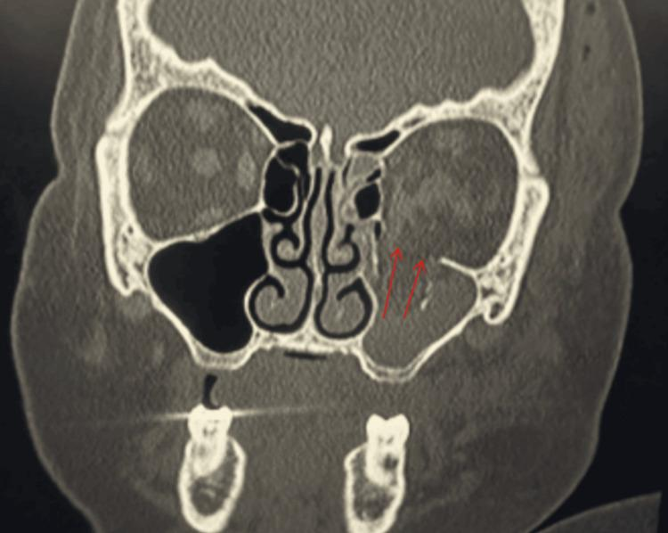

## 문제
A 60-year-old woman is brought to the emergency department 1 hour after a motor vehicle collision in which her face struck the steering wheel. She reports pain and swelling around the left eye. Blood pressure is 134/82 mm Hg and pulse is 92/min. There is marked swelling and ecchymosis of the left eyelids. Visual acuity is 20/25 in both eyes. The pupils are equal and reactive to light, with no relative afferent pupillary defect. Intraocular pressure is 17 mm Hg in the left eye. A coronal CT scan of the facial bones is shown. Further examination of this patient is most likely to show which of the following?

- A. Decreased sensation over the left cheek and upper lip
- B. Decreased sensation over the left forehead and scalp
- C. Left ptosis with a fixed, dilated pupil and complete ophthalmoplegia
- D. Clear watery nasal discharge that increases on leaning forward
- E. Loss of taste over the left anterior two-thirds of the tongue

_Coronal CT of the facial bones, bone window; red arrows are from the original figure (PMC Open Access Subset, CC BY — no cropping or adjustment)_

## 정답 및 해설
> 정답: A

- **정답 핵심**: The coronal CT shows a comminuted fracture of the left orbital floor with bone fragments displaced into the left maxillary sinus (arrows), which is completely opacified by blood; the right maxillary sinus is aerated. The infraorbital nerve (a branch of V2) runs in a groove and canal in the orbital floor, so a floor (blowout) fracture commonly injures it, causing numbness of the cheek, side of the nose, upper lip, and upper gingiva.
- **원리**: <b>Why the orbital floor breaks</b>: a blow to the orbit raises intraorbital pressure, and the force is released through the thinnest walls — the floor over the maxillary sinus (especially medial to the infraorbital canal) and the medial wall (lamina papyracea). The stronger orbital rim may remain intact, hence the term blowout fracture.  <b>Why the cheek goes numb</b>: the infraorbital nerve, the terminal branch of the maxillary division (V2), travels forward in the infraorbital groove and canal within the orbital floor and exits at the infraorbital foramen to supply the lower eyelid, cheek, lateral nose, and upper lip. A fracture line through the floor stretches or compresses the nerve, and hypesthesia in this distribution is one of the most common findings with floor fractures.  <b>What else to look for</b>: entrapment of the inferior rectus or surrounding fat causes limited upward gaze and vertical diplopia (urgent in children with a trapdoor fracture and oculocardiac reflex); enophthalmos may develop as swelling subsides. Vision, pupils, and intraocular pressure are checked first to exclude globe rupture, traumatic optic neuropathy, and orbital compartment syndrome.
- **비교**: <table><thead><tr><th style="width:24%">Feature</th><th style="width:38%">Orbital floor fracture (correct)</th><th>Superior orbital rim/roof injury (closest distractor)</th></tr></thead><tbody> <tr><td>Nerve at risk</td><td><b>Infraorbital nerve (V2)</b> in the floor</td><td><b>Supraorbital nerve (V1)</b> at the superior rim</td></tr> <tr><td>Numb area</td><td>Cheek, lateral nose, upper lip, upper teeth</td><td>Forehead and anterior scalp</td></tr> <tr><td>Sinus finding on CT</td><td>Blood in the maxillary sinus beneath the orbit</td><td>Blood in the frontal sinus, possible intracranial air</td></tr> </tbody></table> Match the fractured wall to the nerve that runs in it: floor → infraorbital (V2), roof and superior rim → supraorbital (V1), superior orbital fissure → CN III, IV, V1, VI.
- **오답 이유**:
  - (B) Forehead and scalp numbness is caused by injury to the supraorbital nerve (V1) and is expected with a superior orbital rim or roof fracture, not a floor fracture into the maxillary sinus.
  - (C) Ptosis, a fixed dilated pupil, and complete ophthalmoplegia indicate superior orbital fissure syndrome or orbital apex injury involving CN III, IV, and VI; the reactive pupils and posterior orbit make it unlikely here.
  - (D) Positional clear rhinorrhea suggests cerebrospinal fluid leak from a fracture of the cribriform plate or frontal sinus posterior wall; this CT shows a floor fracture into the maxillary sinus with intact anterior skull base.
  - (E) Loss of taste on the anterior two-thirds of the tongue indicates injury to the chorda tympani branch of the facial nerve, as in a temporal bone fracture, which is not related to the orbit.
- **함정**: Thinking of the orbit as supplied by V1 alone — the floor carries the infraorbital nerve, a branch of V2, so cheek and upper lip numbness accompany floor fractures.
- **학습목표**: 안면골 관상 CT 에서 안와바닥 골절과 위턱굴 혈액을 읽고, 안와바닥 아래 고랑을 지나는 눈확아래신경 손상(뺨·윗입술 감각저하)을 예측한다
- **근거·출처**: Kanski's Clinical Ophthalmology, 9th ed. Ch. Trauma — orbital floor blowout fracture (infraorbital nerve anesthesia, diplopia, enophthalmos) · Moore KL, Dalley AF, Agur AMR. Clinically Oriented Anatomy, 8th ed. Ch. Head — orbit, maxillary nerve and infraorbital canal · PMC13286041 Figure 2 — case report, 60-year-old woman after a motor vehicle collision (teacher-only) · 작성자 판독(2026-10-13): 관상 CT 뼈 창, 왼쪽 안와바닥 분절 골절과 위턱굴로 내려앉은 골편(원 그림 빨간 화살표), 왼쪽 위턱굴 전체 혼탁, 오른쪽 위턱굴 공기, 안와 지붕·사골판 이상 소견 없음

## 출처
- Emergency Lateral Canthotomy for Orbital Compartment Syndrome After a Motor Vehicle Collision at a Nontrauma Hospital. Cureus. 2026 May 23;18(5):e109510. doi: 10.7759/cureus.109510 (CC BY) — Figure 2 · CC BY · https://creativecommons.org/licenses/
