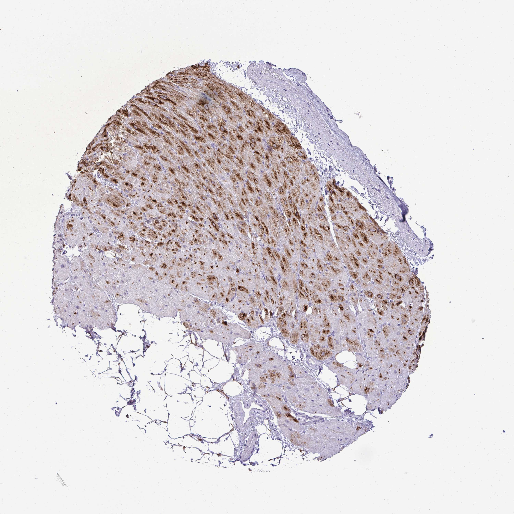

## 문제
62세 남자가 3개월 전 진단된 박출률 감소 심부전으로 외래에 왔다. 왼심실 박출률은 30 % 이고, 에날라프릴·비소프롤롤·스피로놀락톤을 최대 내약 용량으로 먹고 있다. 계단 한 층을 오르면 숨이 차다. 혈압 112/70 mmHg, 맥박 64회/분이다. 혈청 칼륨 4.6 mEq/L, 크레아티닌 1.1 mg/dL 이다. 같은 연령대 심장근육 조직 절편에 한 단백질에 대한 면역조직화학염색을 하였더니 그림과 같았다. 그림에서 염색된 물질의 분해를 막아 혈중 농도를 높이는 약은?

- A. 사쿠비트릴
- B. 발사르탄
- C. 이바브라딘
- D. 디곡신
- E. 하이드랄라진

_조직미세배열 코어의 면역조직화학염색(DAB 갈색 발색, 헤마톡실린 대조염색), 원 배율 (Human Protein Atlas, CC BY 4.0 — 크롭·보정 없음)_

## 정답 및 해설
> 정답: A

- **정답 핵심**: 심근세포의 핵 주위 세포질에 굵은 갈색 과립이 모여 염색되었다. 수축 단백질처럼 근원섬유 전체에 고르게 퍼지거나 사이원반에 줄지어 있지 않고, 핵 곁의 분비 과립에 저장된 모양이다. 심근세포가 과립에 저장했다가 벽이 늘어나면 분비하는 펩타이드는 심방나트륨이뇨펩타이드(ANP)이고, ANP 는 네프릴라이신이 분해한다. 네프릴라이신 억제제 사쿠비트릴이 이 펩타이드의 농도를 높이며, 발사르탄과 합친 제제(ARNI)로 에날라프릴을 대신한다.
- **원리**: <b>왜 과립으로 보이는가</b>: 심근세포는 내분비 기능도 가진다. 특히 심방 근육세포는 골지체가 발달한 핵 주위에 ANP 를 담은 분비 과립을 쌓아 두었다가, 심방 벽이 늘어나면 내보낸다. 그래서 면역조직화학염색에서 핵 곁에 모인 갈색 점(과립)으로 보인다. 근수축 단백질(트로포닌·액틴)은 가로무늬를 따라 세포 전체에 고르게, 연결 단백질은 세포 끝 사이원반에 선으로 염색된다.  <b>왜 분해를 막으면 좋은가</b>: 나트륨이뇨펩타이드는 cGMP 를 올려 혈관을 넓히고 나트륨 배설을 늘리며 레닌·알도스테론·교감신경을 억제한다 — 심부전에서 RAAS 와 반대 방향의 보상이다. 네프릴라이신은 이 펩타이드를 분해하므로 억제하면 그 이로운 작용이 커진다.  <b>왜 ARB 와 함께 써야 하는가</b>: 네프릴라이신은 안지오텐신 II 와 브라디키닌도 분해한다. 단독으로 억제하면 안지오텐신 II 가 늘어 효과가 상쇄되므로 발사르탄과 묶어 쓰고, ACE 억제제와 함께 쓰면 브라디키닌이 쌓여 혈관부종이 생기므로 에날라프릴을 끊고 36시간 뒤에 시작한다.
- **비교**: <table><thead><tr><th style="width:22%">구분</th><th style="width:39%">사쿠비트릴(정답)</th><th>발사르탄(가장 가까운 오답)</th></tr></thead><tbody> <tr><td>표적</td><td><b>네프릴라이신</b>(중성 엔도펩티데이스)</td><td><b>AT1 수용체</b></td></tr> <tr><td>나트륨이뇨펩타이드 농도</td><td>분해가 줄어 <b>오른다</b></td><td>직접 바꾸지 않는다</td></tr> <tr><td>단독 사용</td><td>하지 않는다 — 안지오텐신 II 도 늘어나므로 ARB 와 합제</td><td>ACE 억제제를 못 견딜 때 단독 사용</td></tr> <tr><td>ACE 억제제와 병용</td><td>금기 — 36시간 간격(혈관부종)</td><td>권장하지 않는다(고칼륨·신기능 저하)</td></tr> </tbody></table> 합제(사쿠비트릴/발사르탄)의 두 성분 중 펩타이드 농도를 올리는 쪽은 사쿠비트릴이다. 사쿠비트릴 복용 중에는 BNP 가 함께 올라가므로 심부전 추적에는 NT-proBNP 를 쓴다.
- **오답 이유**:
  - ② 발사르탄은 AT1 수용체를 막아 안지오텐신 II 작용을 줄이는 약이며, 질문이 RAAS 를 막는 약이나 ACE 억제제 기침 때 대체약을 물을 때 정답이 된다.
  - ③ 이바브라딘은 동방결절의 funny 전류를 막아 심박수만 낮추는 약으로, 베타차단제 최대 용량에도 동리듬 맥박이 70회/분 이상일 때 추가한다.
  - ④ 디곡신은 Na⁺/K⁺-ATPase 를 억제해 수축력을 높이고 방실결절을 늦추는 약이며, 최적 치료에도 증상이 남거나 심방세동 맥박 조절이 필요할 때 쓴다.
  - ⑤ 하이드랄라진은 세동맥을 직접 넓히는 약으로, 질산염과 함께 흑인 환자나 ACE 억제제·ARB·ARNI 를 쓸 수 없는 환자에게 쓸 때 정답이 된다.
- **함정**: 합제 이름(사쿠비트릴/발사르탄)만 기억해 발사르탄을 고르는 것 — 펩타이드 분해를 막는 성분은 사쿠비트릴이다.
- **학습목표**: 심근세포 핵 주위 세포질의 과립상 염색을 저장 분비 과립의 나트륨이뇨펩타이드로 읽고, 그 분해 효소(네프릴라이신)를 억제하는 사쿠비트릴과 연결한다
- **근거·출처**: Heidenreich PA, et al. 2022 AHA/ACC/HFSA Guideline for the Management of Heart Failure. Circulation 2022;145:e895-e1032 (ARNI in HFrEF, 36-hour washout from ACE inhibitor) · McMurray JJV, et al. Angiotensin-neprilysin inhibition versus enalapril in heart failure (PARADIGM-HF). N Engl J Med 2014;371:993-1004 · Katzung BG. Basic & Clinical Pharmacology, 15th ed. Ch. Drugs used in heart failure — sacubitril/valsartan, natriuretic peptides · Human Protein Atlas — NPPA, heart muscle (cardiomyocytes, granular cytoplasmic staining; teacher-only) · 작성자 판독(2026-10-13): 심장근육 TMA 코어, 심근세포 핵 주위 세포질의 굵은 갈색 과립상 염색(구역에 따라 강약), 섬유 기질·지방·혈관 음성

## 출처
- Human Protein Atlas, NPPA / Heart muscle (CC BY 4.0), https://images.proteinatlas.org/58269/133550_B_4_6.jpg · Creative Commons Attribution 4.0 International · https://www.proteinatlas.org/about/licence
