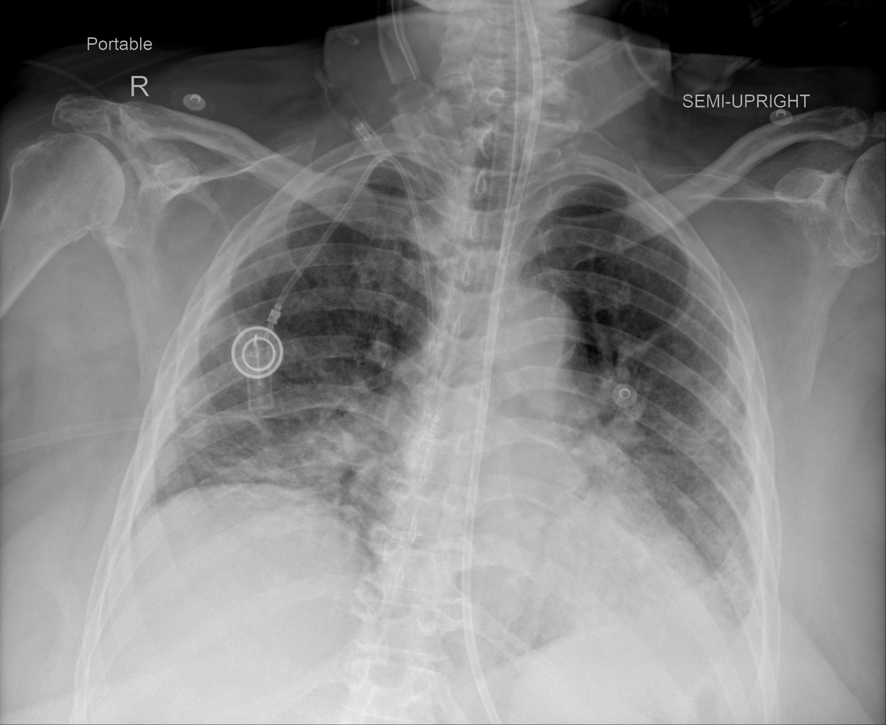

## 문제
A 76-year-old woman is admitted to the intensive care unit with COVID-19 pneumonia confirmed by RT-PCR, 6 days after the onset of fever and cough. She requires high-flow nasal cannula oxygen at 50 L/min with an FiO2 of 0.6 to keep oxygen saturation at 92%. She is receiving dexamethasone. A right internal jugular central venous catheter and a nasogastric feeding tube have been placed. Blood pressure is 128/70 mm Hg and pulse is 96/min. She has no history of bleeding, and there is no clinical evidence of deep venous thrombosis. Hemoglobin is 11.8 g/dL, platelet count is 210,000/mm3, creatinine is 0.9 mg/dL, and D-dimer is 2.4 µg/mL (N < 0.5). A portable chest radiograph is shown. Which of the following is the most appropriate approach to prevention of venous thromboembolism in this patient?

- A. Therapeutic-dose low-molecular-weight heparin
- B. Low-dose aspirin
- C. Intermittent pneumatic compression devices alone
- D. Prophylactic inferior vena cava filter placement
- E. Prophylactic-dose low-molecular-weight heparin

_Portable semi-upright anteroposterior chest radiograph; text markers are from the original image (TCIA, CC BY 4.0 — no cropping or adjustment)_

## 정답 및 해설
> 정답: E

- **정답 핵심**: The radiograph shows bilateral patchy opacities predominating in the lower and peripheral lungs, consistent with COVID-19 pneumonia; she needs high-flow oxygen in the ICU, so she is critically ill. Hospitalized patients with COVID-19 have a high risk of venous thromboembolism, and without bleeding risk or thrombocytopenia every patient should receive pharmacologic prophylaxis. In critically ill patients, randomized trials found no benefit and more bleeding with therapeutic-dose heparin, so prophylactic-dose low-molecular-weight heparin is recommended even when D-dimer is elevated.
- **원리**: <b>Why COVID-19 raises clotting risk</b>: SARS-CoV-2 infection injures endothelium, activates monocytes and neutrophils (tissue factor, neutrophil extracellular traps), and raises fibrinogen, factor VIII, and von Willebrand factor; add immobility, central venous catheters, and critical illness, and venous thromboembolism becomes common. D-dimer rises as a marker of this activation and of lung microthrombi, not necessarily of a deep venous clot.  <b>Why the dose depends on severity</b>: in non-critically ill patients on conventional oxygen, therapeutic-dose heparin reduced progression to organ support, probably by limiting microvascular thrombosis early. Once patients need high-flow oxygen, ventilation, or vasopressors, thrombosis is already established and inflammation dominates; therapeutic-dose heparin then did not improve survival or organ-support-free days and increased major bleeding. Hence prophylactic dosing in the ICU.  <b>Practical points</b>: low-molecular-weight heparin is preferred over unfractionated heparin when renal function allows; mechanical devices are reserved for patients with contraindications to anticoagulation; therapeutic anticoagulation is given only for confirmed or strongly suspected thrombosis.
- **비교**: <table><thead><tr><th style="width:24%">Feature</th><th style="width:38%">Prophylactic dose (correct here)</th><th>Therapeutic dose (closest distractor)</th></tr></thead><tbody> <tr><td>Who</td><td><b>Critically ill</b> — high-flow oxygen, ventilation, vasopressors, ICU</td><td><b>Non-critically ill</b> on conventional oxygen with elevated D-dimer and low bleeding risk</td></tr> <tr><td>Evidence</td><td>Therapeutic dose gave no benefit and more bleeding in ICU trials</td><td>Fewer patients needed organ support in ward trials</td></tr> <tr><td>Also indicated for</td><td>—</td><td>Confirmed DVT or pulmonary embolism at any severity</td></tr> </tbody></table> Decide by severity at the moment of choosing: on the ward with ordinary oxygen and high D-dimer, therapeutic dose may help; in the ICU on high-flow oxygen, use prophylactic dose.
- **오답 이유**:
  - (A) Therapeutic-dose heparin fits a non-critically ill patient on conventional low-flow oxygen with elevated D-dimer and low bleeding risk, or a confirmed thrombosis; in the ICU it adds bleeding without benefit.
  - (B) Aspirin is used for arterial thrombosis prevention and in some orthopedic protocols, but trials in hospitalized COVID-19 patients showed no reduction in mortality, and it is not adequate venous prophylaxis.
  - (C) Pneumatic compression alone is chosen when anticoagulants are contraindicated, such as active bleeding or platelets below 25,000/mm3; this patient has no such contraindication.
  - (D) An inferior vena cava filter is considered for a patient with acute proximal DVT or PE who cannot receive anticoagulation; it is not used for primary prevention.
- **함정**: Choosing therapeutic dose because D-dimer is high — in critically ill COVID-19 patients the elevated D-dimer does not justify therapeutic anticoagulation.
- **학습목표**: 고유량 산소가 필요한 중환자실 코로나19 폐렴(양쪽 아래·바깥쪽 음영)에서 출혈 위험이 없으면 예방 용량 저분자량헤파린으로 정맥혈전색전증을 예방하고, 치료 용량은 중증 환자에서 이득이 없음을 안다
- **근거·출처**: National Institutes of Health. COVID-19 Treatment Guidelines — Antithrombotic therapy in patients with COVID-19 (prophylactic dose for critically ill, therapeutic dose for selected non-critically ill patients) · REMAP-CAP, ACTIV-4a, ATTACC Investigators. Therapeutic anticoagulation with heparin in critically ill patients with Covid-19. N Engl J Med 2021;385:777-789 · ATTACC, ACTIV-4a, REMAP-CAP Investigators. Therapeutic anticoagulation with heparin in noncritically ill patients with Covid-19. N Engl J Med 2021;385:790-802 · 작성자 판독(2026-10-12, 10-13 재확인): 이동식 반직립 AP 흉부 X선, 양쪽 아래·바깥쪽 우세의 반점 모양 간유리·망상 음영, 왼쪽 아래 폐야 더 진함, 폐용적 작음, 오른쪽 중심정맥 도관·위관·심전도 전극

## 출처
- COVID-19-AR, The Cancer Imaging Archive (CC BY 4.0) · series …55898679 · Creative Commons Attribution 4.0 International · https://www.cancerimagingarchive.net/data-usage-policies-and-restrictions/
