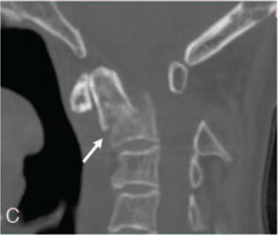

## 문제
85세 여자가 침대 옆에서 넘어져 턱을 바닥에 부딪친 뒤 목 뒤쪽 통증으로 응급실에 왔다. 고혈압과 골다공증으로 약을 먹고 있다. 혈압 148/84 mmHg, 맥박 82회/분이다. 의식은 명료하고 위쪽 목뼈 뒤쪽에 압통이 있으며 고개를 돌리지 못한다. 팔다리의 근력과 감각, 힘줄반사는 정상이다. 경추 CT 정중시상 재구성 영상은 그림과 같다. 진단은?

- A. 치아돌기 기저부 골절
- B. 치아돌기 끝부분 골절
- C. C2 몸통으로 뻗은 치아돌기 골절
- D. C2 양쪽 관절간부 골절
- E. 환추 앞고리 골절

_경추 정중시상 CT 뼈창, 원 그림의 한 패널 — 화살표·패널 문자는 원 그림의 것 (PMC Open Access Subset, CC BY — 보정 없음)_

## 정답 및 해설
> 정답: A

- **정답 핵심**: 정중시상 CT 에서 치아돌기가 C2 몸통과 만나는 기저부(잘록한 목)를 가로지르는 골절선이 있고, 치아돌기 골편이 앞아래로 밀리며 뒤로 꺾였다(화살표). 골절선 아래 C2 몸통의 피질과 해면골은 이어져 있어 몸통으로 뻗지 않는다. 기저부 골절은 Anderson-D'Alonzo II형이며, 고령자가 넘어져 목이 과신전·과굴곡되어 생기는 가장 흔한 경추 골절이다.
- **원리**: <b>왜 고령자는 치아돌기가 부러지는가</b>: 젊은 사람은 고에너지 외상에서 아래 목뼈가 다치지만, 골다공증과 퇴행성 경추증으로 아래 목뼈가 굳은 고령자는 낮은 곳에서 넘어지는 힘이 움직임이 남은 위쪽 목뼈(C1–C2)에 몰린다. 턱이나 이마를 부딪치면 머리가 뒤로 젖혀지며 환추가 치아돌기를 밀어 가장 가는 기저부가 부러진다.  <b>왜 기저부(II형)가 문제인가</b>: 치아돌기 기저부는 해면골이 적고 혈관이 끝에서 내려오는 분수계라 뼈가 잘 붙지 않는다. 그래서 II형은 불유합이 흔하고(전위 5 mm 이상·후방 전위·고령·흡연이 위험인자), 수술(앞 나사 고정 또는 C1–C2 후방 유합)을 고려한다. III형은 골절선이 C2 몸통의 넓은 해면골로 들어가 보조기로도 잘 붙고, I형(끝부분 견열)은 안정 골절이지만 후두–환추 불안정과 동반되는지 본다.  <b>신경학적 이상이 없어도</b>: 이 높이의 척수관은 넓어 신경 손상 없이 오는 경우가 많다 — 진찰이 정상이라도 위쪽 목뼈 압통과 운동 제한이 있으면 CT 를 찍는다.
- **비교**: <table><thead><tr><th style="width:22%">구분</th><th style="width:39%">치아돌기 기저부 골절(II형, 정답)</th><th>C2 몸통으로 뻗은 골절(III형, 가장 가까운 오답)</th></tr></thead><tbody> <tr><td>골절선 위치</td><td>치아돌기와 몸통의 경계(잘록한 목)</td><td>C2 몸통 해면골 안으로 들어가 위 관절면까지</td></tr> <tr><td>뼈가 붙는 정도</td><td><b>불유합이 흔하다</b> — 해면골이 적고 혈류 분수계</td><td>넓은 해면골이라 <b>잘 붙는다</b></td></tr> <tr><td>흔한 치료</td><td>전위·고령이면 수술 고려, 아니면 단단한 보조기</td><td>대개 보조기(경성 목보조기·할로)</td></tr> </tbody></table> 시상면에서 골절선 아래 C2 몸통 피질이 이어져 있으면 II형, 골절선이 몸통 속으로 들어가면 III형이다.
- **오답 이유**:
  - ② 치아돌기 끝부분 골절(I형)은 날개인대가 붙는 끝이 작게 떨어져 나간 견열 골절로, 골절선이 치아돌기 꼭대기에만 있을 때 정답이 된다.
  - ③ C2 몸통으로 뻗은 골절(III형)은 골절선이 기저부 아래 C2 몸통 해면골 속으로 들어가 위 관절면까지 이어질 때 정답이 된다.
  - ④ C2 양쪽 관절간부 골절(행맨 골절)은 과신전과 축성 부하로 C2 신경궁이 부러져 C2 몸통이 C3 위로 앞으로 미끄러질 때 정답이며, 치아돌기는 온전하다.
  - ⑤ 환추 앞고리 골절은 축성 부하로 C1 고리가 터지는 제퍼슨형 골절에서 보이며, 축상면 CT 에서 C1 고리가 여러 곳 끊기고 외측괴가 벌어질 때 정답이 된다.
- **함정**: 골절선이 C2 몸통 위에 있으니 III형이라고 보는 것 — 몸통 피질이 이어져 있으면 기저부(II형)이고, II형이 불유합이 가장 흔하다.
- **학습목표**: 경추 정중시상 CT 에서 치아돌기 기저부 골절(II형)을 읽고, C2 몸통으로 뻗는 III형·C2 신경궁 골절(행맨 골절)과 구별한다
- **근거·출처**: Anderson LD, D'Alonzo RT. Fractures of the odontoid process of the axis. J Bone Joint Surg Am 1974;56:1663-1674 · Tintinalli's Emergency Medicine, 9th ed. Ch. Spine trauma — odontoid fractures in the elderly · PMC7837991 Figure 1C — case report, traumatic atlantoaxial subluxation with type IIA dens fracture (교사용) · 작성자 판독(2026-10-14): 정중시상 CT 뼈창, 치아돌기 기저부를 지나는 분쇄 골절, 치아돌기 골편의 전하방 전위·후만 각형성(화살표), C2 몸통 보존

## 출처
- Traumatic atlantoaxial anteroinferior subluxation with dens and Hangman fractures: A case report. Medicine (Baltimore). 2021 Jan 22;100(3):e24396. doi: 10.1097/MD.0000000000024396 (CC BY) — Figure 1 · CC BY · https://creativecommons.org/licenses/
