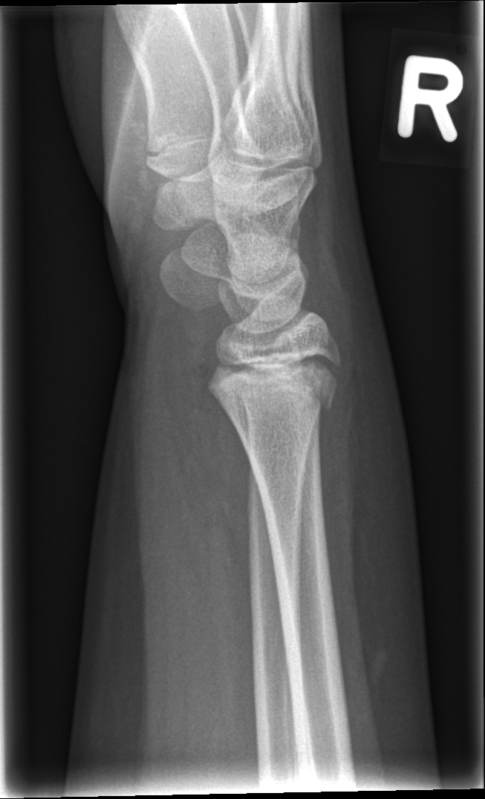

## 문제
13세 남자가 자전거에서 떨어지며 오른손을 짚은 뒤 손목 통증으로 왔다. 다른 병력은 없다. 원위 요골 등쪽이 붓고 누르면 아프다. 손가락의 감각과 혈액순환은 정상이다. 오른쪽 손목 측면 단순 X선은 그림과 같다. 이 골절선이 주로 지나는 성장판의 층은?

- A. 비대층
- B. 휴지층
- C. 증식층
- D. 일차 해면골
- E. 골단의 이차 골화중심

_오른쪽 손목 측면 단순 X선, 위치 표지는 원본의 것, 크기 조정만 (GRAZPEDWRI-DX, figshare, CC BY 4.0)_

## 정답 및 해설
> 정답: A

- **정답 핵심**: 측면 사진에서 원위 요골 성장판을 따라 골단이 등쪽으로 조금 밀렸고, 골간단 등쪽에 작은 삼각형 골편이 붙어 있다(방형회내근 지방선도 볼록하다). 성장판을 지나 골간단 골편을 남기는 골절은 Salter-Harris II형이다. 성장판을 지나는 골절선은 연골세포가 커지고 기질이 적은 비대층을 따라 가며, 줄기세포가 있는 휴지층·증식층은 골단 쪽에 남는다.
- **원리**: <b>왜 비대층이 가장 약한가</b>: 성장판은 골단 쪽부터 휴지층 → 증식층 → 비대층 → 석회화 → 일차 해면골 순서로 쌓여 있다. 휴지층과 증식층은 세포 사이 기질(Ⅱ형 콜라겐·프로테오글리칸)이 풍부해 질기고, 일차 해면골은 이미 석회화된 뼈다. 그 사이 비대층은 연골세포가 부풀어 세포가 차지하는 부피가 크고 기질이 얇으며 아직 석회화되지 않아, 비틀림·전단력이 들어오면 여기서 갈라진다.  <b>왜 예후가 좋은가</b>: Salter-Harris I·II형은 골절선이 비대층을 지나므로 성장을 만드는 휴지층·증식층이 골단에 붙은 채 혈류도 유지된다. 그래서 대개 닫힌 정복과 석고 고정으로 성장 장애 없이 붙는다. 반대로 골절선이 성장판을 수직으로 가로지르는 III·IV형이나 짓눌리는 V형은 증식층이 끊기거나 눌려 골다리(bony bar)가 생기고 성장 정지·각 변형이 올 수 있다.  <b>II형의 골간단 골편(Thurston-Holland 조각)</b>은 골막이 온전한 쪽에 남는다 — 정복할 때 그 골막 경첩을 이용한다.
- **비교**: <table><thead><tr><th style="width:22%">구분</th><th style="width:39%">비대층(정답)</th><th>증식층(가장 가까운 오답)</th></tr></thead><tbody> <tr><td>세포 모양</td><td>부풀어 커진 연골세포, 세포 사이 기질 얇음</td><td>납작한 연골세포가 동전처럼 세로로 쌓임</td></tr> <tr><td>기계적 강도</td><td><b>가장 약하다</b> — 석회화 전이고 기질이 적다</td><td>기질이 많아 질기다</td></tr> <tr><td>손상 시 결과</td><td>I·II형 골절선이 지나도 성장 능력은 골단에 남는다</td><td>손상되면 성장 정지(III·IV·V형, 연골무형성증의 FGFR3 작용 부위)</td></tr> </tbody></table> 「성장판 골절은 어디서 갈라지나」는 비대층, 「성장을 만드는 곳은 어디인가」는 증식층으로 짝지어 기억한다.
- **오답 이유**:
  - ② 휴지층은 골단 쪽 맨 위의 줄기 연골세포 층으로, 골단 혈관이 끊겨 성장판 전체가 멈추는 기전이나 성장판의 시작층을 물을 때 정답이 된다.
  - ③ 증식층은 연골세포가 세로로 쌓이며 길이 성장을 만드는 층으로, 연골무형성증(FGFR3)이나 성장 호르몬 작용 부위를 물을 때 정답이 된다.
  - ④ 일차 해면골은 석회화 연골 위에 뼈가 얹히는 층으로, 괴혈병의 골간단 미세골절이나 구루병의 석회화 장애 부위를 물을 때 정답이 된다.
  - ⑤ 골단의 이차 골화중심은 성장판 위쪽 골단 뼈로, 골절선이 성장판을 가로질러 골단과 관절면까지 들어가는 Salter-Harris III·IV형일 때 손상 부위가 된다.
- **함정**: 성장판 골절이면 성장을 만드는 증식층이 다친다고 보는 것 — I·II형은 가장 약한 비대층을 지나 증식층을 남기므로 예후가 좋다.
- **학습목표**: 손목 측면 X선에서 원위 요골 성장판을 지나 골간단 골편을 남긴 골절을 읽고, 성장판 골절선이 지나는 비대층(가장 약한 층)과 예후를 연결한다
- **근거·출처**: Salter RB, Harris WR. Injuries involving the epiphyseal plate. J Bone Joint Surg Am 1963;45:587-622 · Rockwood and Wilkins' Fractures in Children, 9th ed. Ch. Physeal fractures — physeal anatomy and zone of hypertrophy · Nagy E, et al. A pediatric wrist trauma X-ray dataset (GRAZPEDWRI-DX) for machine learning. Sci Data 2022;9:222 · 작성자 판독(2026-10-14): 오른쪽 손목 측면 X선, 원위 요골 성장판을 따라 지나는 골절과 배측 골간단의 작은 삼각형 골편, 골단의 경미한 배측 전위, 방형회내근 지방선 융기(전문의 주석 23r-E/2.1)

## 출처
- GRAZPEDWRI-DX (figshare, CC BY 4.0) · Creative Commons Attribution 4.0 International · https://creativecommons.org/licenses/by/4.0/
