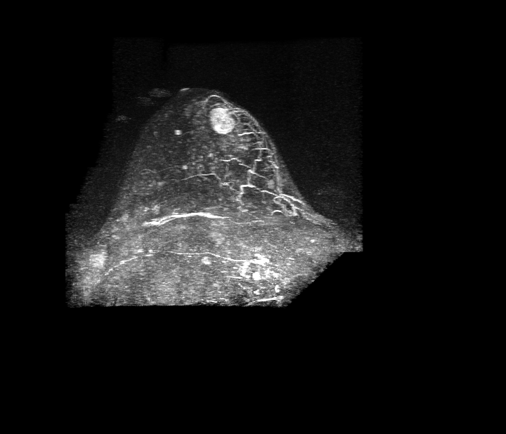

## 문제
A 43-year-old woman comes to the physician because of a lump in her breast that she noticed 4 weeks ago. She has no nipple discharge or pain. Her last menstrual period was 2 weeks ago. Her mother had breast cancer at the age of 61 years. Examination shows a firm, mobile, nontender 2-cm mass; there is no skin change or axillary lymphadenopathy. Mammography shows heterogeneously dense breast tissue without a definite mass or calcifications, and targeted ultrasonography is inconclusive. A maximum intensity projection image from dynamic contrast-enhanced breast MRI is shown. Which of the following is the most appropriate next step in management?

- A. Modified radical mastectomy
- B. Tamoxifen chemoprevention
- C. Image-guided core needle biopsy
- D. Repeat breast MRI in 6 months
- E. Routine annual screening mammography

_Dynamic contrast-enhanced breast MRI, subtraction maximum intensity projection of the affected breast (TCIA, CC BY — no cropping or adjustment)_

## 정답 및 해설
> 정답: C

- **정답 핵심**: The subtraction MIP shows a round, intensely enhancing mass in the anterior breast whose rim is brighter than its center (rim enhancement), with increased vessels around it. Rim enhancement of a mass is among the MRI features with the highest positive predictive value for malignancy (BI-RADS 4–5), and a palpable mass must be sampled. The next step is tissue diagnosis by image-guided core needle biopsy (second-look ultrasonography-guided or MRI-guided).
- **원리**: <b>Why MRI enhancement matters</b>: invasive cancers induce new, leaky, tortuous vessels (angiogenesis driven by VEGF). After gadolinium injection, contrast floods the tumor early, and because the actively growing, well-perfused tumor cells lie at the periphery while the center may be fibrotic or necrotic, the edge enhances more than the center — rim enhancement. The same angiogenesis increases the number of vessels feeding the mass, seen on MIP as increased ipsilateral vascularity.  <b>Why tissue, not follow-up</b>: MRI is very sensitive but only moderately specific; morphology (irregular shape, spiculated margin, rim or heterogeneous internal enhancement) and kinetics (rapid washout) raise suspicion. A mass with suspicious features is BI-RADS 4 or 5, which requires biopsy; short-interval follow-up is reserved for BI-RADS 3 findings with a ≤ 2 % malignancy risk. A palpable mass that imaging cannot clearly explain as benign also needs tissue.  <b>Why core rather than surgery first</b>: a core needle biopsy gives histology, grade, and receptor status (ER, PR, HER2) so that surgery or neoadjuvant therapy can be planned; definitive surgery is never performed without a tissue diagnosis.
- **비교**: <table><thead><tr><th style="width:24%">Feature</th><th style="width:38%">Suspicious mass → biopsy (correct)</th><th>Probably benign → 6-month MRI (closest distractor)</th></tr></thead><tbody> <tr><td>Internal enhancement</td><td><b>Rim</b> or heterogeneous</td><td>Homogeneous, or nonenhancing dark internal septations (fibroadenoma)</td></tr> <tr><td>Shape and margin</td><td>Irregular, spiculated, or rim-enhancing round mass</td><td>Oval, circumscribed</td></tr> <tr><td>Surrounding vessels</td><td>Increased ipsilateral vascularity</td><td>Symmetric</td></tr> <tr><td>BI-RADS and action</td><td>4–5 — tissue diagnosis</td><td>3 — short-interval follow-up (≤ 2 % risk)</td></tr> </tbody></table> A round shape alone does not make a mass benign; the internal enhancement pattern decides, and a palpable mass always needs a definite explanation.
- **오답 이유**:
  - (A) Mastectomy may be part of treatment after cancer is proven, but surgery is planned only after core biopsy confirms the histologic type and receptor status, and breast conservation may still be possible.
  - (B) Tamoxifen chemoprevention is offered to women without cancer whose calculated 5-year risk is elevated; it is not a response to a suspicious mass, which must first be biopsied.
  - (D) Repeat MRI in 6 months is appropriate for a BI-RADS 3 lesion, such as an oval circumscribed mass with homogeneous enhancement or dark internal septations that is not palpable.
  - (E) Routine annual screening would be correct only if the palpable lump were fully explained by a benign finding such as a simple cyst on ultrasonography and MRI showed no suspicious enhancement.
- **함정**: Calling a round, mobile mass in a 43-year-old benign — rim enhancement on MRI is a suspicious feature, and a palpable mass needs tissue regardless of shape.
- **학습목표**: 유방 MRI 감산 MIP 에서 테두리 조영증강 종괴와 주변 혈관 증가를 악성을 시사하는 소견으로 읽고, 다음 단계로 영상 유도 중심부 바늘생검을 고른다
- **근거·출처**: American College of Radiology. ACR BI-RADS Atlas, 5th ed. Breast MRI lexicon — mass internal enhancement (rim enhancement) and assessment categories · Mann RM, Cho N, Moy L. Breast MRI: state of the art. Radiology 2019;292:520-536 · TCIA TCGA-BRCA collection — preoperative breast MRI (teacher-only) · 작성자 판독(2026-10-14): 유방 MRI 동적 조영 감산 MIP, 유방 앞쪽의 둥근 강한 조영증강 종괴, 가장자리가 더 밝은 테두리 조영, 주변 혈관 증가

## 출처
- The Cancer Imaging Archive (CC BY 3.0) · TCGA-BH-A0DZ · Creative Commons Attribution 3.0 Unported · https://www.cancerimagingarchive.net/data-usage-policies-and-restrictions/
