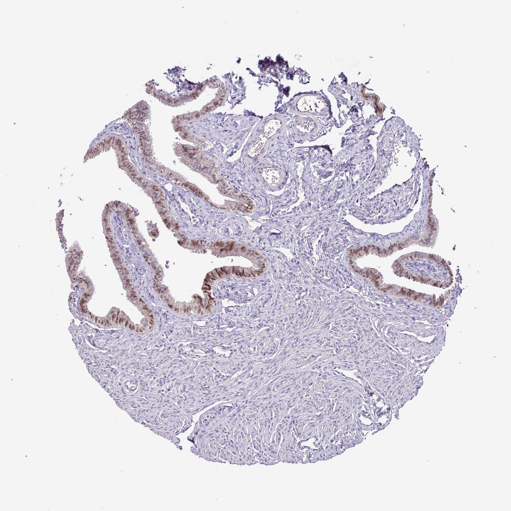

## 문제
A 59-year-old woman with a known pathogenic germline BRCA1 variant undergoes elective risk-reducing laparoscopic bilateral salpingo-oophorectomy. She is postmenopausal and has no symptoms. Pelvic examination and transvaginal ultrasonography were normal before surgery, and serum CA-125 concentration was 14 U/mL. A photomicrograph of a section of the fallopian tube stained by immunohistochemistry for a nuclear transcription factor is shown. The stained epithelial cells are considered the cell of origin of which of the following neoplasms in women with this variant?

- A. Clear cell carcinoma
- B. Mucinous carcinoma
- C. Adult granulosa cell tumor
- D. High-grade serous carcinoma
- E. Endometrioid carcinoma

_Tissue microarray core, immunohistochemistry (brown DAB chromogen, hematoxylin counterstain), original magnification (Human Protein Atlas, CC BY 4.0 — no cropping or adjustment)_

## 정답 및 해설
> 정답: D

- **정답 핵심**: The tubal plicae are lined by columnar epithelium whose nuclei stain brown, mostly in the nonciliated (secretory) cells, while the stroma, smooth muscle, and vessels are negative. These Müllerian secretory cells of the distal fallopian tube are now considered the origin of most high-grade serous carcinomas of the 'ovary' and peritoneum: a TP53-mutated serous tubal intraepithelial carcinoma (STIC) arises in the fimbria and sheds onto the ovary and peritoneum. This is why risk-reducing surgery in BRCA carriers removes the tubes with the ovaries and the fimbriae are examined completely (SEE-FIM protocol).
- **원리**: <b>Why the tube, not the ovary</b>: the ovary has no native Müllerian epithelium — its surface is a modified mesothelium. When pathologists sectioned the entire fimbriae of prophylactic specimens from BRCA carriers, they found early carcinomas (STIC) and TP53 'signatures' in tubal secretory cells, not in the ovarian surface. These lesions share the same TP53 mutation as the accompanying high-grade serous carcinoma, showing that the cancer starts in the tube and spreads to the ovary and peritoneum.  <b>Why secretory cells</b>: Müllerian secretory cells express PAX8 (a nuclear transcription factor), whereas ciliated cells express markers of ciliogenesis. High-grade serous carcinoma, like its precursor, is PAX8-positive and WT1-positive with aberrant p53, which helps to distinguish it from mesothelioma (PAX8-negative) or metastatic carcinoma from other organs.  <b>Why BRCA matters</b>: BRCA1/2 loss impairs homologous recombination repair; in tubal secretory cells exposed to repeated ovulatory inflammation, TP53 mutation follows and drives rapid progression. Hence carriers are offered salpingo-oophorectomy at 35–40 years (BRCA1) or 40–45 years (BRCA2), and PARP inhibitors exploit the same repair defect in established tumors.
- **비교**: <table><thead><tr><th style="width:24%">Feature</th><th style="width:38%">High-grade serous carcinoma (correct)</th><th>Endometrioid / clear cell carcinoma (closest distractors)</th></tr></thead><tbody> <tr><td>Precursor</td><td><b>STIC in tubal secretory cells</b></td><td><b>Endometriosis</b> (atypical endometriosis)</td></tr> <tr><td>Key molecular change</td><td>TP53 mutation in nearly all; BRCA1/2</td><td>ARID1A, PTEN, PIK3CA; Lynch syndrome (mismatch repair)</td></tr> <tr><td>Hereditary link</td><td>BRCA1/2 carriers</td><td>Lynch syndrome</td></tr> <tr><td>Behavior</td><td>Advanced stage at diagnosis, peritoneal spread</td><td>Often early stage, ovarian mass in endometriosis</td></tr> </tbody></table> Both serous and endometrioid tumors are PAX8-positive Müllerian carcinomas — the precursor lesion and the hereditary syndrome, not PAX8 alone, separate them.
- **오답 이유**:
  - (A) Clear cell carcinoma also arises in endometriosis, typically in an endometriotic cyst of a younger Asian woman, and would be correct if the precursor shown were atypical endometriosis rather than tubal epithelium.
  - (B) Mucinous carcinoma usually arises from a mucinous borderline tumor or teratoma with intestinal-type epithelium and KRAS mutation, and is PAX8-negative, so it is not derived from tubal secretory cells.
  - (C) Adult granulosa cell tumor is a sex cord–stromal tumor with FOXL2 mutation that secretes estrogen and inhibin; it arises from ovarian stromal cells, not from tubal epithelium.
  - (E) Endometrioid carcinoma arises from endometriosis and is associated with Lynch syndrome and ARID1A or PTEN mutations; it would be correct if the specimen showed ovarian endometriosis with atypia.
- **함정**: Assuming 'ovarian' cancer starts in the ovarian surface — in BRCA carriers most high-grade serous carcinomas begin as STIC in the secretory cells of the distal fallopian tube.
- **학습목표**: 난관 점막의 핵 염색 상피(Müller관 분비세포)를 읽고, 이 세포가 고등급 장액성 암종의 기원(STIC)이므로 BRCA 보인자의 위험감소 수술에 난관을 포함함을 안다
- **근거·출처**: Kumar V, Abbas AK, Aster JC. Robbins and Cotran Pathologic Basis of Disease, 10th ed. Ch. The female genital tract — serous tumors, STIC and tubal origin · Piek JM, et al. Dysplastic changes in prophylactically removed Fallopian tubes of women predisposed to developing ovarian cancer. J Pathol 2001;195:451-456 · NCCN Clinical Practice Guidelines in Oncology: Genetic/Familial High-Risk Assessment — Breast, Ovarian, and Pancreatic (risk-reducing salpingo-oophorectomy timing) · Human Protein Atlas — PAX8, fallopian tube (glandular cells, nuclear; teacher-only) · 작성자 판독(2026-10-14): 난관 TMA 코어, 난관 주름 원주상피의 핵 염색(분비세포 우세, 일부 음성), 기질·평활근·혈관 음성

## 출처
- Human Protein Atlas, PAX8 / Fallopian tube (CC BY 4.0), https://images.proteinatlas.org/55097/120596_A_7_7.jpg · Creative Commons Attribution 4.0 International · https://www.proteinatlas.org/about/licence
