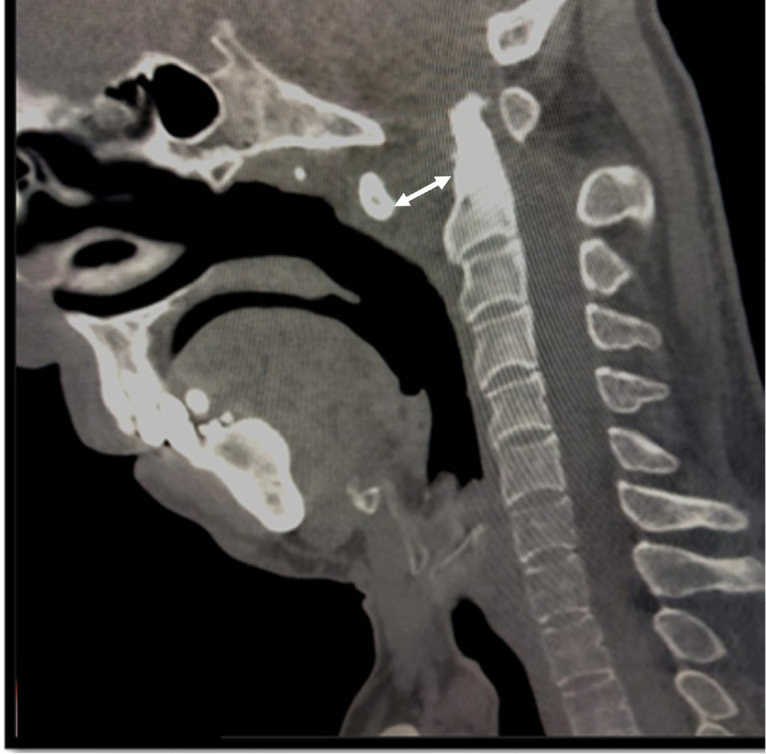

## 문제
A 30-year-old man is brought to the emergency department 1 hour after a motorcycle collision in which he was thrown forward and struck his head on the road. He reports severe pain at the back of the upper neck and supports his head with both hands. Blood pressure is 132/80 mm Hg, and pulse is 94/min. He is alert and oriented. There is midline tenderness over the upper cervical spine. Muscle strength, sensation, and deep tendon reflexes are normal in all four limbs. A midsagittal CT scan of the cervical spine is shown. Disruption of which of the following structures is most likely responsible for these findings?

- A. Transverse ligament of the atlas
- B. Alar ligaments
- C. Tectorial membrane
- D. Anterior longitudinal ligament
- E. Ligamentum flavum

_Midsagittal CT of the cervical spine, bone window; the double-headed arrow is from the original figure (PMC Open Access Subset, CC BY — no cropping or adjustment)_

## 정답 및 해설
> 정답: A

- **정답 핵심**: The CT shows a markedly widened gap between the posterior cortex of the anterior arch of C1 and the anterior cortex of the dens (double-headed arrow) — an increased atlantodental interval — without a fracture line through the dens or C2 body. The transverse ligament of the atlas is the structure that holds the dens against the anterior arch; when it tears, C1 slides forward on C2 and the interval widens (normal in adults ≤3 mm).
- **원리**: <b>Why the atlantodental interval measures the transverse ligament</b>: the dens sits in an osseoligamentous ring formed in front by the anterior arch of C1 and behind by the transverse ligament, which runs between the two lateral masses. The ligament is the primary restraint against anterior translation of C1 on C2 during flexion. If it ruptures, nothing stops the atlas from sliding forward, so the space between the anterior arch and the dens opens up — in adults more than 3 mm suggests injury, and more than 5 mm suggests the secondary restraints (alar ligaments) have also failed.  <b>Why this matters clinically</b>: the forward-sliding ring narrows the canal behind the dens, so the cord can be compressed even when the patient is neurologically intact at presentation. A purely ligamentous (Dickman type I) tear does not heal reliably with an orthosis and usually needs C1–C2 fusion, whereas an avulsion of the ligament insertion (type II) may heal with immobilization.  <b>Reading order</b>: on a midsagittal image first check the dens and C2 body for a fracture, then the atlantodental interval, then the basion–dens relationship for craniocervical dissociation.
- **비교**: <table><thead><tr><th style="width:22%">Feature</th><th style="width:39%">Transverse ligament tear (answer)</th><th>Alar ligament injury (closest distractor)</th></tr></thead><tbody> <tr><td>Normal function</td><td>Holds the dens against the anterior arch of C1 — limits anterior translation</td><td>Connects the dens tip to the occipital condyles — limits rotation and lateral bending</td></tr> <tr><td>Key CT sign</td><td><b>Widened atlantodental interval</b> (&gt;3 mm in adults)</td><td>Atlantodental interval near normal; asymmetric dens–lateral mass spaces or rotatory fixation</td></tr> <tr><td>Typical consequence</td><td>Anterior atlantoaxial instability; risk of cord compression behind the dens</td><td>Excess C1–C2 rotation; isolated avulsion of the dens tip (type I odontoid fracture)</td></tr> </tbody></table> A widened gap in front of the dens points to the transverse ligament; rotation without a widened gap points to the alar ligaments.
- **오답 이유**:
  - (B) Alar ligament injury would be correct if the CT showed rotatory malalignment of C1 on C2 or an avulsed dens tip with a near-normal atlantodental interval.
  - (C) Tectorial membrane disruption would be correct in atlanto-occipital dissociation, in which the basion is distracted away from the dens tip while the atlantodental interval is normal.
  - (D) Anterior longitudinal ligament rupture would be correct in a hyperextension injury with widening of the anterior disc space and prevertebral soft-tissue swelling in the subaxial spine.
  - (E) Ligamentum flavum injury is uncommon; it would be the answer to a question about thickened ligament causing posterior canal narrowing in degenerative cervical stenosis.
- **함정**: Looking only for a fracture and calling the CT normal because the dens and C2 body are intact — the abnormality is the widened space in front of the dens.
- **학습목표**: 경추 정중시상 CT 에서 넓어진 환추-치아 간격을 읽고 환추 가로인대 파열과 연결하며, 날개인대·덮개막 손상과 구별한다
- **근거·출처**: Dickman CA, Greene KA, Sonntag VK. Injuries involving the transverse atlantal ligament: classification and treatment guidelines based upon experience with 39 injuries. Neurosurgery 1996;38:44-50 · Rockwood and Green's Fractures in Adults, 9th ed. Ch. Cervical spine fractures — atlantoaxial instability and the atlantodental interval · PMC11778602 Figure 1 — case report, C1–C2 diastasis with transverse ligament rupture (교사용) · 작성자 판독(2026-10-15): 정중시상 CT 뼈창, C1 앞고리와 치아돌기 앞 피질 사이 간격이 뚜렷이 넓어짐(양방향 화살표), 치아돌기·C2 몸통 골절선 없음

## 출처
- Atlantoaxial Subluxation Related to Axial Spondylarthritis: A Case-Based Systematic Review. Mediterr J Rheumatol. 2024 Dec 31;35(4):563–72. doi: 10.31138/mjr.070624.asr (CC BY) — Figure 1. · CC BY · https://creativecommons.org/licenses/
