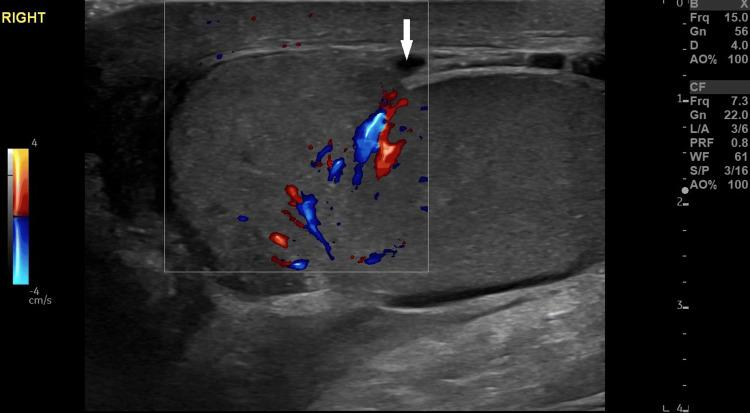

## 문제
14세 남자가 1시간 전 축구 경기 중 공에 오른쪽 음낭을 세게 맞은 뒤 심한 통증과 부기로 응급실에 왔다. 구역은 있으나 구토는 없다. 다른 병력은 없다. 혈압 118/72 mmHg, 맥박 96회/분, 체온 36.8 ℃ 이다. 오른쪽 음낭이 붓고 멍이 들었으며 고환을 누르면 매우 아프다. 고환올림근반사는 양쪽 모두 있다. 소변검사는 정상이다. 오른쪽 고환의 회색조·색 도플러 초음파는 그림과 같다. 가장 적절한 처치는?

- A. 도수 정복으로 고환 비틀림 풀기
- B. 경구 항생제 투여와 외래 추적
- C. 1주 뒤 초음파 재검
- D. 응급 음낭 수술 탐색과 백막 봉합
- E. 얼음찜질·진통제·음낭 거상 후 외래 추적

_오른쪽 고환 회색조·색 도플러 종단 초음파, 화살표와 기계 표시는 원본의 것 (PMC Open Access Subset, CC BY — 자르기·보정 없음)_

## 정답 및 해설
> 정답: D

- **정답 핵심**: 초음파에서 고환 위쪽의 백막(고환을 싸는 하얀 고에코 막)이 국소적으로 끊겨 있고(화살표) 고환 실질의 에코가 불균질하다 — 고환 파열이다. 실질 안 혈류는 남아 있어 비틀림은 아니다. 고환 파열은 72시간 안에 수술로 탐색해 괴사한 세관을 제거하고 백막을 봉합해야 고환을 살릴 확률이 높다.
- **원리**: <b>왜 백막이 끊기면 수술인가</b>: 백막은 고환 실질(정세관)을 싸서 압력을 버티는 질긴 섬유막이다. 둔상으로 이 막이 터지면 정세관이 밖으로 빠져나오고 실질 안 압력이 올라 허혈·괴사가 진행되며, 노출된 정세관 항원이 면역계에 드러나 항정자 항체가 생길 수도 있다. 그래서 백막 끊김이 보이면 혈류가 남아 있더라도 빨리(대개 72시간 안) 탐색해 괴사 조직을 제거하고 백막을 봉합한다 — 이렇게 하면 고환 보존율이 80~90 % 이고, 늦어지면 고환절제율이 크게 오른다.  <b>보존 치료가 되는 경우</b>: 백막이 온전하고 고환 안 작은 혈종이나 음낭벽 부종·작은 혈류고환초(hematocele)만 있으면 얼음찜질·진통·거상으로 지켜본다.  <b>비틀림을 먼저 생각하는 이유와 가르는 근거</b>: 외상 뒤에도 비틀림이 생길 수 있다. 그러나 도플러에서 실질 혈류가 보이고 고환올림근반사가 있으면 비틀림 가능성은 낮다.
- **비교**: <table><thead><tr><th style="width:22%">구분</th><th style="width:39%">고환 파열(정답 — 수술 탐색)</th><th>백막이 온전한 고환 타박(가장 가까운 오답 — 보존 치료)</th></tr></thead><tbody> <tr><td>백막</td><td><b>국소 끊김</b>, 고환 윤곽이 불규칙</td><td>고에코 선이 끊김 없이 이어짐</td></tr> <tr><td>실질 에코</td><td>불균질(출혈·괴사), 실질이 막 밖으로 빠져나올 수 있음</td><td>대체로 균질, 작은 실질 안 혈종만</td></tr> <tr><td>처치</td><td>72시간 안 탐색·괴사 조직 제거·백막 봉합</td><td>얼음찜질·진통제·음낭 거상, 추적 초음파</td></tr> </tbody></table> 초음파의 질문은 「백막이 이어져 있는가」 하나다 — 끊겼으면 수술, 이어져 있으면 보존이다.
- **오답 이유**:
  - ① 도수 정복은 갑작스런 통증과 함께 도플러에서 고환 혈류가 없고 고환올림근반사가 없어 비틀림이 의심되는데 수술이 바로 어려울 때 임시로 시도한다.
  - ② 경구 항생제는 외상 없이 서서히 시작된 통증과 배뇨 증상, 부고환 혈류 증가가 있는 부고환염일 때 정답이 된다.
  - ③ 1주 뒤 초음파 재검은 백막이 온전한 작은 실질 혈종을 보존 치료하며 크기 변화를 확인할 때 쓰는 추적 방법이다.
  - ⑤ 얼음찜질·진통제·음낭 거상은 백막이 온전하고 작은 고환 안 혈종이나 음낭벽 부종만 있는 타박일 때 정답이 된다.
- **함정**: 혈류가 남아 있으니 수술이 필요 없다고 보는 것 — 혈류는 비틀림을 가르는 근거이고, 수술 여부는 백막의 끊김이 정한다.
- **학습목표**: 음낭 둔상 뒤 고환 초음파에서 백막의 끊김과 불균질한 실질을 읽고, 혈류가 남아 있어 비틀림이 아님을 확인한 뒤 응급 수술 탐색을 결정한다
- **근거·출처**: Morey AF, et al. Urotrauma guideline 2020: AUA guideline. J Urol 2021;205:30-35 · Campbell-Walsh-Wein Urology, 12th ed. Ch. Genital and lower urinary tract trauma — testicular rupture · PMC11804949 Figure 2 — testicular rupture, gray-scale and color Doppler (교사용) · 작성자 판독(2026-10-15): 오른쪽 고환 회색조+색 도플러 종단면, 고환 위쪽 백막의 국소 끊김(흰 화살표), 실질 에코 불균질, 실질 안 혈류는 남아 있음

## 출처
- Testicular Rupture: Clinical, Sonographic, and Surgical Correlation in an Adolescent Patient. Cureus. 2025 Feb 7;17(2):e78688. doi: 10.7759/cureus.78688 (CC BY) — Figure 2 · CC BY · https://creativecommons.org/licenses/
