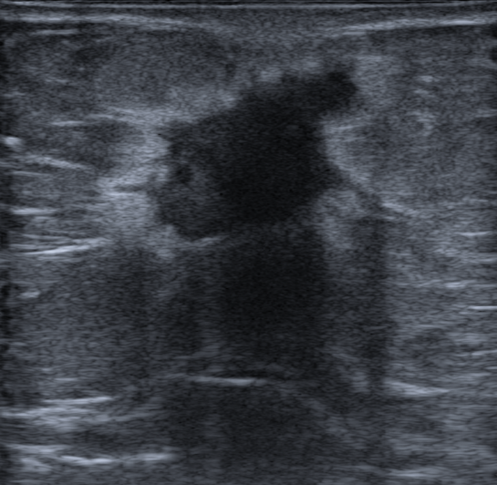

## 문제
65세 여자가 2개월 전 샤워하다 오른쪽 유방에서 만져지는 멍울을 발견하고 왔다. 통증과 유두 분비물은 없다. 52세에 폐경되었고 호르몬 치료를 받은 적은 없다. 어머니가 70세에 유방암 진단을 받았다. 오른쪽 유방 위바깥쪽에 약 2 cm 의 단단하고 잘 움직이지 않는 종괴가 만져지며, 겨드랑이 림프절은 만져지지 않는다. 유방촬영술에서 같은 부위에 경계가 불분명한 종괴가 보였다. 같은 부위의 유방 초음파는 그림과 같다. 다음 단계로 가장 적절한 것은?

- A. 타목시펜 복용 후 추적
- B. 초음파 유도 중심부 바늘생검
- C. 6개월 뒤 추적 초음파
- D. 세침흡인으로 내용물 배액
- E. 조직 진단 없이 유방전절제술

_유방 초음파 회색조 영상, 원본 그대로 (TCIA, CC BY 4.0 — 자르기·보정 없음)_

## 정답 및 해설
> 정답: B

- **정답 핵심**: 초음파에서 종괴는 저에코이고 경계가 불규칙하며 각이 지고, 뒤쪽으로 음향 그림자가 진다 — 악성을 강하게 시사하는 소견(BI-RADS 4C~5)이다. 촉진·유방촬영 소견도 같은 방향이다. 다음 단계는 치료를 정하기 전 조직 진단으로, 초음파 유도 중심부 바늘생검으로 조직형·호르몬 수용체·HER2 를 확인한다.
- **원리**: <b>왜 이 모양이 악성을 시사하는가</b>: 침윤암은 주변 조직으로 불규칙하게 파고들며 섬유성 반응(desmoplasia)을 일으킨다. 그래서 경계가 각지거나 침상으로 뻗고, 단단한 섬유 조직이 초음파를 흡수·산란시켜 뒤쪽에 음향 그림자를 만든다. 반대로 섬유샘종처럼 밀어내며 자라는 양성 종양은 타원형·평행·경계가 매끈하고 그림자가 없다.  <b>왜 중심부 바늘생검인가</b>: BI-RADS 4·5 는 조직 진단이 필요한 범주다. 중심부 바늘생검은 조직 구조를 보존해 침윤 여부와 조직형을 가르고, 같은 검체로 ER·PR·HER2·Ki-67 을 측정해 수술 전 항암치료 여부와 수술 범위를 정한다. 세침흡인은 세포만 얻어 침윤과 상피내암을 구별하지 못한다.  <b>추적이 되는 범주</b>: BI-RADS 3(타원형·평행·경계 매끈 — 악성 가능성 2 % 이하)일 때만 6개월 추적을 한다.
- **비교**: <table><thead><tr><th style="width:22%">구분</th><th style="width:39%">악성 의심 종괴(정답 — 중심부 바늘생검)</th><th>양성 가능성 높은 종괴(가장 가까운 오답 — 6개월 추적)</th></tr></thead><tbody> <tr><td>모양·방향</td><td>불규칙, 비평행(키가 큼)</td><td>타원형, 피부와 평행</td></tr> <tr><td>경계</td><td>각지거나 침상·불분명</td><td>매끈하고 뚜렷함</td></tr> <tr><td>뒤쪽 소견</td><td><b>음향 그림자</b> — 섬유성 반응</td><td>변화 없음 또는 약한 증강</td></tr> <tr><td>BI-RADS·처치</td><td>4~5 → 조직 진단</td><td>3 → 6개월 추적(악성 ≤ 2 %)</td></tr> </tbody></table> 모양·경계·뒤쪽 그림자 중 하나라도 악성 쪽이면 추적이 아니라 생검이다.
- **오답 이유**:
  - ① 타목시펜은 조직 검사로 호르몬 수용체 양성 유방암을 확인한 뒤 보조 치료로, 또는 고위험 여성의 화학적 예방으로 쓸 때 정답이 된다.
  - ③ 6개월 뒤 추적 초음파는 타원형·평행·경계가 매끈한 BI-RADS 3 종괴처럼 악성 가능성이 2 % 이하일 때 정답이 된다.
  - ④ 세침흡인 배액은 초음파에서 속이 무에코이고 뒤쪽 증강이 있는 단순 낭종이 아프거나 커서 증상이 있을 때 정답이 된다.
  - ⑤ 유방전절제술은 중심부 생검으로 침윤암을 확인하고 병기·수용체 결과로 수술 범위를 정한 뒤에 하며, 조직 진단 없이 하지 않는다.
- **함정**: 만져지는 단단한 종괴이니 곧바로 수술한다고 보는 것 — 치료 계획(수술 전 항암 여부·수술 범위)은 중심부 생검의 조직형·수용체로 정한다.
- **학습목표**: 유방 초음파에서 불규칙·각진 경계와 뒤쪽 음향 그림자를 가진 저에코 종괴를 악성 의심(BI-RADS 4~5)으로 읽고, 수술 전 영상 유도 중심부 바늘생검을 선택한다
- **근거·출처**: ACR BI-RADS Atlas, 5th ed. Ultrasound — mass shape, orientation, margin, posterior features; assessment categories · NCCN Clinical Practice Guidelines in Oncology: Breast Cancer Screening and Diagnosis, v.2024 · Pawłowska A, et al. Curated benchmark dataset for ultrasound based breast lesion analysis (BrEaST). Sci Data 2024;11:148 · 작성자 판독(2026-10-15): 유방 초음파, 불규칙하고 각진 저에코 종괴, 경계 불분명, 뒤쪽 음향 그림자

## 출처
- BrEaST-Lesions-USG, The Cancer Imaging Archive (CC BY 4.0) · case149 · Creative Commons Attribution 4.0 International · https://www.cancerimagingarchive.net/data-usage-policies-and-restrictions/
