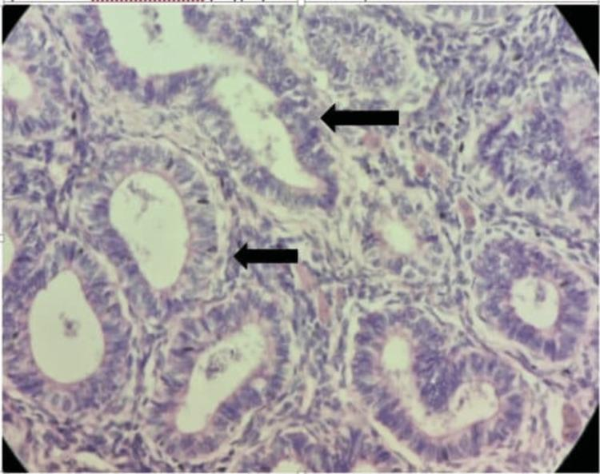

## 문제
A 65-year-old woman comes to the physician because of vaginal bleeding for 3 weeks. Menopause occurred at age 51 years, and she has never taken hormone therapy. She has hypertension and type 2 diabetes mellitus. Her BMI is 33 kg/m2. Pelvic examination shows blood in the vaginal vault and a mobile, nontender right adnexal mass. Transvaginal ultrasonography shows a thickened endometrial stripe and a 9-cm solid right ovarian mass. A photomicrograph of an endometrial biopsy specimen stained with hematoxylin and eosin is shown. Which of the following is the most likely mechanism underlying this endometrial lesion?

- A. Excess progesterone from a luteinized ovarian tumor
- B. Ectopic endometrial glands within the myometrium
- C. Estrogen stimulation unopposed by progesterone
- D. TP53 mutation arising in atrophic endometrium
- E. Integration of high-risk HPV E6 and E7 genes

_Photomicrograph, hematoxylin and eosin; black arrows are from the original figure (PMC Open Access Subset, CC BY — no cropping or adjustment)_

## 정답 및 해설
> 정답: C

- **정답 핵심**: The biopsy shows crowded, back-to-back tubular glands lined by stratified columnar cells with elongated nuclei and very little intervening stroma — an endometrioid-type glandular proliferation, without the papillae, slit-like spaces, and severe nuclear pleomorphism of serous carcinoma. Endometrioid (type I) lesions arise from prolonged estrogen stimulation without progesterone; here obesity (aromatase in adipose tissue) and a solid ovarian mass in a postmenopausal woman (classically an estrogen-secreting granulosa cell tumor) both supply estrogen.
- **원리**: <b>Why estrogen without progesterone causes glandular crowding</b>: estrogen drives endometrial gland proliferation through estrogen receptors; progesterone normally opposes it by converting the endometrium to a secretory, nonproliferating state and by inducing enzymes that inactivate estradiol. After menopause there is no ovulation and no progesterone, so any ongoing estrogen source acts unopposed. Glands multiply faster than stroma, become crowded, and accumulate mutations (PTEN loss, PIK3CA, KRAS, mismatch-repair defects), progressing from hyperplasia to atypical hyperplasia and endometrioid carcinoma.  <b>Where the estrogen comes from here</b>: adipose tissue aromatizes androstenedione to estrone, so obesity, diabetes, and hypertension are the classic type I risk profile. A solid ovarian mass in an older woman adds a granulosa cell tumor, which secretes estrogen (and inhibin) and is found with endometrial hyperplasia or carcinoma in a substantial minority of cases.  <b>Type II contrast</b>: serous carcinoma arises in thin, atrophic endometrium of older, often thin women, is driven by TP53 mutation, and does not depend on estrogen.
- **비교**: <table><thead><tr><th style="width:22%">Feature</th><th style="width:39%">Endometrioid, type I (answer)</th><th>Serous, type II (closest distractor)</th></tr></thead><tbody> <tr><td>Driver</td><td><b>Unopposed estrogen</b>; PTEN, PIK3CA, KRAS, mismatch repair</td><td>TP53 mutation; estrogen-independent</td></tr> <tr><td>Background endometrium</td><td>Hyperplasia</td><td>Atrophy; precursor serous intraepithelial carcinoma</td></tr> <tr><td>Histology</td><td>Crowded tubular glands, stratified columnar cells, mild–moderate atypia</td><td>Papillae and slit-like spaces, marked nuclear pleomorphism</td></tr> <tr><td>Typical patient</td><td>Obese, diabetic, estrogen-secreting tumor</td><td>Older, thin; aggressive course</td></tr> </tbody></table> Gland-forming lesion plus an estrogen source → unopposed estrogen; papillary high-grade lesion in atrophic endometrium → TP53.
- **오답 이유**:
  - (A) Excess progesterone would produce a secretory or decidualized, nonproliferative endometrium; it is the treatment for hyperplasia rather than its cause.
  - (B) Ectopic glands within the myometrium describe adenomyosis, which would be correct for an enlarged, tender uterus with heavy painful menses in a premenopausal woman.
  - (D) TP53 mutation would be correct if the biopsy showed papillary and slit-like architecture with severely pleomorphic nuclei arising from a thin, atrophic endometrium (serous carcinoma).
  - (E) High-risk HPV integration would be correct for a lesion of the endocervix or ectocervix, such as usual-type endocervical adenocarcinoma, with block-like p16 staining.
- **함정**: Choosing TP53 because the patient is older and postmenopausal — the gland-forming histology and the estrogen sources (obesity, solid ovarian tumor) point to the estrogen-driven type I pathway.
- **학습목표**: 자궁내막 조직에서 밀집한 관상 샘과 층을 이룬 원주상피(자궁내막모양 샘 증식)를 읽고, 비만·에스트로겐 분비 난소 종양과 연결해 길항되지 않는 에스트로겐 자극 기전을 고른다
- **근거·출처**: Kumar V, Abbas AK, Aster JC. Robbins and Cotran Pathologic Basis of Disease, 10th ed. Ch. 22 The female genital tract — endometrial carcinoma types I and II · WHO Classification of Tumours Editorial Board. Female Genital Tumours, 5th ed. 2020 — endometrioid carcinoma; adult granulosa cell tumour · PMC9721141 Figure 7 — case report, synchronous endometrial carcinoma and ovarian granulosa cell tumor (교사용) · 작성자 판독(2026-10-15): H&E, 서로 붙은 듯 밀집한 관상 샘, 길쭉한 핵이 여러 층으로 쌓인 원주상피, 샘 사이 간질 적음(자궁내막모양 샘 증식)

## 출처
- A Rare Case of Granulosa Cell Tumor Associated With Endometrial Carcinoma - A Case Report. Cureus. 2022 Nov 5;14(11):e31122. doi: 10.7759/cureus.31122 (CC BY) — Figure 7 · CC BY · https://creativecommons.org/licenses/
