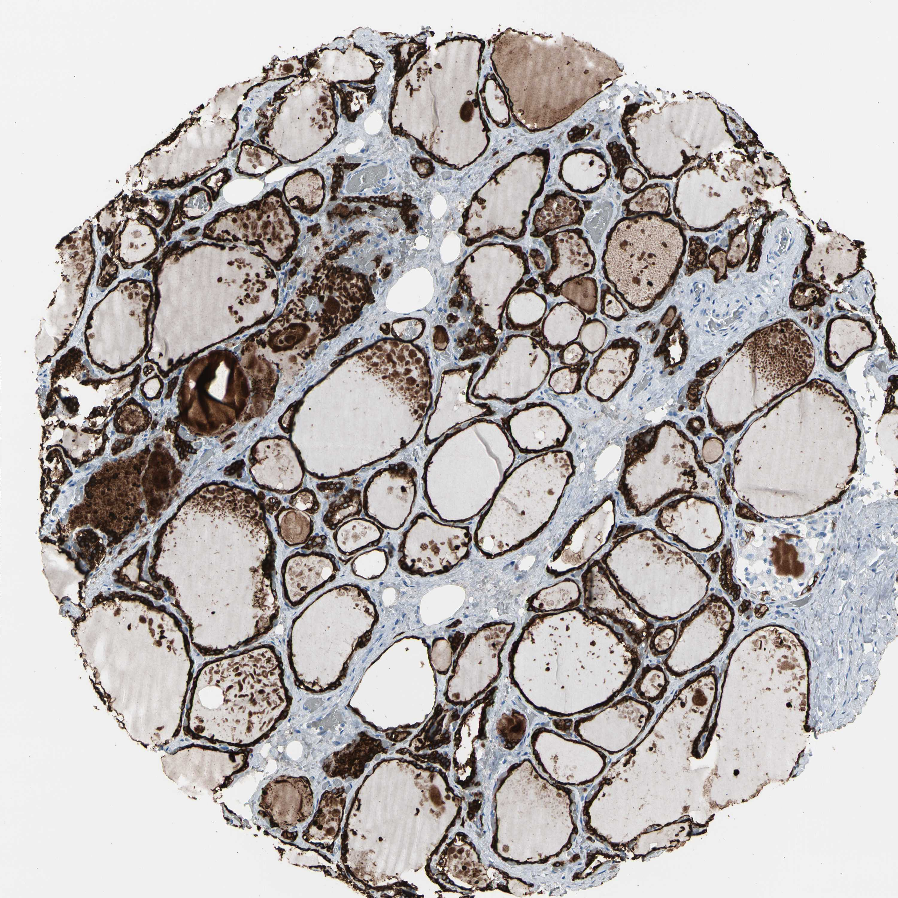

## 문제
A 61-year-old man undergoes left thyroid lobectomy for a 3-cm thyroid nodule found incidentally on a neck CT performed after a minor car accident. He has no symptoms. Pulse is 72/min, and blood pressure is 128/78 mm Hg. Serum thyroid-stimulating hormone concentration is 1.6 µU/mL (N 0.4-4.0), and serum calcium concentration is 9.4 mg/dL. Pathologic examination shows a follicular adenoma. A section of the uninvolved thyroid tissue is stained by immunohistochemistry with an antibody against thyroid peroxidase and is shown. Hormone production by the stained cell population is most directly stimulated by which of the following?

- A. Gastrin released from gastric antral G cells
- B. Thyrotropin-releasing hormone acting directly on the gland
- C. Adrenocorticotropic hormone from the anterior pituitary
- D. Thyroid-stimulating hormone from the anterior pituitary
- E. A rise in serum ionized calcium concentration

_Immunohistochemical stain of a tissue microarray core (DAB brown chromogen, hematoxylin counterstain), original magnification (Human Protein Atlas, CC BY 4.0; no cropping or color adjustment)_

## 정답 및 해설
> 정답: D

- **정답 핵심**: The brown stain lines every colloid-filled follicle — it is in the single layer of follicular epithelial cells, while the cells in the stroma between follicles are unstained. Thyroid peroxidase sits on the apical (colloid-facing) membrane of these follicular cells, where it oxidizes iodide and iodinates thyroglobulin. Thyroid hormone synthesis and secretion by follicular cells are driven by TSH acting on its Gs-coupled receptor.
- **원리**: <b>Why the stain marks follicular cells</b>: thyroid peroxidase is made only by follicular epithelial cells and is inserted into their apical membrane, facing the colloid. There it oxidizes iodide, attaches iodine to tyrosyl residues of thyroglobulin, and couples iodotyrosines into T4 and T3. That is why the brown signal outlines each follicle as a ring.  <b>Why TSH controls every step</b>: TSH binds a Gs-coupled receptor on the basolateral membrane of follicular cells. The cAMP rise increases sodium-iodide symporter expression, thyroglobulin and peroxidase synthesis, endocytosis of colloid, and release of T4/T3. With long-term stimulation the cells become taller and the follicles smaller; with suppression they flatten.  <b>The other endocrine cell in the gland</b>: parafollicular C cells lie singly or in small groups between follicles, do not contain thyroid peroxidase, and secrete calcitonin in response to a rise in serum calcium (and to gastrin). They would be unstained here.
- **비교**: <table><thead><tr><th style="width:22%">Feature</th><th style="width:39%">Follicular cells (answer)</th><th>Parafollicular C cells (closest distractor)</th></tr></thead><tbody> <tr><td>Position</td><td>Single layer lining each colloid-filled follicle</td><td>Between follicles, in the interstitium</td></tr> <tr><td>Thyroid peroxidase</td><td><b>Present</b> — apical membrane</td><td>Absent (they stain for calcitonin)</td></tr> <tr><td>Main stimulus</td><td>TSH (Gs-cAMP)</td><td>Rising serum calcium via the calcium-sensing receptor; gastrin</td></tr> <tr><td>Product</td><td>T4 and T3</td><td>Calcitonin</td></tr> </tbody></table> A stain that outlines the follicles points to follicular cells and TSH; scattered positive cells between follicles would point to C cells and calcium.
- **오답 이유**:
  - (A) Gastrin also stimulates calcitonin release, so it would fit a question about C cells or medullary thyroid carcinoma (pentagastrin test), not the follicle-lining cells.
  - (B) TRH acts on pituitary thyrotrophs to release TSH; it would be correct only if the question asked what stimulates thyrotrophs rather than thyroid follicular cells.
  - (C) ACTH would be correct for a stain of adrenal zona fasciculata cells (for example 11β-hydroxylase), not for thyroid follicular epithelium.
  - (E) A rise in serum ionized calcium would be correct if the stained cells were the scattered parafollicular C cells between follicles, as with a calcitonin stain.
- **함정**: Choosing the hypothalamic hormone because it sits at the top of the axis — the question asks what most directly stimulates the stained cells.
- **학습목표**: 갑상샘 면역조직화학에서 염색된 세포가 콜로이드를 둘러싼 여포상피임을 읽고, 그 세포의 호르몬 합성이 TSH 로 조절됨을 연결하며 여포 곁 C 세포와 구별한다
- **근거·출처**: Guyton and Hall Textbook of Medical Physiology, 14th ed. Ch. Thyroid metabolic hormones — TSH regulation of follicular cells · Human Protein Atlas — TPO, thyroid gland tissue (CC BY 4.0) (교사용) · 작성자 판독(2026-10-16): 콜로이드로 찬 여포를 둘러싼 여포상피가 갈색으로 강하게 염색, 여포 사이 간질 세포는 음성

## 출처
- Human Protein Atlas, TPO / Thyroid gland (CC BY 4.0), https://images.proteinatlas.org/7987/21449_B_2_5.jpg · Creative Commons Attribution 4.0 International · https://www.proteinatlas.org/about/licence
