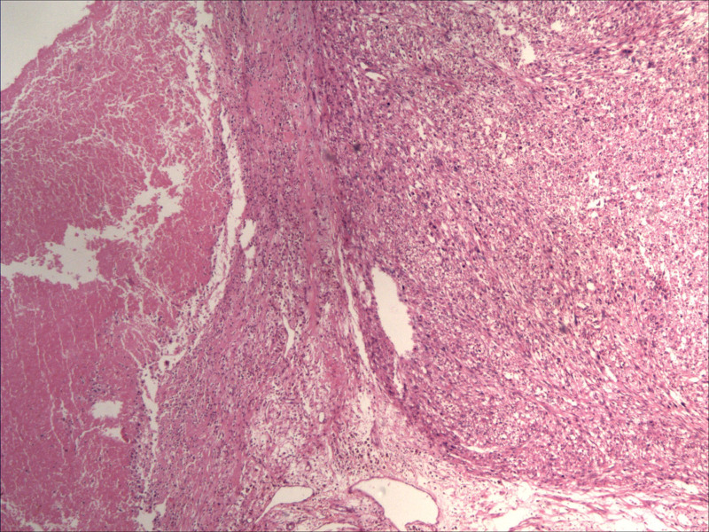

## 문제
35세 여자가 임신 중 빠르게 커진 자궁 종괴로 제왕절개 분만 때 종괴절제술을 받았으나, 분만 3개월 뒤 하복부 압박감과 불규칙한 질 출혈로 다시 왔다. 혈압 116/72 mmHg, 맥박 88회/분이다. 하복부에 단단한 종괴가 만져진다. 혈색소 10.2 g/dL, 혈청 β-hCG 는 음성이다. 골반 MRI 에서 자궁 근층에 경계가 불규칙한 9 cm 종괴가 있어 자궁절제술을 하였다. 고배율에서 핵 이형성이 뚜렷하고 유사분열은 고배율 10시야당 18개였다. 자궁 종괴의 헤마톡실린-에오신 염색 조직 소견은 그림과 같다. 진단은?

- A. 저등급 자궁내막 간질육종
- B. 태반부위 영양막종양
- C. 평활근육종
- D. 적색변성을 동반한 평활근종
- E. 세포성 평활근종

_헤마톡실린-에오신 염색 저배율 현미경 사진, 출판된 증례 그림 한 컷 그대로 (PMC Open Access Subset, CC BY — 크롭·보정 없음)_

## 정답 및 해설
> 정답: C

- **정답 핵심**: 그림의 오른쪽은 서로 엇갈리는 다발로 배열한 세포 밀도 높은 방추형 세포 종양이고, 왼쪽은 종양과 갑자기 경계를 이루는 괴사·출혈 구역이다. 여기에 뚜렷한 핵 이형성과 고배율 10시야당 18개의 유사분열이 더해지면 평활근 종양의 악성 기준(종양세포 괴사·중등도 이상 핵 이형성·유사분열 ≥ 10/10 HPF 중 둘 이상)을 충족해 평활근육종이다.
- **원리**: <b>왜 평활근 종양의 악성은 세 소견으로 가르는가</b>: 자궁 평활근 종양은 모양만으로는 양성·악성이 겹친다. 그래서 스탠퍼드 기준은 ① 종양세포(응고) 괴사 ② 미만성 중등도 이상 핵 이형성 ③ 유사분열 지수 세 가지를 본다. 이 가운데 둘 이상이면 평활근육종이다. 핵 이형성이 뚜렷하면 유사분열이 10/10 HPF 이상만 되어도 악성이다.  <b>괴사의 종류가 중요한 이유</b>: 종양세포 괴사는 살아 있는 종양세포에서 괴사 구역으로 갑자기 넘어가고 괴사 구역 안에 이형성 핵의 유령 윤곽이 남는다. 반면 경색형(유리질화) 괴사는 허혈로 생겨 그 사이에 육아조직·유리질화 띠가 끼고 세포 이형성이 없다 — 임신 중 평활근종의 적색변성이 이 경색형이다.  <b>임신이 주는 함정</b>: 임신 중에는 평활근종의 유사분열이 늘고 출혈성 경색(적색변성)이 흔해 악성처럼 보일 수 있다. 그러나 이때는 핵 이형성이 없다. 분만 뒤에도 빠르게 다시 자란 것은 이 진단을 뒷받침한다.
- **비교**: <table><thead><tr><th style="width:22%">구분</th><th style="width:39%">평활근육종(정답)</th><th>적색변성 평활근종(가장 가까운 오답)</th></tr></thead><tbody> <tr><td>괴사</td><td>종양세포 괴사 — 살아 있는 종양과 <b>갑작스러운 경계</b></td><td>출혈성 경색 — 육아조직·유리질화 띠가 사이에 낌</td></tr> <tr><td>핵 이형성</td><td>미만성 중등도 이상</td><td>없거나 경미</td></tr> <tr><td>유사분열</td><td>≥ 10/10 HPF(이형성 동반 시)</td><td>임신 중 다소 늘 수 있으나 이형성은 없음</td></tr> <tr><td>경과</td><td>분만 뒤에도 커지고 재발</td><td>분만 뒤 통증이 가라앉고 크기가 줄어듦</td></tr> </tbody></table> 괴사만으로는 가르지 못한다 — 핵 이형성과 유사분열이 함께 있으면 악성, 이형성이 없으면 경색형 변성으로 본다.
- **오답 이유**:
  - ① 저등급 자궁내막 간질육종은 방추형 다발 대신 작은 둥근 세포가 소동맥 주위로 소용돌이치며 근층에 혀 모양으로 침윤할 때 정답이 된다.
  - ② 태반부위 영양막종양은 혈청 β-hCG 가 낮게 양성이고 중간형 영양막세포가 근섬유 사이로 침윤하며 hPL 염색 양성일 때 생각한다.
  - ④ 적색변성 평활근종은 임신 중 통증·미열과 함께 출혈성 경색이 보이지만 핵 이형성이 없고 유사분열이 적을 때 정답이 된다.
  - ⑤ 세포성 평활근종은 세포 밀도는 높지만 핵 이형성·종양세포 괴사가 없고 유사분열이 적을 때의 진단이다.
- **함정**: 임신 중 평활근종의 적색변성을 떠올려 괴사만 보고 양성으로 판정하는 것 — 핵 이형성과 높은 유사분열이 함께 있으면 악성 기준을 충족한다.
- **학습목표**: 임신 중 빠르게 커진 자궁 종괴의 조직에서 세포 밀도 높은 방추형 세포 다발과 종양세포 괴사를 읽고, 핵 이형성·유사분열과 함께 평활근육종으로 판정하며 적색변성 평활근종과 구별한다
- **근거·출처**: WHO Classification of Tumours: Female Genital Tumours, 5th ed. — uterine leiomyosarcoma, diagnostic criteria · Bell SW, Kempson RL, Hendrickson MR. Problematic uterine smooth muscle neoplasms: a clinicopathologic study of 213 cases. Am J Surg Pathol 1994;18:535-558 · PMC13166545 Figure 7 — uterine leiomyosarcoma in pregnancy, case report (교사용) · 작성자 판독(2026-10-16): H&E 저배율, 엇갈리는 다발의 세포 밀도 높은 방추형 세포 종양과 갑작스러운 경계의 출혈·괴사 구역

## 출처
- Leiomyosarcoma of uterus in pregnancy: A case report. Medicine (Baltimore). 2026 May 8;105(19):e48608. doi: 10.1097/MD.0000000000048608 (CC BY) — Figure 7. · CC BY · https://creativecommons.org/licenses/
