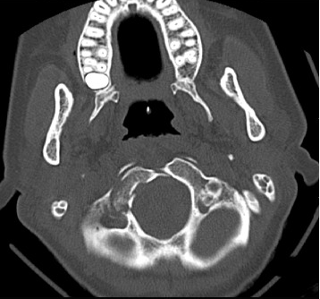

## 문제
24세 여자가 5일 전 자동차 사고로 머리를 부딪친 뒤부터 쉰 목소리와 삼킴 곤란이 점점 심해져 왔다. 사고 직후 잠깐 의식을 잃었다가 회복했고 목 뒤가 계속 아프다. 혈압 118/74 mmHg, 맥박 82회/분, 체온 36.7 ℃ 이다. 의식은 명료하고 동공 크기와 대광반사는 양쪽 같다. 팔다리 근력과 감각은 정상이다. 물을 마시면 사레가 든다. 뇌 CT 검사에서 머리뼈 바닥을 뼈창으로 본 대후두공 높이 축상 영상은 그림과 같다. 이 환자에서 함께 관찰될 가능성이 가장 높은 소견은?

- A. 혀를 내밀면 오른쪽으로 치우친다.
- B. 혀를 내밀면 왼쪽으로 치우친다.
- C. 오른쪽 이마 주름을 만들지 못한다.
- D. 오른쪽 눈을 바깥쪽으로 움직이지 못한다.
- E. 오른쪽 얼굴의 통각이 떨어진다.

_대후두공 높이의 축상 CT 뼈창 — 출판된 증례 그림에서 축상 패널 한 컷만 잘라냄 (PMC Open Access Subset, CC BY — 보정 없음)_

## 정답 및 해설
> 정답: A

- **정답 핵심**: CT 에서 영상 왼쪽, 즉 환자 오른쪽 후두과가 여러 조각으로 부서져 있고 반대쪽 후두과는 온전하다. 후두과 바닥에는 혀밑신경관(XII)이, 바로 바깥 앞쪽에는 목정맥구멍(IX·X·XI)이 있어 후두과 골절은 아래쪽 뇌신경 마비(콜레-시카르 증후군)를 일으킨다. 쉰 목소리·삼킴 곤란(IX·X)에 더해 오른쪽 혀밑신경이 마비되면 오른쪽 턱끝혀근이 약해져 혀를 내밀 때 오른쪽(병변 쪽)으로 치우친다.
- **원리**: <b>왜 후두과 골절이 아래쪽 뇌신경을 다치게 하는가</b>: 혀밑신경관은 후두과의 바닥을 앞바깥쪽으로 뚫고 지나가고, 목정맥구멍은 후두과 바로 바깥 앞쪽에서 혀인두신경(IX)·미주신경(X)·더부신경(XI)이 나간다. 그래서 후두과가 부서지면 골편·혈종·부종이 이 구멍들을 눌러 IX~XII 가 한쪽에서 함께 마비될 수 있다(콜레-시카르 증후군). 마비는 부종이 차오르며 며칠 뒤에 나타나기도 한다.  <b>왜 혀는 병변 쪽으로 치우치는가</b>: 혀를 내미는 근육은 양쪽 턱끝혀근이 혀를 앞으로·반대쪽으로 민다. 한쪽 혀밑신경이 마비되면 건강한 쪽 근육만 혀를 밀어 혀끝이 <b>약한 쪽(병변 쪽)</b>으로 기운다. 말초 XII 손상은 같은 쪽 혀 위축·잔떨림도 동반한다.  <b>CT 의 좌우</b>: 축상 CT 는 발쪽에서 올려다본 방향으로 표시해 영상 왼쪽이 환자 오른쪽이다.
- **비교**: <table><thead><tr><th style="width:22%">구분</th><th style="width:39%">오른쪽 혀밑신경 마비(정답)</th><th>혀가 왼쪽으로 치우침(가장 가까운 오답)</th></tr></thead><tbody> <tr><td>병변</td><td>환자 오른쪽(영상 왼쪽) 후두과 골절 → 오른쪽 혀밑신경관</td><td>왼쪽 말초 XII 손상, 또는 오른쪽 대뇌 겉질연수로 병변</td></tr> <tr><td>혀 내밀기</td><td>오른쪽(병변 쪽)으로</td><td>왼쪽으로</td></tr> <tr><td>동반 소견</td><td>오른쪽 혀 위축·잔떨림, IX·X·XI 마비</td><td>상위운동신경원이면 위축 없음, 반대쪽 팔다리 약화 동반</td></tr> </tbody></table> 말초 혀밑신경 손상은 혀가 병변 쪽으로, 겉질 쪽 손상은 반대쪽으로 기운다 — 먼저 CT 에서 어느 쪽이 부서졌는지 읽는다.
- **오답 이유**:
  - ② 혀가 왼쪽으로 치우치는 것은 골절이 환자 왼쪽 후두과에 있거나 오른쪽 대뇌 겉질연수로 병변일 때 정답이 된다 — 영상 좌우를 뒤집어 읽은 답이다.
  - ③ 오른쪽 이마 주름 소실은 측두골 골절로 오른쪽 얼굴신경(VII)이 말초에서 손상될 때 정답이 된다.
  - ④ 오른쪽 눈의 외전 장애는 추체 끝 골절이나 두개내압 상승으로 오른쪽 갓돌림신경(VI)이 늘어나 손상될 때 정답이 된다.
  - ⑤ 오른쪽 얼굴 통각 저하는 삼차신경(V)이나 연수 외측의 척수로가 손상될 때 정답이 되며, 후두과 골절의 전형적 신경 손상은 아니다.
- **함정**: 축상 CT 의 영상 왼쪽을 환자 왼쪽으로 읽거나, 말초 혀밑신경 마비에서 혀가 건강한 쪽으로 간다고 거꾸로 외우는 것.
- **학습목표**: 대후두공 높이 축상 CT 에서 후두과 골절과 그 쪽을 읽고, 후두과를 지나는 혀밑신경관과 목정맥구멍의 아래쪽 뇌신경(IX~XII) 마비를 연결해 혀의 치우침 방향을 예측한다
- **근거·출처**: Tuli S, Tator CH, Fehlings MG, Mackay M. Occipital condyle fractures. Neurosurgery 1997;41:368-377 · Gray's Anatomy, 42nd ed. — hypoglossal canal and jugular foramen · PMC4403883 Figure 1 — occipital condyle fracture with lower cranial nerve palsy, case report (교사용) · 작성자 판독(2026-10-16): 대후두공 높이 축상 CT 뼈창, 환자 오른쪽(영상 왼쪽) 후두과 분쇄 골절, 반대쪽 온전

## 출처
- Occipital condyle fracture and lower cranial nerve palsy after blunt head trauma – a literature review and case report. J Trauma Manag Outcomes. 2015 Apr 11;9:2. doi: 10.1186/s13032-015-0024-3 (CC BY) — Figure 1 · CC BY · https://creativecommons.org/licenses/
