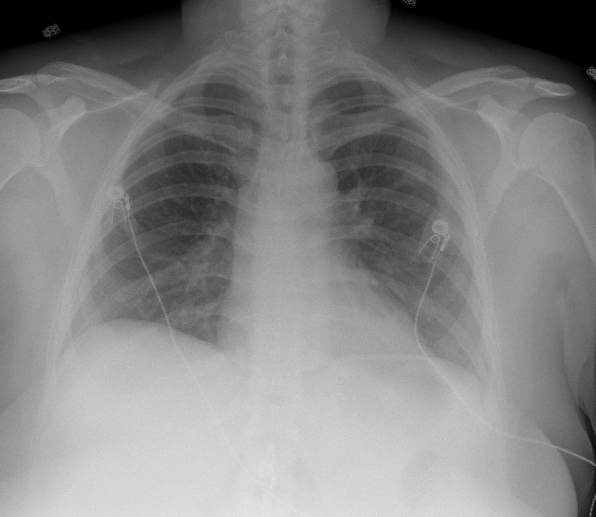

## 문제
A 40-year-old woman is admitted to the hospital because of fever, cough, and shortness of breath for 7 days. A nasopharyngeal swab is positive for SARS-CoV-2 by RT-PCR. On admission, oxygen saturation is 90% on room air, and treatment with dexamethasone, remdesivir, and 3 L/min of oxygen by nasal cannula is begun. Over the next 24 hours, her oxygen requirement increases rapidly, and she now requires high-flow nasal cannula oxygen at 40 L/min with an FiO2 of 0.6 to keep oxygen saturation at 93%. Temperature is 38.6°C (101.5°F), pulse is 108/min, respirations are 28/min, and blood pressure is 124/76 mm Hg. Crackles are heard at both lung bases. Leukocyte count is 7200/mm3 with lymphocytes 8%. Serum C-reactive protein concentration is 14 mg/dL (N <0.5), and serum procalcitonin concentration is 0.1 ng/mL. Serum ALT activity is 32 U/L. A chest x-ray is shown. In addition to continuing dexamethasone, which of the following is the most appropriate next step in pharmacotherapy?

- A. Tocilizumab
- B. High-dose intravenous methylprednisolone
- C. Ceftriaxone and azithromycin
- D. COVID-19 convalescent plasma
- E. Ivermectin

_Portable anteroposterior chest radiograph, ECG leads as in the original (TCIA, CC BY 4.0; DICOM converted with standard windowing, no cropping)_

## 정답 및 해설
> 정답: A

- **정답 핵심**: The chest x-ray shows low lung volumes with hazy ground-glass and consolidative opacities in both lower lung zones — bilateral viral pneumonia. Despite dexamethasone, her oxygen need has risen rapidly to high-flow oxygen, and CRP is markedly elevated, indicating ongoing systemic inflammation. Adding an IL-6 receptor blocker (tocilizumab) — or a JAK inhibitor (baricitinib) — to dexamethasone reduced mortality in this group (RECOVERY, REMAP-CAP).
- **원리**: <b>Why add an immunomodulator rather than more steroid</b>: in the second week of COVID-19, hypoxemia is driven by host inflammation, and IL-6 is a central mediator — it sustains fever, CRP production, and capillary leak. Dexamethasone at 6 mg broadly suppresses inflammation, but in patients whose oxygen needs keep climbing with high CRP, blocking the IL-6 receptor (tocilizumab) or JAK1/2 signaling downstream of several cytokines (baricitinib) adds a mortality benefit.  <b>Why higher steroid doses do not help</b>: trials of high-dose dexamethasone (for example 20 mg) or pulse methylprednisolone did not lower mortality and in some settings increased it, while raising infection and hyperglycemia risk.  <b>Safety checks before tocilizumab</b>: no active bacterial or fungal infection (procalcitonin is low), no marked neutropenia, and liver enzymes not markedly elevated. Because IL-6 blockade suppresses CRP and fever, later infections may be harder to recognize.
- **비교**: <table><thead><tr><th style="width:22%">Feature</th><th style="width:39%">Tocilizumab added to dexamethasone (answer)</th><th>High-dose methylprednisolone (closest distractor)</th></tr></thead><tbody> <tr><td>Target</td><td>IL-6 receptor — a specific inflammatory pathway</td><td>Broad glucocorticoid receptor effect, just more of it</td></tr> <tr><td>Trial evidence</td><td>Lower 28-day mortality in hypoxemic patients with high CRP (RECOVERY, REMAP-CAP)</td><td>No mortality benefit; higher dose did not outperform 6 mg dexamethasone</td></tr> <tr><td>Who benefits</td><td>Rapidly rising oxygen need (high-flow, NIV, early ventilation), CRP ≥7.5 mg/dL</td><td>No group shown to benefit</td></tr> </tbody></table> When oxygen needs rise on standard-dose dexamethasone, the next step is a second immunomodulator, not a bigger steroid dose.
- **오답 이유**:
  - (B) High-dose methylprednisolone might be considered if the picture were organizing pneumonia or another steroid-responsive process, but in COVID-19 a higher dose did not reduce mortality.
  - (C) Ceftriaxone and azithromycin would be correct if a lobar consolidation, purulent sputum, or a high procalcitonin suggested bacterial coinfection.
  - (D) Convalescent plasma with high antibody titer would only be considered very early in immunocompromised patients who cannot make antibodies; it did not help hospitalized patients like her.
  - (E) Ivermectin would be correct only for a parasitic infection such as strongyloidiasis — for example, as pre-emptive treatment before immunosuppression in someone from an endemic area.
- **함정**: Assuming that worsening on dexamethasone calls for a larger steroid dose — the evidence supports adding an IL-6 or JAK inhibitor instead.
- **학습목표**: 덱사메타손 투여 중에도 산소 요구량이 빠르게 늘고 염증 지표가 높은 SARS-CoV-2 폐렴에 IL-6 수용체 차단제(또는 JAK 억제제)를 더하며, 고용량 스테로이드 증량과 구별한다
- **근거·출처**: RECOVERY Collaborative Group. Tocilizumab in patients admitted to hospital with COVID-19 (RECOVERY): a randomised, controlled, open-label, platform trial. Lancet 2021;397:1637-1645 · NIH COVID-19 Treatment Guidelines — therapeutic management of hospitalized adults (final version) · 작성자 판독(2026-10-16): 전후 흉부 X선, 작은 폐용적과 양쪽 하폐야 흐린 간유리·경화 음영, 기흉·다량 흉수 없음

## 출처
- COVID-19-AR, The Cancer Imaging Archive (CC BY 4.0) · series …50039416 · Creative Commons Attribution 4.0 International · https://www.cancerimagingarchive.net/data-usage-policies-and-restrictions/
