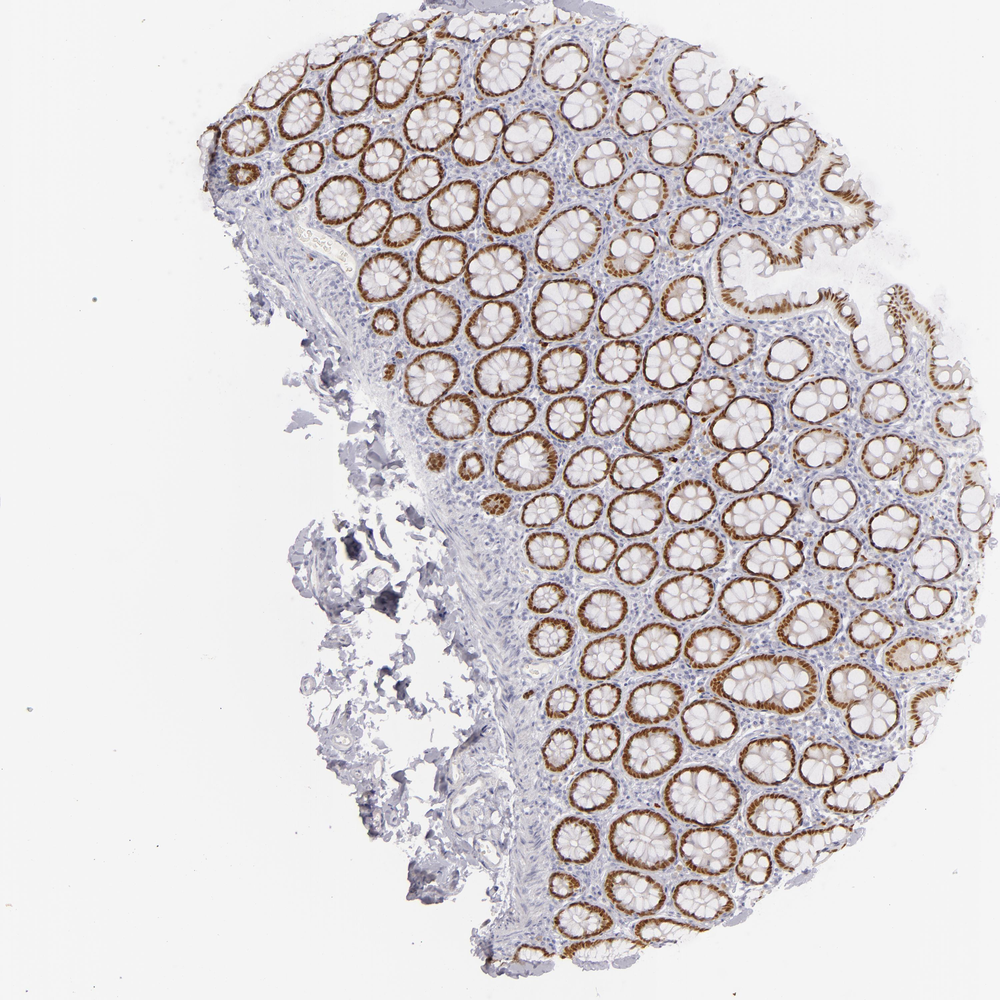

## 문제
61세 여자가 2개월 전부터 계속된 오른쪽 윗배 불편감과 4 kg 체중 감소로 왔다. 3년 전 상행결장암으로 오른쪽 반결장절제술을 받았다. 혈압 124/76 mmHg, 맥박 80회/분, 체온 36.7℃이다. 간이 오른쪽 갈비뼈 아래 2 cm 만져진다. 혈액검사에서 알칼리인산분해효소 210 U/L, 암배아항원 48 ng/mL이다. 복부 CT에서 간에 여러 개의 저음영 결절이 있고, 초음파 유도 간 생검에서 선암이 나왔다. 원발 부위를 가리기 위한 면역조직화학 패널의 대조로, 같은 항체로 이전 수술 검체의 정상 대장 점막 조직을 염색한 결과는 그림과 같다. 이 항체가 인식하는 항원으로 가장 적절한 것은?

- A. MUC2 점액단백
- B. E-카드헤린
- C. 암배아항원(CEA)
- D. CDX2
- E. 사이토케라틴 20(CK20)

_조직 마이크로어레이 코어의 면역조직화학염색(DAB 갈색 발색, 헤마톡실린 대조염색), 원 배율 (Human Protein Atlas, CC BY 4.0 — 크롭·보정 없음)_

## 정답 및 해설
> 정답: D

- **정답 핵심**: 갈색 신호가 가로로 잘린 음와를 이루는 상피세포의 핵에만 점처럼 모여 있고, 술잔세포의 점액 공포·세포질과 고유판의 간질세포는 음성이다. 핵에 국재하는 장 상피 표지자는 장 분화를 지시하는 호메오박스 전사인자 CDX2 다. 전이성 선암에서 CDX2 양성은 CK7 음성·CK20 양성과 함께 대장 원발을 강하게 시사한다.
- **원리**: <b>왜 염색 위치가 항원을 알려 주는가</b>: 면역조직화학의 갈색 침착은 항원이 세포 안 어디에 있는지를 그대로 보여 준다. 전사인자는 DNA 에 붙어 일하므로 <b>핵</b>, 중간섬유인 사이토케라틴은 <b>세포질</b>, 세포 부착 단백인 E-카드헤린은 세포 사이 <b>막</b>, 분비 점액은 술잔세포의 <b>점액 공포</b>, CEA 는 <b>내강 쪽 꼭대기막</b>에 나타난다.  <b>CDX2 는 무엇인가</b>: CDX2 는 장 상피의 분화를 지시하는 호메오박스 전사인자로, 십이지장에서 직장까지 거의 모든 장 상피세포(흡수세포·술잔세포)의 핵에서 발현된다. 그래서 정상 대장에서는 음와마다 핵이 고리 모양으로 갈색이 된다.  <b>임상에서 쓰는 이유</b>: 원발 부위를 모르는 전이성 선암에서 CK7 음성·CK20 양성·CDX2 양성이면 대장 원발을 강하게 시사한다. 다만 위·췌장·장형 점액성 종양에서도 일부 양성일 수 있어 다른 표지자와 함께 판단한다.
- **비교**: <table><thead><tr><th style="width:22%">구분</th><th style="width:39%">CDX2(정답)</th><th>CK20(가장 가까운 오답)</th></tr></thead><tbody> <tr><td>단백 종류</td><td>호메오박스 전사인자</td><td>중간섬유(사이토케라틴)</td></tr> <tr><td>염색 위치</td><td><b>핵</b> — 음와 상피 전체의 핵이 점처럼</td><td>세포질 — 표면 상피와 음와 위쪽에 강함</td></tr> <tr><td>정상 대장 분포</td><td>음와 깊이와 관계없이 거의 모든 상피</td><td>표면 쪽으로 갈수록 강하고 음와 바닥은 약함</td></tr> <tr><td>전이암 패널</td><td>대장 원발을 시사(장 분화)</td><td>CK7−/CK20+ 조합이 대장을 시사</td></tr> </tbody></table> 둘 다 대장 원발 패널에 들어가지만, 갈색이 <b>핵</b>에 있으면 CDX2, <b>세포질</b>을 채우면 CK20 이다.
- **오답 이유**:
  - ① MUC2 는 술잔세포 점액 공포 안이 갈색으로 차고 핵과 흡수세포는 음성인 양상일 때 정답이 된다.
  - ② E-카드헤린은 이웃 상피세포 사이의 옆쪽 막이 벌집처럼 갈색 선으로 그려질 때 정답이 되며, 소엽암에서 소실된다.
  - ③ CEA 는 음와 내강을 향한 꼭대기막과 내강 속 분비물이 갈색일 때 정답이 되며, 혈청 수치는 추적 지표로 쓰인다.
  - ⑤ CK20 은 같은 대장 원발 패널에 들어가지만 갈색이 핵이 아니라 표면 상피 세포질을 채우는 양상일 때 정답이 된다.
- **함정**: 혈청 CEA 가 높다는 정보와 「대장암 표지자」라는 연상으로 CEA 나 CK20 을 고르는 것 — 그림의 갈색은 핵에 있다.
- **학습목표**: 대장 점막 면역조직화학에서 갈색 신호가 음와 상피세포의 핵에만 있음을 읽고, 장 분화 전사인자 CDX2 를 세포질·막·점액 표지자와 구별한다
- **근거·출처**: Kumar V, Abbas AK, Aster JC. Robbins and Cotran Pathologic Basis of Disease, 10th ed. Ch. Neoplasia — immunohistochemistry in tumors of unknown origin · Werling RW, et al. CDX2, a highly sensitive and specific marker of adenocarcinomas of intestinal origin. Am J Surg Pathol 2003;27:303-310 · Human Protein Atlas — CDX2, colon tissue (CC BY 4.0) (교사용) · 작성자 판독(2026-10-18): 가로로 잘린 음와 상피세포의 핵이 갈색, 점액 공포·고유판은 음성

## 출처
- Human Protein Atlas, CDX2 / Colon (CC BY 4.0), https://images.proteinatlas.org/2221/5840_A_9_3.jpg · Creative Commons Attribution 4.0 International · https://www.proteinatlas.org/about/licence
