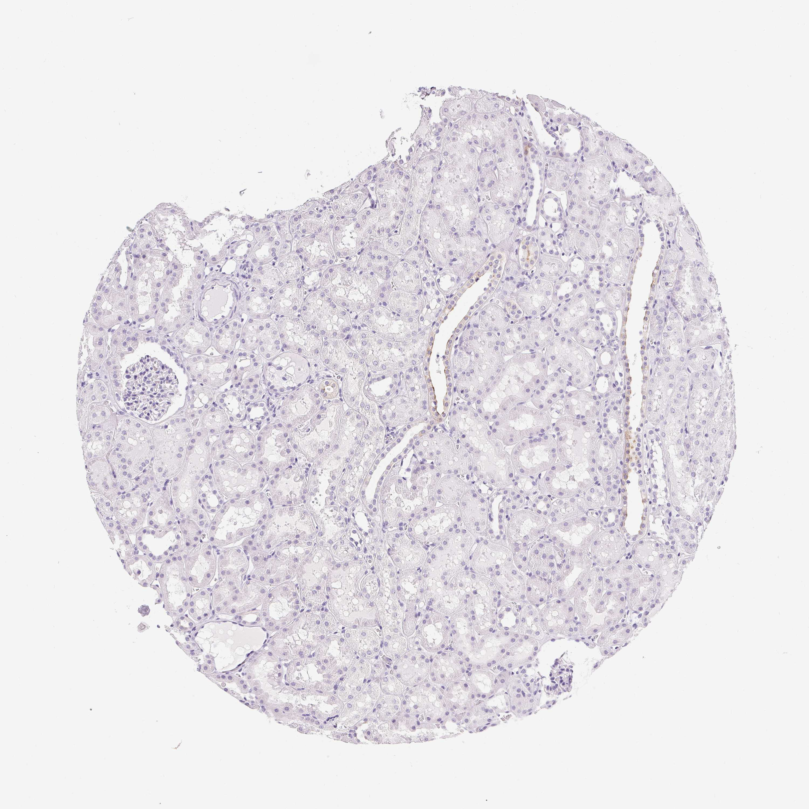

## 문제
A 16-year-old boy is brought to the emergency department 40 minutes after a motorcycle collision. He has left flank pain and gross hematuria. Pulse is 128/min, and blood pressure is 82/50 mm Hg despite 2 L of intravenous crystalloid. CT of the abdomen shows a shattered left kidney with active contrast extravasation, and an emergency left nephrectomy is performed. A section of uninjured renal cortex from the specimen is stained by immunohistochemistry with an antibody against a membrane protein expressed by one epithelial cell type of the distal nephron; the result is shown. Which of the following diuretics acts primarily on the epithelial cells lining the stained tubules?

- A. Mannitol
- B. Amiloride
- C. Hydrochlorothiazide
- D. Furosemide
- E. Acetazolamide

_Immunohistochemical stain of a tissue microarray core (DAB brown chromogen, hematoxylin counterstain), original magnification (Human Protein Atlas, CC BY 4.0; no cropping or color adjustment)_

## 정답 및 해설
> 정답: B

- **정답 핵심**: Only the long, straight tubules lined by pale cuboidal cells with distinct cell borders show brown staining along the luminal surface; the proximal tubules with eosinophilic cytoplasm and brush borders, the glomerulus, and the interstitium are unstained. Straight, pale-celled tubules running through the cortex are cortical collecting ducts in a medullary ray, and the stained cells are principal cells. Principal cells reabsorb sodium through the epithelial sodium channel (ENaC), which amiloride blocks.
- **원리**: <b>How to recognize the collecting duct</b>: in the cortex, collecting ducts run straight in medullary rays. Their cells are cuboidal, pale (few mitochondria), with sharp lateral borders and a wide, clean lumen. Proximal tubules have tall eosinophilic cells with a brush border and a fuzzy lumen; distal convoluted tubules are short convoluted profiles near the glomerulus with eosinophilic cells and no brush border.  <b>What the principal cell does</b>: the principal cell takes up sodium through apical ENaC and pumps it out with basolateral Na-K-ATPase; the resulting lumen-negative potential drives potassium secretion through ROMK. Vasopressin, through V2-Gs-cAMP, inserts aquaporin-2 water channels into the same apical membrane, which is why an apical-membrane water channel stain marks these cells.  <b>Why amiloride acts here</b>: amiloride and triamterene block ENaC directly, so they cause mild natriuresis and potassium retention. Spironolactone acts on the same cells indirectly by blocking the aldosterone receptor that up-regulates ENaC.
- **비교**: <table><thead><tr><th style="width:22%">Feature</th><th style="width:39%">Collecting duct — amiloride (answer)</th><th>Distal convoluted tubule — thiazide (closest distractor)</th></tr></thead><tbody> <tr><td>Shape in cortex</td><td><b>Long, straight</b> profiles in medullary rays</td><td>Short convoluted profiles beside the glomerulus</td></tr> <tr><td>Cells</td><td>Pale cuboidal, sharp lateral borders</td><td>Eosinophilic cuboidal, no brush border</td></tr> <tr><td>Apical sodium entry</td><td>ENaC (aldosterone-regulated)</td><td>Na-Cl cotransporter (NCC)</td></tr> <tr><td>Diuretic</td><td>Amiloride, triamterene (spironolactone indirectly)</td><td>Hydrochlorothiazide, chlorthalidone</td></tr> <tr><td>Potassium effect</td><td>Retained</td><td>Lost</td></tr> </tbody></table> Both segments are "distal nephron"; the straight course and pale cells place the stain in the collecting duct.
- **오답 이유**:
  - (A) Mannitol acts osmotically mainly in the proximal tubule and descending limb, which are water-permeable segments, not on a specific transporter of the stained cells.
  - (C) Hydrochlorothiazide would be correct if the stained profiles were short convoluted tubules of eosinophilic cells next to the glomerulus, as with a stain for the Na-Cl cotransporter.
  - (D) Furosemide would be correct for a stain of the thick ascending limb, whose cells carry the Na-K-2Cl cotransporter and run in the medulla and medullary rays as straight eosinophilic tubules.
  - (E) Acetazolamide would be correct if the stained cells were proximal tubule cells with brush borders, where carbonic anhydrase drives bicarbonate reabsorption.
- **함정**: Reading 'distal nephron' and choosing the thiazide — the stained tubules are straight and pale-celled, which places them in the collecting duct, not the distal convoluted tubule.
- **학습목표**: 신장 피질 면역조직화학에서 염색된 세관이 길고 곧은 밝은 입방상피의 집합관임을 근위세관·원위곡세관과 구별해 읽고, 그 주세포에 작용하는 이뇨제를 연결한다
- **근거·출처**: Ross MH, Pawlina W. Histology: A Text and Atlas, 8th ed. Ch. Urinary system — cortical collecting ducts and medullary rays · Katzung BG, Vanderah TW. Basic and Clinical Pharmacology, 15th ed. Ch. Diuretic agents — potassium-sparing diuretics · Human Protein Atlas — AQP2, kidney tissue (CC BY 4.0) (교사용) · 작성자 판독(2026-10-18): 길고 곧은 관의 밝은 입방상피 내강면만 약한 갈색, 근위세관·사구체 음성

## 출처
- Human Protein Atlas, AQP2 / Kidney (CC BY 4.0), https://images.proteinatlas.org/46834/147521_A_9_5.jpg · Creative Commons Attribution 4.0 International · https://www.proteinatlas.org/about/licence
