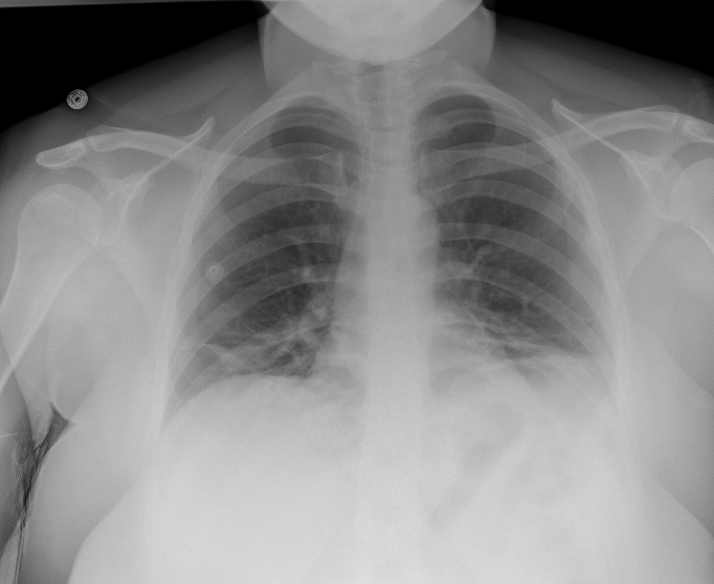

## 문제
34세 여자가 5일 전부터 열, 마른기침, 근육통이 있고 2일 전부터 냄새를 맡지 못해 왔다. 함께 사는 남편이 1주 전 같은 증상을 앓았다. 흡연하지 않고 기저질환은 없다. 혈압 118/74 mmHg, 맥박 96회/분, 호흡수 22회/분, 체온 38.2℃, 실내 공기에서 산소포화도 95%이다. 양쪽 아래 폐야에서 흡기 말 수포음이 들린다. 혈액검사에서 백혈구 4,800/mm³(림프구 12%), C-반응단백질 3.1 mg/dL, 프로칼시토닌 0.08 ng/mL이다. 흉부 X선 사진은 그림과 같다. 진단을 위해 가장 먼저 시행할 검사로 가장 적절한 것은?

- A. 객담 그람염색과 세균 배양
- B. 소변 레지오넬라 항원검사
- C. 객담 항산균 도말과 배양
- D. 기관지내시경 폐포세척액 검사
- E. 비인두 도말 검체의 SARS-CoV-2 역전사 중합효소연쇄반응

_앉은 자세 전후 흉부 X선 사진 (TCIA, CC BY 4.0 — DICOM 을 표준 창으로 변환, 크롭 없음)_

## 정답 및 해설
> 정답: E

- **정답 핵심**: 흉부 X선에서 폐용적이 작고 양쪽 하폐야 말초에 흐린 간유리·망상 음영이 있으며, 한 엽을 채우는 경화나 상엽 공동은 없다. 가족 내 접촉, 후각 소실, 림프구감소, 낮은 프로칼시토닌과 함께 이 분포는 SARS-CoV-2 바이러스 폐렴을 가장 먼저 의심하게 하므로, 비인두 도말 검체의 핵산증폭검사(RT-PCR)를 먼저 한다.
- **원리**: <b>왜 분포가 원인을 가르는가</b>: 바이러스 폐렴은 폐포 벽과 간질에 염증이 생겨 공기가 남아 있는 채로 흐려지는 간유리 음영을 만들고, 코로나바이러스감염증-19 는 특히 <b>양쪽·말초·하폐야</b>에 분포한다. 폐렴알균 같은 세균 폐렴은 폐포 안이 삼출물로 차서 한 엽이나 구역을 빽빽하게 채우는 <b>대엽성 경화</b>와 공기기관지조영을 만든다. 재활성 결핵은 산소분압이 높은 <b>상엽 첨후구역</b>의 공동을 만든다.  <b>혈액검사가 더하는 근거</b>: 림프구감소는 코로나바이러스감염증-19 의 흔한 소견이고, 프로칼시토닌은 세균 감염에서 주로 오르므로 0.1 ng/mL 아래면 세균 폐렴 가능성을 낮춘다.  <b>왜 비인두 도말 RT-PCR 인가</b>: 바이러스 RNA 를 직접 증폭해 민감도·특이도가 가장 높은 확진 검사이고, 결과에 따라 격리·항바이러스제·접촉자 관리가 정해진다. 침습적인 기관지내시경은 비인두 검사가 음성인데 의심이 계속될 때 고려한다.
- **비교**: <table><thead><tr><th style="width:22%">구분</th><th style="width:39%">바이러스 폐렴 — SARS-CoV-2 RT-PCR(정답)</th><th>세균 폐렴 — 객담 그람염색·배양(가장 가까운 오답)</th></tr></thead><tbody> <tr><td>흉부 X선</td><td>양쪽 하폐야 말초의 <b>흐린 간유리</b> 음영</td><td>한 엽을 채우는 경화 + 공기기관지조영</td></tr> <tr><td>기침</td><td>마른기침</td><td>화농성 객담</td></tr> <tr><td>백혈구</td><td>정상~감소, <b>림프구감소</b></td><td>호중구 증가</td></tr> <tr><td>프로칼시토닌</td><td>&lt; 0.1 ng/mL(세균 가능성 낮음)</td><td>대개 0.25 ng/mL 이상</td></tr> <tr><td>역학 단서</td><td>가족 접촉, 후각 소실</td><td>오한·흉막성 흉통의 급성 발병</td></tr> </tbody></table> 간유리 음영이 한 엽을 채우는 경화로 바뀌고 화농성 객담·호중구 증가가 있으면 세균 폐렴 검사가 먼저다.
- **오답 이유**:
  - ① 객담 그람염색과 배양은 화농성 객담, 호중구 증가, 한 엽을 채우는 경화가 보이는 세균 폐렴을 의심할 때 정답이 된다.
  - ② 소변 레지오넬라 항원검사는 고열·설사·저나트륨혈증·간효소 상승이 있고 냉각탑·온수 노출력이 있는 중증 폐렴에서 정답이 된다.
  - ③ 객담 항산균 도말·배양은 수주 이상의 기침·체중 감소·야간 발한과 상엽 공동이 있을 때 정답이 된다.
  - ④ 기관지내시경 폐포세척은 비인두 검사가 음성인데 진행하거나 면역저하 환자에서 폐포자충 등을 찾아야 할 때 정답이 된다.
- **함정**: 양쪽 수포음과 열만 보고 습관적으로 세균 폐렴 검사부터 고르는 것 — 접촉력·후각 소실·림프구감소·낮은 프로칼시토닌과 말초 간유리 음영이 바이러스를 가리킨다.
- **학습목표**: 가족 접촉·후각 소실·림프구감소와 양쪽 하폐야 말초의 흐린 음영에서 바이러스 폐렴을 의심하고, 대엽성 세균 폐렴·결핵 검사보다 먼저 SARS-CoV-2 핵산증폭검사를 고른다
- **근거·출처**: Jameson JL, et al. Harrison's Principles of Internal Medicine, 21st ed. Ch. Coronaviruses including SARS-CoV-2 — diagnosis · Rubin GD, et al. The role of chest imaging in patient management during the COVID-19 pandemic: a multinational consensus statement from the Fleischner Society. Chest 2020;158:106-116 · TCIA COVID-19-AR collection (CC BY 4.0) (교사용) · 작성자 판독(2026-10-18): 작은 폐용적과 양쪽 하폐야 말초의 흐린 간유리·망상 음영, 대엽성 경화·공동 없음

## 출처
- COVID-19-AR, The Cancer Imaging Archive (CC BY 4.0) · series …59876973 · Creative Commons Attribution 4.0 International · https://www.cancerimagingarchive.net/data-usage-policies-and-restrictions/
