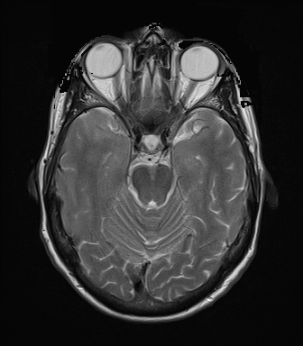

## 문제
68세 여자가 3주 전부터 기억력이 떨어지고 아침에 심해지는 두통이 있어 왔다. 고혈압으로 암로디핀을 먹고 있다. 혈압 134/82 mmHg, 맥박 74회/분, 체온 36.5℃이다. 신경학적 진찰에서 지남력은 정상이고 간이정신상태검사는 26점이며, 운동·감각 기능과 뇌신경 진찰은 정상이다. 혈액검사에서 혈당, 전해질, 갑상샘자극호르몬, 비타민 B12 는 정상이다. 뇌 MRI 에서 중뇌 높이의 축상 영상 하나는 그림과 같다. 이 영상만으로는 뇌실 벽과 피질 고랑에 붙은 작은 병변이 뇌척수액과 잘 구별되지 않아 영상을 하나 더 얻으려 한다. 추가할 영상으로 가장 적절한 것은?

- A. 자기공명혈관조영
- B. 액체감쇠역전회복(FLAIR) 영상
- C. 조영제 주사 전 T1 강조영상
- D. 확산강조영상
- E. 경사에코(T2*) 영상

_뇌 MRI 축상 영상, 표준 표시 방향(환자 오른쪽이 보는 사람 왼쪽) (The Cancer Imaging Archive, CC BY 4.0 — DICOM 변환, 크롭 없음)_

## 정답 및 해설
> 정답: B

- **정답 핵심**: 그림에서 안구 유리체와 중뇌 주위 수조·뇌고랑의 뇌척수액이 밝고, 백질이 회색질보다 어두우므로 T2 강조영상이다. T2 에서는 대부분의 병변(부종·탈수초·종양)도 밝아 같은 밝기의 뇌척수액에 붙어 있으면 경계가 묻힌다. FLAIR 는 T2 대비를 유지하면서 반전 펄스로 자유수인 뇌척수액 신호만 지워, 뇌실 곁·피질 고랑 곁 병변을 가장 잘 드러낸다.
- **원리**: <b>그림을 T2 로 읽는 근거</b>: T2 강조영상은 가로 이완이 느린 물이 밝다. 그래서 자유수가 많은 <b>뇌척수액과 유리체가 가장 밝고</b>, 수분이 적고 미엘린이 많은 백질이 회색질보다 어둡다. T1 강조영상은 반대로 뇌척수액이 어둡고 백질이 회색질보다 밝다.  <b>T2 의 한계</b>: 부종·탈수초·종양·경색 같은 대부분의 병변은 물이 늘어 T2 에서 밝다. 이 병변이 같은 밝기의 뇌척수액에 붙어 있으면(뇌실 주위, 피질 고랑 가장자리) 경계가 사라져 작게 보이거나 보이지 않는다.  <b>FLAIR 가 해결하는 방식</b>: FLAIR 는 T2 강조에 앞서 반전 펄스를 주고 뇌척수액의 세로 자화가 0 을 지나는 시점(긴 반전시간)에 신호를 얻는다. 그러면 자유수인 뇌척수액만 어두워지고, 조직에 묶인 물을 가진 병변은 여전히 밝게 남는다. 그래서 다발경화증의 뇌실 주위 병변, 종양 주위 부종, 지주막하 출혈·수막염의 고랑 신호를 찾는 데 쓴다.
- **비교**: <table><thead><tr><th style="width:22%">구분</th><th style="width:39%">FLAIR(정답)</th><th>조영 전 T1 강조영상(가장 가까운 오답)</th></tr></thead><tbody> <tr><td>뇌척수액</td><td><b>어둡다</b>(신호 억제)</td><td>어둡다</td></tr> <tr><td>대부분의 병변</td><td><b>밝다</b> — 어두운 뇌척수액과 대비가 큼</td><td>약간 어둡다 — 주변 뇌와 대비가 작음</td></tr> <tr><td>잘 보이는 것</td><td>뇌실·고랑 곁 부종·탈수초·종양</td><td>해부 구조, 지방·아급성 출혈·멜라닌(밝음)</td></tr> <tr><td>쓰임</td><td>T2 로 가려진 뇌척수액 곁 병변 찾기</td><td>조영 후 T1 과 짝지어 증강 여부 판정</td></tr> </tbody></table> 둘 다 뇌척수액이 어둡지만, 병변을 밝게 남기는 것은 T2 대비를 지닌 FLAIR 다.
- **오답 이유**:
  - ① 자기공명혈관조영은 동맥류·혈관 협착·동정맥 기형처럼 혈관 자체를 평가해야 할 때 정답이 된다.
  - ③ 조영 전 T1 은 뒤이은 조영 후 T1 과 비교해 혈뇌장벽 파괴(증강)를 판정하거나 지방·아급성 출혈을 볼 때 정답이 되지만 병변 대비는 낮다.
  - ④ 확산강조영상은 발병 몇 분~시간 안의 급성 뇌경색이나 고름집·표피낭종처럼 확산이 제한되는 병변을 찾을 때 정답이 된다.
  - ⑤ 경사에코(T2*) 영상은 미세출혈·헤모시데린·석회화의 자화율 효과로 생긴 신호 소실을 찾을 때 정답이 된다.
- **함정**: 「뇌척수액이 어둡다」만 보고 T1 을 고르는 것 — 병변까지 밝게 남겨 대비를 만드는 것은 T2 대비를 유지한 FLAIR 다.
- **학습목표**: 뇌척수액과 유리체가 밝은 영상을 T2 강조영상으로 읽고, 뇌척수액에 붙은 병변이 가려지는 한계 때문에 뇌척수액 신호를 억제한 FLAIR 를 추가함을 안다
- **근거·출처**: Osborn AG, Hedlund GL, Salzman KL. Osborn's Brain: Imaging, Pathology, and Anatomy, 2nd ed. Ch. Approach to brain MR — sequences · De Coene B, et al. MR of the brain using fluid-attenuated inversion recovery (FLAIR) pulse sequences. AJNR Am J Neuroradiol 1992;13:1555-1564 · TCIA UPENN-GBM collection (CC BY 4.0) — DICOM 시리즈 설명 T2 AXIAL (교사용) · 작성자 판독(2026-10-18): 유리체와 중뇌 주위 수조의 뇌척수액이 밝고 백질이 회색질보다 어두운 T2 대비, 이 단면에 뚜렷한 종괴 없음

## 출처
- The Cancer Imaging Archive (CC BY 4.0) · series …13203111 · Creative Commons Attribution 4.0 International · https://www.cancerimagingarchive.net/data-usage-policies-and-restrictions/
