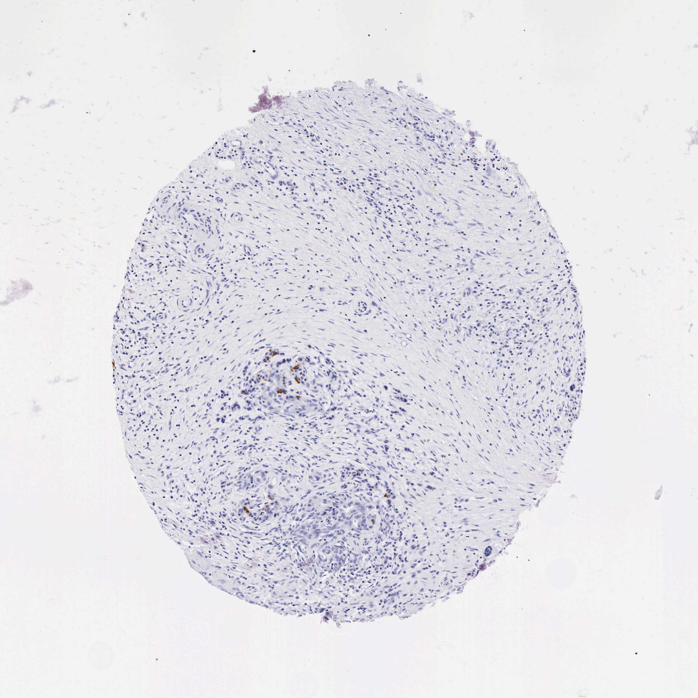

## 문제
73세 남자가 등으로 뻗치는 명치 통증이 약으로 조절되지 않아 췌장 부분절제술을 받았다. 25년 동안 술을 많이 마셨고 췌장염이 여러 번 재발하였으며, 기름지고 악취 나는 대변을 본다. 4년 전 당뇨병으로 진단되어 인슐린을 쓰는데, 적은 용량에도 심한 저혈당이 여러 번 있었다. 복부 CT에서 췌장 전체에 석회화가 있고 췌관이 늘어나 있었다. 절제 검체에서 샘꽈리 조직은 대부분 섬유 조직으로 바뀌어 있다. 절제한 췌장 조직 절편에 면역조직화학염색을 한 결과는 그림과 같다. 이 항체가 인식하는 항원으로 가장 적절한 것은?

- A. 인슐린
- B. 크로모그라닌 A
- C. 트립시노겐
- D. 사이토케라틴 19
- E. 글루카곤

_조직 마이크로어레이 코어의 면역조직화학염색(DAB 갈색 발색, 헤마톡실린 대조염색), 원 배율 (Human Protein Atlas, CC BY 4.0 — 크롭·보정 없음)_

## 정답 및 해설
> 정답: E

- **정답 핵심**: 코어는 섬유화가 심해 샘꽈리가 거의 없고, 흉터 속에 작은 내분비 세포 둥지가 남아 있다. 각 둥지에서 소수의 세포만 세포질이 진한 갈색이고 나머지 둥지 세포와 간질은 음성이다. 섬 세포의 소수에서 세포질에 나타나는 호르몬은 알파세포의 글루카곤이다. 인슐린이면 둥지 세포 대부분이, 크로모그라닌 A 면 전부가 갈색이어야 한다. 글루카곤 반대조절 반응의 소실은 만성 췌장염에 의한 당뇨병(3c 형)에서 심한 저혈당이 잘 생기는 이유다.
- **원리**: <b>왜 염색된 세포의 비율이 호르몬을 알려 주는가</b>: 섬은 여러 세포가 섞인 집단이다. 베타세포(인슐린)가 약 60~70 %, 알파세포(글루카곤)가 약 15~20 %, 델타세포(소마토스타틴)가 5~10 %, PP 세포가 그보다 적다. 한 호르몬에 대한 항체는 그 세포의 몫만큼만 둥지를 물들이고, 크로모그라닌 A 같은 범신경내분비 표지자는 거의 모든 섬 세포를 물들인다.  <b>왜 섬유화된 췌장에 섬이 남는가</b>: 만성 췌장염에서는 반복 손상이 샘꽈리를 먼저 없애고 섬유화로 바꾼다. 섬은 초기에 비교적 보존되어 흉터 속에 몰려 남고, 시간이 지나면 베타세포와 알파세포가 함께 줄어든다.  <b>임상적 의미</b>: 췌장성(3c 형) 당뇨병에서는 인슐린과 함께 저혈당에 대한 글루카곤 분비도 사라져, 적은 인슐린 용량에도 심한 저혈당이 생긴다. 흡수장애와 음주로 인한 섭취 부족이 위험을 더한다.
- **비교**: <table><thead><tr><th style="width:22%">구분</th><th style="width:39%">글루카곤(정답)</th><th>인슐린(가장 가까운 오답)</th></tr></thead><tbody> <tr><td>세포</td><td>알파세포</td><td>베타세포</td></tr> <tr><td>섬 세포 중 비율</td><td><b>소수</b>(약 15~20 %)</td><td>다수(약 60~70 %)</td></tr> <tr><td>둥지의 염색 양상</td><td>흩어진 몇 개 세포, 많은 세포는 음성</td><td>둥지 세포 대부분이 갈색</td></tr> <tr><td>저혈당에서 역할</td><td>첫 반대조절 호르몬</td><td>저혈당에서 분비 억제</td></tr> </tbody></table> 둥지마다 대부분의 세포가 갈색이면 인슐린, 모든 내분비 세포가 갈색이면 크로모그라닌 A 같은 범신경내분비 표지자다.
- **오답 이유**:
  - ① 인슐린은 둥지 세포의 소수가 아니라 대부분이 세포질 갈색일 때 정답이 되며, 베타세포가 섬 세포의 다수를 이루기 때문이다.
  - ② 크로모그라닌 A 는 내분비 세포 둥지의 모든 세포가 갈색일 때 정답이 되며, 모든 신경내분비 세포의 분비 과립에 있다.
  - ③ 트립시노겐은 꼭대기 쪽 효소원 과립을 가진 샘꽈리세포가 갈색일 때 정답이 되며, 이 코어에서는 샘꽈리가 대부분 섬유화로 바뀌었다.
  - ④ CK19 는 작은 내강을 둘러싼 췌관·세관 상피가 갈색일 때 정답이 되며, 흉터 속 세관 증식에서 볼 수 있다.
- **함정**: 췌장 섬의 항체면 인슐린이라고 단정하는 것 — 둥지 세포의 소수만 물들어 베타세포가 아니라 알파세포에 맞는다.
- **학습목표**: 섬유화된 췌장에서 남은 내분비 세포 둥지의 소수 세포만 세포질이 갈색인 양상을 읽고, 섬 세포의 소수를 이루는 알파세포의 글루카곤을 다수인 베타세포의 인슐린·범내분비 표지자·외분비 표지자와 구별한다
- **근거·출처**: Kumar V, Abbas AK, Aster JC. Robbins and Cotran Pathologic Basis of Disease, 10th ed. Ch. The Pancreas — chronic pancreatitis; Ch. The Endocrine System — islets · Hart PA, et al. Type 3c (pancreatogenic) diabetes mellitus secondary to chronic pancreatitis and pancreatic cancer. Lancet Gastroenterol Hepatol 2016;1:226-237 · Human Protein Atlas — GCG, pancreas tissue (CC BY 4.0) (교사용) · 작성자 판독(2026-10-19): 섬유화 속 내분비 세포 둥지, 소수 세포의 세포질만 갈색

## 출처
- Human Protein Atlas, GCG / Pancreas (CC BY 4.0), https://images.proteinatlas.org/40/255_A_1_3.jpg · Creative Commons Attribution 4.0 International · https://www.proteinatlas.org/about/licence
