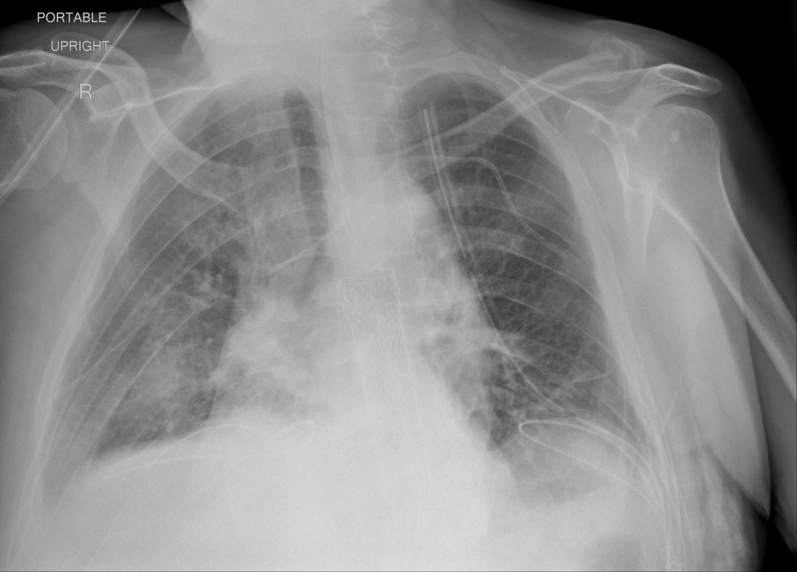

## 문제
A 64-year-old man is admitted to the intensive care unit because of worsening shortness of breath 9 days after the onset of fever and cough. A nasopharyngeal swab is positive for SARS-CoV-2 by RT-PCR. He is 175 cm (5 ft 9 in) tall and weighs 98 kg (216 lb). Despite high-flow nasal oxygen, he becomes exhausted and is intubated. On assist-control ventilation with an FIO2 of 0.6 and positive end-expiratory pressure of 10 cm H2O, arterial PO2 is 68 mm Hg. Echocardiography shows normal left ventricular size and function. A portable chest x-ray obtained after intubation is shown. Which of the following is the most appropriate initial tidal volume setting?

- A. 420 mL
- B. 280 mL
- C. 590 mL
- D. 700 mL
- E. 840 mL

_Portable anteroposterior chest radiograph; position labels as in the original (TCIA, CC BY 4.0; DICOM converted with a standard window, no cropping)_

## 정답 및 해설
> 정답: A

- **정답 핵심**: The portable chest x-ray shows patchy bilateral opacities around both hila, in the right mid and lower zones, and at the left base. With a PaO2/FIO2 ratio of 68/0.6 = 113 on PEEP 10 and normal left ventricular function, this is moderate ARDS. Tidal volume is set from predicted body weight, which depends on height and sex: 50 + 0.91 × (175 − 152.4) ≈ 71 kg. The initial target is 6 mL/kg PBW ≈ 420 mL, keeping plateau pressure at or below 30 cm H2O.
- **원리**: <b>Why predicted body weight, not actual weight</b>: lung size is determined by height and sex, not by body fat. A 98-kg man who is 175 cm tall has the lungs of a 71-kg man; scaling tidal volume to actual weight would overinflate the small amount of aerated lung that remains in ARDS (the "baby lung").  <b>Why 6 mL/kg</b>: in ARDS much of the lung is flooded or collapsed, so a normal tidal volume is delivered to a fraction of the alveoli and overstretches them (volutrauma), releasing inflammatory mediators (biotrauma). The ARDSNet trial showed that 6 mL/kg PBW with plateau pressure ≤ 30 cm H2O reduced mortality from about 40 % to 31 % compared with 12 mL/kg.  <b>How the image contributes</b>: bilateral opacities not fully explained by effusion, collapse, or nodules are one of the Berlin criteria; with acute onset, hypoxemia on PEEP ≥ 5, and no cardiac failure (normal echocardiogram), the diagnosis of ARDS is established.
- **비교**: <table><thead><tr><th style="width:22%">Feature</th><th style="width:39%">420 mL (answer)</th><th>590 mL (closest distractor)</th></tr></thead><tbody> <tr><td>Basis</td><td>6 mL/kg × <b>predicted</b> body weight (71 kg)</td><td>6 mL/kg × actual body weight (98 kg)</td></tr> <tr><td>Why that weight</td><td>Lung volume scales with height and sex</td><td>Fat does not add lung tissue</td></tr> <tr><td>Effect in ARDS</td><td>Protects the remaining aerated lung</td><td>Equals about 8.3 mL/kg PBW, overdistending alveoli</td></tr> </tbody></table> If plateau pressure stays above 30 cm H2O at 420 mL, the next step is to lower tidal volume toward 4 mL/kg PBW (about 280 mL), not to start there.
- **오답 이유**:
  - (B) 280 mL is 4 mL/kg PBW and would be correct only after 6 mL/kg yields a plateau pressure above 30 cm H2O; it is the lower limit, not the starting point.
  - (C) 590 mL would be correct only if the patient's actual weight equaled his predicted weight; using actual weight in an obese patient overdistends the lungs.
  - (D) 700 mL is about 10 mL/kg PBW and would be acceptable only in a patient without lung injury, such as during short elective anesthesia, not in ARDS.
  - (E) 840 mL is about 12 mL/kg PBW, the traditional volume used in the control arm of the ARDSNet trial, which had higher mortality.
- **함정**: Multiplying 6 mL/kg by the actual weight of 98 kg — tidal volume is based on predicted body weight from height and sex.
- **학습목표**: 바이러스 폐렴 뒤 양쪽 폐 음영·PaO2/FiO2 약 110·정상 좌심실 기능으로 중등도 급성호흡곤란증후군을 판정하고, 첫 일회호흡량을 실제 체중이 아니라 예측 체중 6 mL/kg 으로 정한다
- **근거·출처**: Acute Respiratory Distress Syndrome Network. Ventilation with lower tidal volumes as compared with traditional tidal volumes for acute lung injury and ARDS. N Engl J Med 2000;342:1301-1308 · ARDS Definition Task Force. Acute respiratory distress syndrome: the Berlin Definition. JAMA 2012;307:2526-2533 · TCIA COVID-19-AR collection (CC BY 4.0) (교사용) · 작성자 판독(2026-10-19): 양쪽 폐문 주위·오른쪽 중하폐야·왼쪽 폐저부의 반점상 음영

## 출처
- COVID-19-AR, The Cancer Imaging Archive (CC BY 4.0) · series …42942232 · Creative Commons Attribution 4.0 International · https://www.cancerimagingarchive.net/data-usage-policies-and-restrictions/
