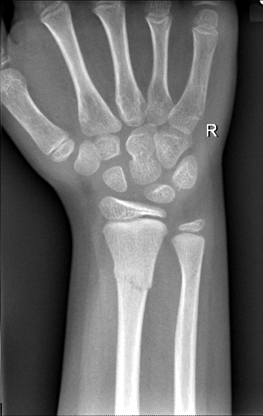

## 문제
7세 여아가 2시간 전 놀이터 구름사다리에서 떨어지며 오른손을 짚은 뒤 손목이 아파 움직이지 않으려 해 응급실에 왔다. 이전에 골절된 적은 없다. 활력징후는 정상이다. 손목 주름에서 약 3 cm 근위부의 원위 전완에 부종과 국소 압통이 있으나 눈에 보이는 변형은 없다. 요골동맥 맥박, 모세혈관 재충혈과 손의 감각은 정상이고 모든 손가락을 굽히고 펼 수 있다. 오른쪽 손목 전후면 X선 사진은 그림과 같다. 이 손상을 가장 잘 설명하는 것은?

- A. 골편 없이 원위 요골 성장판이 벌어진 Salter-Harris 1형 골절
- B. 원위 요골·척골은 정상이고 주상골 허리에 전위 없는 골절
- C. 원위 요골 몸통 골절과 원위 요척관절의 탈구가 함께 있는 손상
- D. 성장판을 침범하지 않은 원위 요골 골간단 골절과 원위 척골 골간단 융기 골절
- E. 원위 요골 성장판을 지나 골간단 골편을 남긴 Salter-Harris 2형 골절

_오른쪽 손목·원위 전완 전후면 X선, 위치 표지는 원본의 것, 크기 조정만 (GRAZPEDWRI-DX, figshare, CC BY 4.0)_

## 정답 및 해설
> 정답: D

- **정답 핵심**: 원위 요골 골간단을 성장판에서 약 3 cm 근위부에서 가로지르는 골절선과 요측 피질의 작은 단차가 있고, 원위 척골 골간단 피질이 살짝 부풀어 있다(융기 골절). 두 성장판은 열려 있고 골절선이 닿지 않으므로 Salter-Harris 손상이 아니라 골간단 골절이다. 손목 주름 3 cm 근위부의 압통 위치도 골간단과 맞는다.
- **원리**: <b>왜 소아의 원위 전완 골절은 모양이 다른가</b>: 소아의 골간단은 구멍이 많고 골막이 두껍고 느슨하게 붙어 있다. 압박 힘을 받으면 얇은 피질이 부러지지 않고 구겨져 융기(torus) 골절이 되고, 힘이 더 크면 한쪽 골막이 남은 채 골간단을 가로지르는 완전 골절이 된다.  <b>왜 성장판 침범 여부가 중요한가</b>: 성장판은 비대층이 가장 약하다. Salter-Harris 골절은 이 연골을 지나므로 길이 성장을 방해할 수 있어 더 가까이 추적한다. 골간단 골절은 성장 연골을 피하고, 빨리 자라는 원위 요골 성장판 가까이에 있어 재형성이 잘 된다.  <b>영상 읽는 법</b>: 요측에서 척측까지 투명한 성장판 선을 따라가 골절선이 한 번도 닿지 않으면 골간단 골절이다. 그다음 척골을 본다 — 양쪽 뼈 손상에서 척골 쪽은 미세한 융기인 경우가 많다.
- **비교**: <table><thead><tr><th style="width:22%">구분</th><th style="width:39%">성장판을 피한 골간단 골절(정답)</th><th>Salter-Harris 2형(가장 가까운 오답)</th></tr></thead><tbody> <tr><td>골절선</td><td>골간단을 가로지르고 성장판에 <b>닿지 않는다</b></td><td>성장판을 따라가다 골간단으로 빠진다</td></tr> <tr><td>골편</td><td>골단에 붙은 골편 없음</td><td>삼각형 골간단 골편(Thurston-Holland)</td></tr> <tr><td>성장 장애 위험</td><td>매우 낮다</td><td>낮지만 있다 — 추적 필요</td></tr> <tr><td>압통 위치</td><td>손목 주름보다 근위부</td><td>성장판 높이</td></tr> </tbody></table> 골절선이 열린 성장판을 따라가다 골간단 모서리로 빠졌다면 Salter-Harris 2형이 정답이다.
- **오답 이유**:
  - ① Salter-Harris 1형은 골간단 골절선 없이 골단이 밀리거나 성장판이 벌어지고 압통이 정확히 성장판 높이에 있을 때 정답이 된다.
  - ② 주상골 허리 골절은 압통이 해부학적 코담뱃갑에 있고 주상골을 가로지르는 선이 보일 때 정답이 되며, 골격이 성숙하기 전에는 드물다.
  - ③ 갈레아치 손상은 요골 몸통이 부러지고 원위 척골이 원위 요척관절에서 요골과 어긋나 있을 때 정답이 된다.
  - ⑤ Salter-Harris 2형은 골절선이 성장판을 따라가다 골간단으로 빠져 삼각형 골간단 골편을 남길 때 정답이 된다.
- **함정**: 소아의 원위 요골 골절을 모두 Salter-Harris 손상으로 부르는 것 — 이 골절선은 골간단에 머물고 성장판은 온전하다.
- **학습목표**: 소아 손목 전후면 X선에서 원위 요골 골간단을 가로지르는 골절선이 열린 성장판에 닿지 않고 원위 척골 골간단 피질이 융기한 것을 읽어, 성장판 골절(Salter-Harris)과 구별한다
- **근거·출처**: Kliegman RM, et al. Nelson Textbook of Pediatrics, 21st ed. Ch. Common fractures — distal forearm fractures · Nagy E, et al. A pediatric wrist trauma X-ray dataset (GRAZPEDWRI-DX) for machine learning. Sci Data 2022;9:222 · GRAZPEDWRI-DX (figshare, CC BY 4.0) — 소아영상의학 전문의 주석 AO 23r-M/3.1, 23u-M/2.1 (교사용) · 작성자 판독(2026-10-19): 원위 요골 골간단 가로 골절선, 요측 피질 단차, 원위 척골 골간단 피질 융기, 성장판 침범 없음

## 출처
- GRAZPEDWRI-DX (figshare, CC BY 4.0) · Creative Commons Attribution 4.0 International · https://creativecommons.org/licenses/by/4.0/
