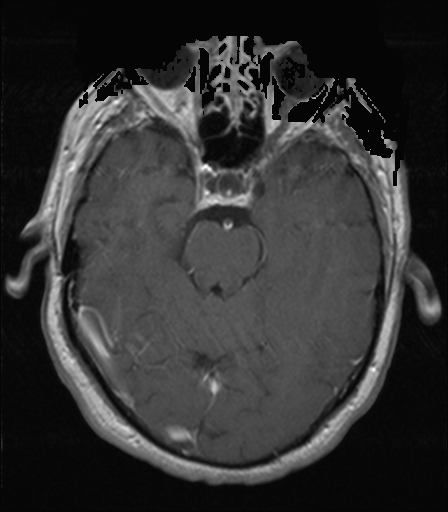

## 문제
A 73-year-old man comes to the physician because of headaches and difficulty finding words for 3 weeks. He has hypertension treated with amlodipine. Temperature is 36.8°C (98.2°F), pulse is 78/min, and blood pressure is 138/84 mm Hg. He has mild expressive aphasia; the rest of the neurologic examination shows no abnormalities. MRI of the brain with gadolinium shows an enhancing intra-axial mass on higher sections. An axial T1-weighted MRI of the brain obtained after gadolinium administration at the level of the midbrain is shown. The normal brain parenchyma on this image does not enhance, whereas the dural venous sinus does. Which of the following structures is primarily responsible for this difference?

- A. Arachnoid barrier cells beneath the dura mater
- B. Tight junctions between capillary endothelial cells
- C. Foot processes of astrocytes surrounding the capillaries
- D. Pericytes embedded in the capillary basement membrane
- E. Ependymal cells lining the cerebral ventricles

_Axial brain MRI, standard display orientation (patient's right on the viewer's left) (The Cancer Imaging Archive, CC BY 4.0; DICOM converted, no cropping)_

## 정답 및 해설
> 정답: B

- **정답 핵심**: On this postcontrast T1-weighted image, cerebrospinal fluid is dark, scalp fat is bright, and the dural venous sinus is bright because gadolinium stays in the blood there, but the brain parenchyma does not enhance. Gadolinium cannot leave brain capillaries because continuous endothelial cells are sealed by tight junctions (claudin-5, occludin) and have few transcytotic vesicles — the blood-brain barrier. Tumors such as high-grade glioma make leaky vessels without these junctions, so they enhance.
- **원리**: <b>What contrast enhancement means</b>: gadolinium shortens T1 and makes tissue bright only where it reaches. Inside blood vessels and venous sinuses it is always bright; in tissue it is bright only where it can leak out of capillaries into the extracellular space.  <b>What forms the barrier</b>: brain capillary endothelial cells are joined by continuous tight junctions (claudin-5, occludin, ZO-1), lack fenestrations, and have little pinocytosis, so even small molecules such as gadolinium chelates cannot pass. Astrocyte end-feet and pericytes surround the capillary and induce and maintain these endothelial properties, but the seal itself is the endothelial tight junction.  <b>Where enhancement is normal</b>: structures outside the barrier — dural sinuses and dura, choroid plexus, pituitary, and circumventricular organs such as the area postrema — enhance normally. In tumors, abscesses, demyelination, and subacute infarcts the barrier breaks down and parenchyma enhances.
- **비교**: <table><thead><tr><th style="width:22%">Feature</th><th style="width:39%">Endothelial tight junctions (answer)</th><th>Astrocyte foot processes (closest distractor)</th></tr></thead><tbody> <tr><td>Role</td><td><b>Physically seal</b> the gap between endothelial cells</td><td>Induce and maintain the endothelial barrier phenotype</td></tr> <tr><td>Proteins</td><td>Claudin-5, occludin, ZO-1</td><td>Aquaporin-4 water channels, glucose transport support</td></tr> <tr><td>Small molecule passage</td><td>Blocked</td><td>Gaps between end-feet allow passage</td></tr> <tr><td>Loss leads to</td><td>Contrast leakage and vasogenic edema</td><td>Barrier weakens indirectly over time</td></tr> </tbody></table> Astrocytes tell endothelial cells to form the barrier, but the structure that actually stops gadolinium is the tight junction between endothelial cells.
- **오답 이유**:
  - (A) Arachnoid barrier cells would be the answer if the question concerned separation of dural blood from subarachnoid cerebrospinal fluid, not from brain parenchyma.
  - (C) Astrocyte foot processes would be the answer if the question asked which cells induce the barrier or regulate water through aquaporin-4; they do not form the seal.
  - (D) Pericytes would be the answer if the question asked which contractile cells regulate capillary blood flow and support barrier development, not which structure blocks leakage.
  - (E) Ependymal cells would be the answer if the question concerned exchange between cerebrospinal fluid and brain interstitium, which they do not block because they lack tight junctions.
- **함정**: Choosing astrocyte foot processes because they wrap the capillaries — they induce the barrier, but the seal is the endothelial tight junction.
- **학습목표**: 조영 후 T1 MRI 에서 경막 정맥동은 증강되고 뇌실질은 증강되지 않음을 읽고, 혈액뇌장벽을 이루는 구조가 모세혈관 내피세포 사이의 치밀연접임을 안다
- **근거·출처**: Kandel ER, et al. Principles of Neural Science, 6th ed. Ch. The blood-brain barrier · Abbott NJ, et al. Structure and function of the blood-brain barrier. Neurobiol Dis 2010;37:13-25 · TCIA UPENN-GBM collection (CC BY 4.0) (교사용) · 작성자 판독(2026-10-19): 조영 후 T1, 오른쪽 가로정맥동 증강·뇌실질 증강 없음, 이 단면에 종괴 없음

## 출처
- The Cancer Imaging Archive (CC BY 4.0) · series …32629006 · Creative Commons Attribution 4.0 International · https://www.cancerimagingarchive.net/data-usage-policies-and-restrictions/
