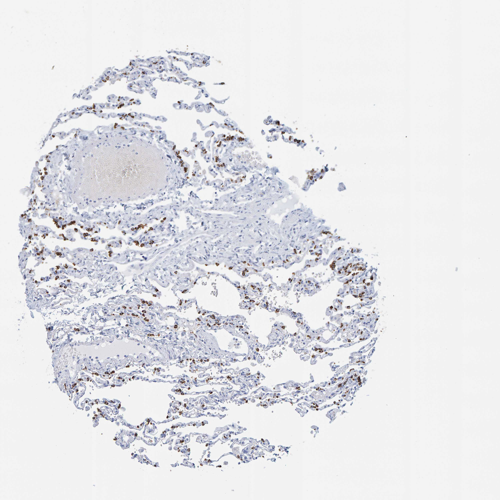

## 문제
A 21-year-old man comes to the emergency department because of sudden right-sided chest pain and shortness of breath that began while he was sitting at his desk 3 hours ago. He has had a similar episode on the same side 6 months ago that resolved with needle aspiration. He is 188 cm (6 ft 2 in) tall and weighs 64 kg (141 lb), and he smokes half a pack of cigarettes daily. Breath sounds are decreased over the right hemithorax. A chest x-ray shows a right apical pneumothorax. Because of recurrence, he undergoes video-assisted thoracoscopic resection of an apical bleb. A photomicrograph of a section of the resected lung tissue stained by immunohistochemistry is shown. The antibody most likely recognizes which of the following antigens?

- A. Surfactant protein C
- B. Macrosialin (CD68)
- C. CD31 (PECAM-1)
- D. Podoplanin (D2-40)
- E. Smooth muscle actin

_Immunohistochemical stain of a tissue microarray core (DAB brown chromogen, hematoxylin counterstain), original magnification (Human Protein Atlas, CC BY 4.0; no cropping or color adjustment)_

## 정답 및 해설
> 정답: A

- **정답 핵심**: The core shows alveolar walls in which scattered small round cells, often clustered, have brown cytoplasm, while the thin flat cells lining most of the alveolar surface, the capillary endothelium, the walls of the large vessels, and free cells in the alveolar spaces are negative. Scattered cuboidal cells set into the alveolar wall are type II pneumocytes, and the protein made only by them is surfactant protein C.
- **원리**: <b>Why a type II pneumocyte marker stains only scattered cells</b>: type I pneumocytes cover about 95 % of the alveolar surface but are thin squamous cells, whereas type II pneumocytes are more numerous but small and cuboidal, sitting at the corners of the alveolar walls. A cytoplasmic marker of type II cells therefore lights up dots along the septa rather than a continuous line.  <b>Why SP-C is specific</b>: surfactant proteins A, B, and D are also made by club cells, but SP-C is synthesized only by type II pneumocytes; its precursor (pro-SP-C) is stored with lipids in lamellar bodies, so the stain is cytoplasmic and granular.  <b>Clinical connection</b>: type II cells are the progenitors that regenerate type I cells after injury, and mutations in SFTPC cause familial interstitial lung disease. In this patient, the lung away from the bleb is normal; the tall, thin smoking man with recurrent apical pneumothorax is the background, not the answer.
- **비교**: <table><thead><tr><th style="width:22%">Feature</th><th style="width:39%">Surfactant protein C (answer)</th><th>CD68 (closest distractor)</th></tr></thead><tbody> <tr><td>Cell</td><td>Type II pneumocyte</td><td>Alveolar macrophage</td></tr> <tr><td>Location</td><td><b>Within</b> the alveolar wall, at septal corners</td><td>Free in the alveolar space or loosely attached</td></tr> <tr><td>Shape</td><td>Small, cuboidal, evenly scattered along septa</td><td>Larger, round, with abundant (often pigmented) cytoplasm</td></tr> <tr><td>Staining</td><td>Granular cytoplasm (lamellar bodies)</td><td>Granular cytoplasm (lysosomes)</td></tr> </tbody></table> Both are cytoplasmic and granular, so location is the discriminator: cells built into the septa favor SP-C, cells floating in the lumen favor CD68.
- **오답 이유**:
  - (B) CD68 would be correct if the brown cells were large round cells floating free within the alveolar spaces, the position of alveolar macrophages.
  - (C) CD31 would be correct if a continuous thin brown line outlined every septal capillary and the endothelium of the large vessels, which are negative here.
  - (D) Podoplanin would be correct if the thin flat cells lining most of the alveolar surface (type I pneumocytes) and lymphatics were stained.
  - (E) Smooth muscle actin would be correct if the media of the large vessels and the bronchiolar walls were brown, but the vessel walls here are negative.
- **함정**: Choosing CD68 because the stained cells are small, round, and granular — their position inside the alveolar wall, not in the lumen, marks type II pneumocytes.
- **학습목표**: 폐포벽을 따라 흩어진 작고 둥근 세포만 세포질이 갈색인 양상을 제2형 폐포세포의 표면활성 단백질 C 로 읽고, 제1형 폐포세포·내피·대식세포 표지자와 구별한다
- **근거·출처**: Kumar V, Abbas AK, Aster JC. Robbins and Cotran Pathologic Basis of Disease, 10th ed. Ch. The Lung — normal structure · Whitsett JA, Weaver TE. Hydrophobic surfactant proteins in lung function and disease. N Engl J Med 2002;347:2141-2148 · Human Protein Atlas — SFTPC, lung tissue (CC BY 4.0) (교사용) · 작성자 판독(2026-10-20): 폐포벽 속 작고 둥근 세포의 세포질만 갈색, 피복세포·내피·폐포 내 세포 음성

## 출처
- Human Protein Atlas, SFTPC / Lung (CC BY 4.0), https://images.proteinatlas.org/10928/51559_A_1_4.jpg · Creative Commons Attribution 4.0 International · https://www.proteinatlas.org/about/licence
