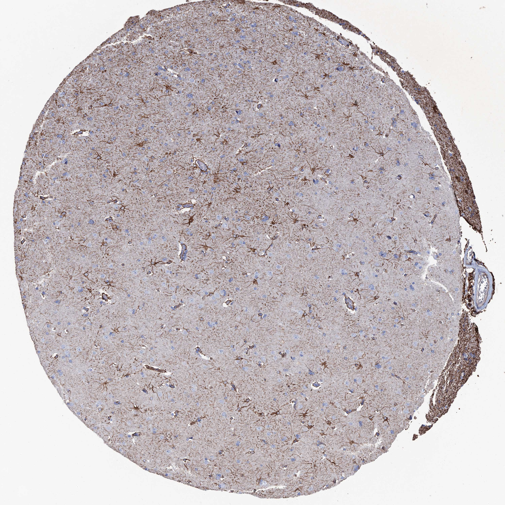

## 문제
A 62-year-old man is brought to the physician by his wife because of a 2-month history of progressive weakness of the left leg and episodes of left foot twitching. He has hypertension treated with amlodipine. Strength is 4/5 in the left lower extremity, and the Babinski sign is present on the left. MRI of the brain shows a 4-cm dural-based, homogeneously enhancing mass over the right parasagittal frontal convexity. The mass is resected together with a thin rim of the adjacent cerebral cortex. A photomicrograph of a section of the adjacent cortex stained by immunohistochemistry is shown. The antibody most likely recognizes which of the following antigens?

- A. Glial fibrillary acidic protein
- B. Neuronal nuclear antigen (NeuN)
- C. Macrosialin (CD68)
- D. Myelin basic protein
- E. Neurofilament light chain protein

_Immunohistochemical stain of a tissue microarray core (DAB brown chromogen, hematoxylin counterstain), original magnification (Human Protein Atlas, CC BY 4.0; no cropping or color adjustment)_

## 정답 및 해설
> 정답: A

- **정답 핵심**: Throughout the neuropil, scattered star-shaped cells have brown cell bodies with many fine radiating processes, some ending on small vessels, and there is a dense brown band beneath the pial surface. The large neuronal cell bodies are pale blue and negative. Star-shaped cells whose processes form perivascular end-feet and the subpial glia limitans are astrocytes, and their intermediate filament is glial fibrillary acidic protein.
- **원리**: <b>Why the shape of the stained cell identifies the filament</b>: intermediate filaments are cell-type specific. Astrocytes are filled with GFAP, which runs from the cell body out into every process, so a GFAP stain draws the whole star: the soma, radiating processes, end-feet wrapping capillaries, and the glia limitans under the pia.  <b>What the negative cells tell you</b>: neurons contain neurofilaments and nuclear NeuN, not GFAP, so their large cell bodies stay blue. Microglia (CD68, Iba1) are small, elongated cells with few processes, and oligodendrocytes are small round cells with a perinuclear halo that make myelin rather than filaments.  <b>Clinical use</b>: GFAP marks reactive gliosis (astrocytes swell and become more strongly positive next to a lesion such as this meningioma) and confirms glial origin in tumors such as astrocytoma and glioblastoma.
- **비교**: <table><thead><tr><th style="width:22%">Feature</th><th style="width:39%">GFAP (answer)</th><th>Neurofilament (closest distractor)</th></tr></thead><tbody> <tr><td>Cell</td><td>Astrocyte</td><td>Neuron</td></tr> <tr><td>Pattern</td><td>Small soma with many short radiating processes (star)</td><td>Large soma with long axons and dendrites</td></tr> <tr><td>Subpial band</td><td><b>Present</b> (glia limitans)</td><td>Absent</td></tr> <tr><td>Perivascular end-feet</td><td>Present</td><td>Absent</td></tr> </tbody></table> If the large pyramidal cell bodies and their long processes were brown and the small star-shaped cells were blue, the antigen would be a neuronal filament.
- **오답 이유**:
  - (B) NeuN would be correct if the nuclei of the large neuronal cell bodies were brown, whereas here the neurons are the negative pale cells.
  - (C) CD68 would be correct if small elongated microglia or foamy macrophages were stained, rather than star-shaped cells with long processes.
  - (D) Myelin basic protein would be correct if the stain followed myelinated fiber tracts, which are sparse in the cortex and densest in white matter.
  - (E) Neurofilament protein would be correct if large neuronal cell bodies with long axons and dendrites were brown instead of small star-shaped cells.
- **함정**: Choosing a neuronal marker because the tissue is cerebral cortex — the stained cells are small star-shaped cells, and the neurons are negative.
- **학습목표**: 대뇌 피질에서 별 모양 세포의 세포체·돌기와 연막 아래 띠가 갈색이고 신경세포는 음성인 양상을 성상세포의 중간섬유 GFAP 로 읽고, 신경세포·미세아교세포·희소돌기아교세포 표지자와 구별한다
- **근거·출처**: Kumar V, Abbas AK, Aster JC. Robbins and Cotran Pathologic Basis of Disease, 10th ed. Ch. The Central Nervous System — cellular pathology · Louis DN, et al. The 2021 WHO Classification of Tumors of the Central Nervous System: a summary. Neuro Oncol 2021;23:1231-1251 · Human Protein Atlas — GFAP, cerebral cortex (CC BY 4.0) (교사용) · 작성자 판독(2026-10-20): 별 모양 세포의 세포체·돌기와 연막 아래 띠가 갈색, 신경세포 음성

## 출처
- Human Protein Atlas, GFAP / Cerebral cortex (CC BY 4.0), https://images.proteinatlas.org/39/98649_B_9_5.jpg · Creative Commons Attribution 4.0 International · https://www.proteinatlas.org/about/licence
