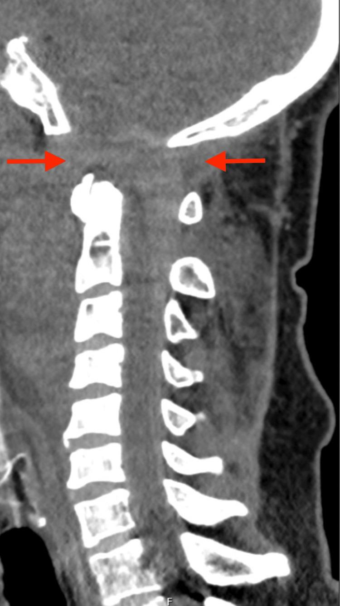

## 문제
42세 남자가 고속도로에서 오토바이를 타다 앞차와 충돌하여 응급실에 실려 왔다. 현장에서 경추 보호대를 하였다. 기관삽관 뒤 혈압 112/70 mmHg, 맥박 96회/분이다. 진정 전 진찰에서 양쪽 팔다리의 근력이 4등급으로 약했고, 오른쪽 외전신경 마비가 있었다. 흉부·복부·골반 CT에서 출혈은 없었다. 경추 정중시상 CT 재구성 영상은 그림과 같다. 이 환자에게 가장 적절한 치료는?

- A. 할로 조끼 단독 고정 12주
- B. 후두-경추 고정술
- C. 두개골 집게 견인
- D. 연성 경추 보조기 착용 후 6주 뒤 추적 CT
- E. 고용량 메틸프레드니솔론 24시간 정주

_경추 정중시상 CT 재구성 뼈창, 화살표와 아래 방향 표지는 원 그림의 것 (PMC Open Access Subset, CC BY — 크롭·보정 없음)_

## 정답 및 해설
> 정답: B

- **정답 핵심**: 정중시상 CT에서 기저골(basion)과 치아돌기 끝·환추 앞고리 사이가 크게 벌어져 있고 그 사이 연부조직이 넓다. 아래 경추의 정렬은 보존되어 있다. 고속 충돌 뒤 사지 근력 약화와 외전신경 마비가 함께 있으면 후두골과 환추를 잇는 인대(덮개막·날개인대)가 끊어진 환추-후두 탈구다. 인대성 손상이라 저절로 붙지 않으므로 견인을 피하고 내고정(후두-경추 고정술)으로 안정화한다.
- **원리**: <b>왜 두개-경추 이음부는 인대가 버티는가</b>: 후두과와 환추 외측괴 사이 관절은 얕아서, 머리를 척추에 붙들어 두는 것은 덮개막(tectorial membrane)·날개인대·첨인대 같은 인대다. 고속 감속 손상에서 머리가 앞뒤로 크게 흔들리면 이 인대가 끊어지고 머리가 척추에서 떨어진다.  <b>영상에서 무엇을 재는가</b>: 기저골-치아돌기 간격(BDI)이 성인에서 약 8.5~10 mm 를 넘거나 후두과-환추 관절 간격이 넓으면 환추-후두 탈구를 의심한다. 이 그림은 그 간격이 눈에 띄게 벌어져 있다.  <b>왜 견인이 위험한가</b>: 이미 인대가 끊어져 벌어진 이음부를 잡아당기면 간격이 더 벌어져 숨뇌·척수와 척추동맥이 늘어나 손상이 악화된다. 인대는 뼈처럼 유합되지 않으므로 외고정만으로는 실패가 많고, 후두골과 상부 경추를 나사·막대로 고정하는 수술이 표준 치료다. 그 전까지는 모래주머니·경추 보호대로 움직임을 막는다.
- **비교**: <table><thead><tr><th style="width:22%">구분</th><th style="width:39%">후두-경추 고정술(정답)</th><th>두개골 집게 견인(가장 가까운 오답)</th></tr></thead><tbody> <tr><td>잘 맞는 손상</td><td>인대성 환추-후두 탈구</td><td>아래 경추의 탈구·골절 정복</td></tr> <tr><td>작용</td><td>벌어진 이음부를 그 자리에 고정</td><td>세로 방향으로 잡아당겨 정렬</td></tr> <tr><td>이 환자에게</td><td>인대가 붙지 않으므로 내고정이 필요</td><td><b>간격을 더 벌려</b> 숨뇌·척수 손상 악화</td></tr> </tbody></table> 같은 고속 충돌이라도 아래 경추의 면관절 탈구라면 견인 정복이 쓰이지만, 두개-경추 이음부의 인대 손상에서는 견인이 금기다.
- **오답 이유**:
  - ① 할로 조끼 단독 고정은 일부 치아돌기·환추 골절처럼 뼈가 붙을 손상에 쓰며, 인대성 탈구에서는 실패가 많아 수술 전 임시로만 쓴다.
  - ③ 두개골 집게 견인은 아래 경추의 면관절 탈구를 정복할 때 쓰며, 이 손상에서는 벌어진 이음부를 더 벌려 신경 손상을 악화시킨다.
  - ④ 연성 보조기 후 추적은 인대 손상 없이 근육 염좌만 있을 때 맞는 처치이고, 불안정한 인대 손상에서는 신경 손상을 막지 못한다.
  - ⑤ 고용량 메틸프레드니솔론은 감염·위장관출혈 위험 때문에 급성 척수손상에서 일상적으로 권하지 않으며, 불안정성을 고치지 못한다.
- **함정**: 고속 충돌 뒤 경추 손상이면 견인으로 정렬부터 맞춘다고 생각하는 것 — 두개-경추 이음부의 인대 손상은 견인이 간격을 더 벌린다.
- **학습목표**: 경추 정중시상 CT 에서 기저골과 치아돌기 끝·환추 사이가 크게 벌어진 것을 환추-후두 탈구로 읽고, 견인을 피하고 후두-경추 고정술로 치료함을 안다
- **근거·출처**: Theodore N, et al. The diagnosis and management of traumatic atlanto-occipital dislocation injuries. Neurosurgery 2013;72 Suppl 2:114-126 · Townsend CM, et al. Sabiston Textbook of Surgery, 21st ed. Ch. Spine trauma · PMC Open Access Subset — 증례 보고 Figure 2 (CC BY) (교사용) · 작성자 판독(2026-10-20): 기저골과 치아돌기 끝·환추 사이 간격이 크게 벌어지고 연부조직이 넓음, 아래 경추 정렬 보존

## 출처
- Atlanto-Occipital Dissociation With Catastrophic Neurological Injury: Ethical Challenges in the Intensive Care Setting. Cureus. 2025 Dec 13;17(12):e99105. doi: 10.7759/cureus.99105 (CC BY) — Figure 2 · CC BY · https://creativecommons.org/licenses/
