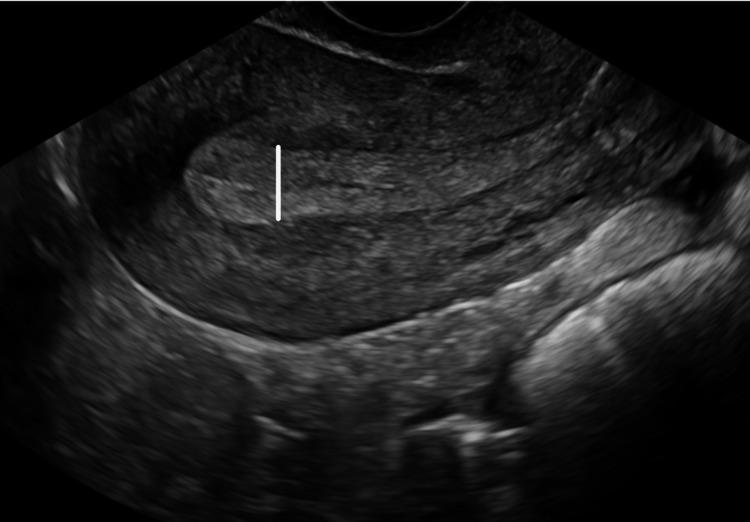

## 문제
65세 여자가 2주 전부터 생긴 질출혈로 왔다. 13년 전 폐경되었고 그 뒤 호르몬제를 먹은 적은 없다. 출산 3회이며 당뇨병과 고혈압으로 약을 먹는다. 키 155 cm, 체중 72 kg이다. 질경 검사에서 자궁경부는 육안으로 정상이고 자궁 안에서 적은 양의 피가 흘러나온다. 1년 전 자궁경부 세포검사는 정상이었다. 혈색소 12.4 g/dL이다. 경질 초음파 자궁 시상면 영상은 그림과 같으며 자궁내막 두께는 14 mm이다. 다음 단계로 가장 적절한 것은?

- A. 복강경 자궁절제술
- B. 자궁경부 세포검사 반복
- C. 자궁내막 조직검사
- D. 3개월 뒤 경질 초음파 재검
- E. 프로게스틴 3개월 투여 후 재평가

_경질 초음파 자궁 시상면, 흰 계측 막대는 원 그림의 것 (PMC Open Access Subset, CC BY — 크롭·보정 없음)_

## 정답 및 해설
> 정답: C

- **정답 핵심**: 경질 초음파에서 자궁내막이 고에코로 두껍고(계측 막대) 14 mm 로 측정된다. 폐경 후 출혈에서 자궁내막 두께가 4 mm 이하이면 자궁내막암 가능성이 매우 낮지만, 4 mm 를 넘으면 암·증식증을 배제할 수 없으므로 조직을 얻어야 한다. 비만·당뇨병·고혈압은 길항되지 않는 에스트로겐 노출로 위험을 더 높인다. 진단 없이 관찰·호르몬 치료·수술로 넘어가지 않는다.
- **원리**: <b>왜 내막 두께가 기준이 되는가</b>: 폐경 뒤에는 난소 에스트로겐이 거의 없어 자궁내막이 얇게(대개 4 mm 이하) 위축된다. 위축 내막에서 생기는 출혈은 대부분 양성(위축성 자궁내막염)이고, 두께가 4 mm 이하이면 자궁내막암의 음성예측도가 99 % 를 넘는다.  <b>왜 두꺼우면 조직이 필요한가</b>: 폐경 후에도 내막이 두껍다는 것은 지방조직의 방향화효소가 만든 에스트로겐, 에스트로겐을 내는 난소 종양 같은 <b>길항되지 않는 에스트로겐</b> 자극이 있다는 뜻이고, 이것이 자궁내막 증식증→자궁내막모양 선암의 경로를 만든다. 초음파는 두께만 보여 줄 뿐 세포의 비정형성을 말해 주지 못하므로, 외래 흡인 조직검사(또는 자궁경 하 생검·소파술)로 진단한다.  <b>순서</b>: 진단(조직) → 병기(영상) → 치료(수술). 조직 없이 호르몬을 쓰면 암을 가리고 치료를 늦춘다.
- **비교**: <table><thead><tr><th style="width:22%">구분</th><th style="width:39%">자궁내막 조직검사(정답)</th><th>3개월 뒤 초음파 재검(가장 가까운 오답)</th></tr></thead><tbody> <tr><td>잘 맞는 경우</td><td>폐경 후 출혈 + 내막 <b>4 mm 초과</b></td><td>폐경 후 출혈 + 내막 4 mm 이하이고 출혈이 멈춤</td></tr> <tr><td>왜 그 기준인가</td><td>4 mm 초과에서는 암을 배제할 수 없다</td><td>4 mm 이하이면 암의 음성예측도 99 % 이상</td></tr> <tr><td>목적</td><td>세포의 비정형성·암을 조직으로 확인</td><td>위축 내막에서 출혈 재발 여부 관찰</td></tr> </tbody></table> 내막이 얇아도 출혈이 계속되면 조직검사로 넘어간다 — 지속 출혈은 두께와 무관하게 조직검사의 적응증이다.
- **오답 이유**:
  - ① 복강경 자궁절제술은 조직검사로 비정형 증식증이나 자궁내막암이 확인된 뒤의 치료이며, 진단 없이 먼저 하지 않는다.
  - ② 자궁경부 세포검사는 자궁경부에서 피가 나거나 경부암 선별 간격이 되었을 때 맞고, 자궁 안에서 나오는 출혈의 원인을 밝히지 못한다.
  - ④ 3개월 뒤 초음파 재검은 자궁내막이 4 mm 이하이고 출혈이 한 번으로 멈춘 경우에 맞으며, 14 mm 에서는 암 진단을 늦춘다.
  - ⑤ 프로게스틴 투여는 조직검사로 비정형성이 없는 증식증이 확인된 뒤에 쓰며, 진단 전에 쓰면 암을 가리고 병기를 놓친다.
- **함정**: 폐경 후 소량 출혈을 위축 때문으로 보고 경과 관찰하는 것 — 내막 두께 14 mm 는 4 mm 기준을 넘어 조직검사가 필요하다.
- **학습목표**: 폐경 후 출혈 여성의 경질 초음파에서 4 mm 를 넘는 두꺼운 자궁내막을 읽고, 다음 단계로 자궁내막 조직검사를 선택한다
- **근거·출처**: American College of Obstetricians and Gynecologists. Committee Opinion No. 734: The role of transvaginal ultrasonography in evaluating the endometrium of women with postmenopausal bleeding. Obstet Gynecol 2018;131:e124-e129 · Berek JS. Berek & Novak's Gynecology, 16th ed. Ch. Uterine Cancer · PMC Open Access Subset — 증례 보고 Figure 1 (CC BY) (교사용) · 작성자 판독(2026-10-20): 고에코로 두꺼운 자궁내막, 근층과 경계 뚜렷

## 출처
- A Rare Case of Granulosa Cell Tumor Associated With Endometrial Carcinoma - A Case Report. Cureus. 2022 Nov 5;14(11):e31122. doi: 10.7759/cureus.31122 (CC BY) — Figure 1 · CC BY · https://creativecommons.org/licenses/
