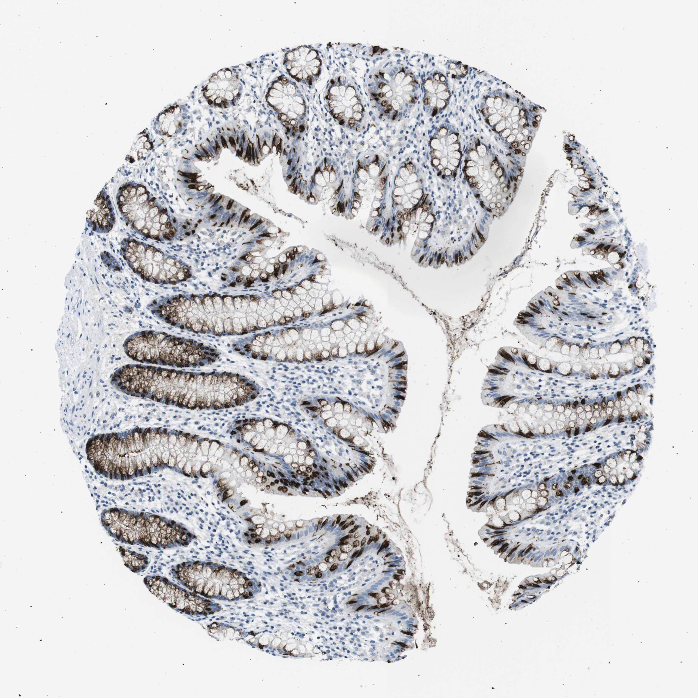

## 문제
A 56-year-old woman comes to the physician because of a 4-month history of nonbloody watery diarrhea, three to four times daily, without weight loss or nocturnal symptoms. She takes no medications and does not drink alcohol. Abdominal examination shows no abnormalities. Stool cultures, ova and parasite examination, serum tissue transglutaminase IgA, and thyroid-stimulating hormone are normal. A colonoscopy shows normal-appearing mucosa, and random biopsy specimens are obtained from the colon. A photomicrograph of a section of the colonic mucosa stained by immunohistochemistry is shown. The antibody most likely recognizes which of the following antigens?

- A. Chromogranin A
- B. Caudal-type homeobox 2 (CDX2)
- C. Carcinoembryonic antigen
- D. Mucin 5AC (MUC5AC)
- E. Mucin 2 (MUC2)

_Immunohistochemical stain of a tissue microarray core (DAB brown chromogen, hematoxylin counterstain), original magnification (Human Protein Atlas, CC BY 4.0; no cropping or color adjustment)_

## 정답 및 해설
> 정답: E

- **정답 핵심**: The brown chromogen fills the large mucin vacuoles of the goblet cells that line every crypt, and small compressed goblet cells at the crypt base and surface are darkly stained, while the nuclei, the intervening absorptive cells, and the lamina propria are negative. A secretory product stored in colonic goblet-cell mucin vacuoles is the gel-forming mucin MUC2. [핵심 판단] 대장 음와의 술잔세포 점액 공포 안만 갈색이고 핵·흡수세포·고유판은 음성이다. 대장 술잔세포가 저장하는 점액 단백 MUC2 이며, 드문드문 한 세포만 물드는 chromogranin A 와 위치·빈도로 가른다.
- **원리**: <b>Why the stain sits inside the vacuoles</b>: goblet cells synthesize the large glycoprotein MUC2 in the endoplasmic reticulum and Golgi apparatus and store it in apical granules that coalesce into a single "theca". Because the protein itself is the stored product, an antibody against it fills the vacuole with brown granules and also stains the mucus released into the lumen, leaving the nuclei blue.  <b>Why location answers the question</b>: every marker of colonic epithelium is found in the same crypts, so the compartment decides — nuclear (CDX2), apical brush border (CEA), scattered basal granules of single cells (chromogranin A), or stored mucin (MUC2).  <b>Clinical connection</b>: MUC2 forms the inner mucus layer that keeps bacteria away from the epithelium; MUC2-rich tumors are mucinous adenocarcinoma and the appendiceal neoplasms of pseudomyxoma peritonei, and MUC2-positive goblet cells in the stomach or esophagus define intestinal metaplasia (Barrett esophagus). Here the biopsy is normal; the diarrhea work-up is the setting, not the answer.
- **비교**: <table><thead><tr><th style="width:22%">Feature</th><th style="width:39%">MUC2 (answer)</th><th>Chromogranin A (closest distractor)</th></tr></thead><tbody> <tr><td>Cell</td><td>Goblet cell (most crypt cells)</td><td>Enteroendocrine cell (about 1 % of crypt cells)</td></tr> <tr><td>Site in the cell</td><td><b>Apical mucin vacuole</b> and luminal mucus</td><td>Basal neurosecretory granules, below the nucleus</td></tr> <tr><td>Distribution</td><td>Almost every crypt lined by brown vacuoles</td><td>Isolated single cells scattered along the crypts</td></tr> </tbody></table> Both are granular, so number and position decide: brown vacuoles in nearly every cell of every crypt mean stored mucin; an occasional triangular cell with granules toward the basement membrane means an endocrine marker.
- **오답 이유**:
  - (A) Chromogranin A would be correct if only scattered single cells with brown granules beneath the nucleus were stained, which is the enteroendocrine pattern.
  - (B) CDX2 would be correct if the brown signal were confined to the nuclei of all crypt cells, since it is an intestinal transcription factor.
  - (C) Carcinoembryonic antigen would be correct if a thin brown line traced the apical brush border and luminal surface rather than filling the vacuoles.
  - (D) MUC5AC would be correct if the tissue were gastric foveolar epithelium or a colonic polyp with gastric-type mucin; normal colonic goblet cells do not make it.
- **함정**: Choosing MUC5AC because the stained material is mucin — the tissue is normal colon, and colonic goblet cells store MUC2; MUC5AC is the gastric surface mucin.
- **학습목표**: 대장 점막에서 술잔세포의 점액 공포 안만 갈색이고 흡수세포·핵·고유판이 음성인 양상을 술잔세포 점액 단백 MUC2 로 읽고, 핵·막·내분비세포 표지자와 위치로 구별한다
- **근거·출처**: Kumar V, Abbas AK, Aster JC. Robbins and Cotran Pathologic Basis of Disease, 10th ed. Ch. The Gastrointestinal Tract — normal colon · Johansson ME, Hansson GC. Immunological aspects of intestinal mucus and mucins. Nat Rev Immunol 2016;16:639-649 · Human Protein Atlas — MUC2, colon (CC BY 4.0) (교사용) · 작성자 판독(2026-10-21): 음와 술잔세포 점액 공포 안이 갈색 과립, 흡수세포·핵·고유판 음성, 내강 점액 갈색

## 출처
- Human Protein Atlas, MUC2 / Colon (CC BY 4.0), https://images.proteinatlas.org/16275/35623_A_7_3.jpg · Creative Commons Attribution 4.0 International · https://www.proteinatlas.org/about/licence
