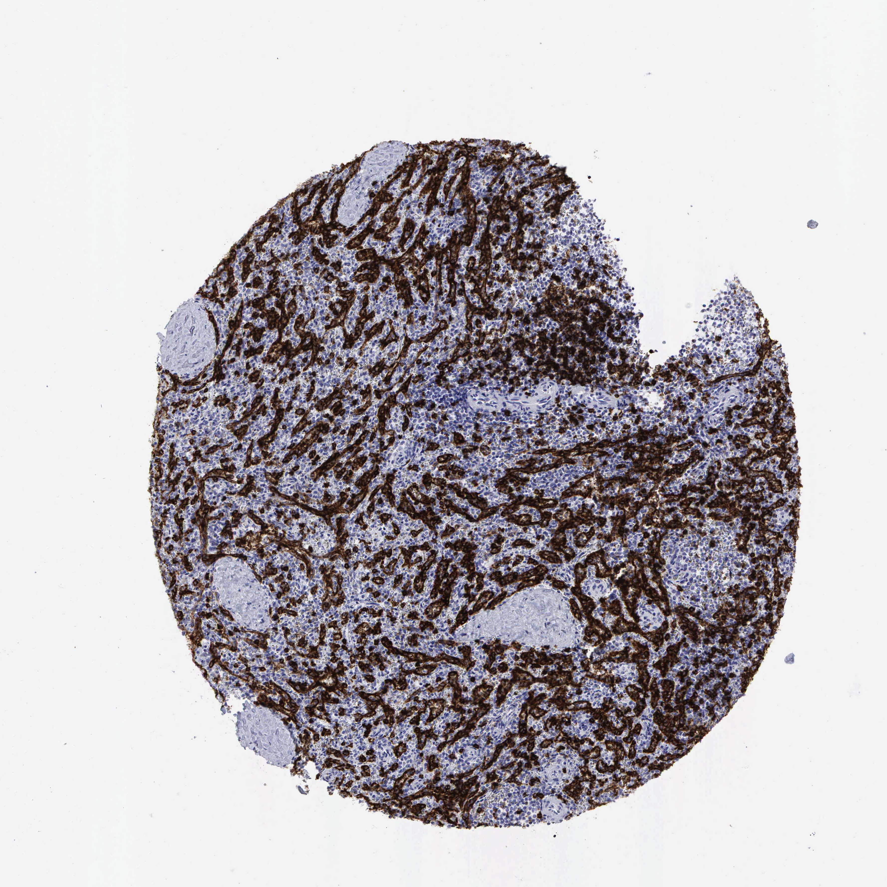

## 문제
An 18-year-old man is brought to the emergency department 40 minutes after his motorcycle collided with a car. He has left upper quadrant abdominal pain and pain in the left shoulder. His pulse is 128/min, and blood pressure is 84/50 mm Hg. There is tenderness of the left upper quadrant with guarding. Focused abdominal ultrasonography shows free fluid in the left upper quadrant and pelvis. Hemodynamic instability persists despite transfusion, and a shattered spleen is removed at laparotomy. A photomicrograph of a section of the spleen stained by immunohistochemistry is shown. The brown-stained cells line channels that are the principal site of which of the following functions?

- A. Filtration of lymph arriving through afferent lymphatics
- B. Removal of aged and poorly deformable erythrocytes
- C. Trapping of encapsulated bacteria by marginal-zone B cells
- D. Antigen presentation to T cells in the periarteriolar sheath
- E. Affinity maturation of B cells in germinal centers

_Immunohistochemical stain of a tissue microarray core (DAB brown chromogen, hematoxylin counterstain), original magnification (Human Protein Atlas, CC BY 4.0; no cropping or color adjustment)_

## 정답 및 해설
> 정답: B

- **정답 핵심**: The brown cells outline a dense network of anastomosing, blood-filled channels with negative cells packed in the cords between them, while trabeculae and arterial walls are negative. Channels of this kind are the venous sinuses of the red pulp, lined by elongated littoral cells, and the red pulp is where aged or rigid erythrocytes are held back and removed.
- **원리**: <b>How the red pulp filters red cells</b>: arterial blood in the spleen opens into the cords of Billroth, a meshwork rich in macrophages, and must re-enter the circulation by squeezing through narrow slits between the littoral cells that line the venous sinuses. A normal erythrocyte (8 µm) deforms enough to pass a 1–3 µm slit; an aged, spherocytic, sickled, or antibody-coated cell cannot, stays in the cords, and is phagocytosed (culling). Inclusions such as Howell-Jolly bodies are pinched out at the same slits (pitting).  <b>Why this stain outlines the sinuses</b>: the antibody here is CD8. Besides cytotoxic T cells, splenic littoral cells are unusual in expressing CD8, so a CD8 stain draws the whole sinus network of the red pulp — an anatomic, not an immunologic, clue.  <b>Clinical connection</b>: after this splenectomy, Howell-Jolly bodies, target cells, and thrombocytosis appear in the blood, and the loss of marginal-zone B cells leaves the patient at risk of overwhelming infection with encapsulated bacteria — so vaccination against pneumococcus, meningococcus, and Haemophilus influenzae type b is required.
- **비교**: <table><thead><tr><th style="width:22%">Feature</th><th style="width:39%">Red pulp sinuses (answer)</th><th>Marginal zone (closest distractor)</th></tr></thead><tbody> <tr><td>Position</td><td>Throughout the red pulp, between cords</td><td>A rim around each white-pulp nodule</td></tr> <tr><td>Appearance</td><td><b>Anastomosing, blood-filled channels</b> lined by elongated cells</td><td>A band of medium-sized B lymphocytes and macrophages</td></tr> <tr><td>Main function</td><td>Culling and pitting of red cells</td><td>Capture of blood-borne encapsulated bacteria (T-independent IgM)</td></tr> <tr><td>Loss after splenectomy</td><td>Howell-Jolly bodies, target cells</td><td>Overwhelming pneumococcal sepsis</td></tr> </tbody></table> Both functions are lost with splenectomy, so the question turns on which structure is stained: a branching channel network is the red pulp, a cuff around lymphoid nodules would be the marginal zone.
- **오답 이유**:
  - (A) Lymph filtration through afferent lymphatics describes the subcapsular and medullary sinuses of a lymph node; the spleen has no afferent lymphatics.
  - (C) Marginal-zone trapping would be correct if the stain formed a band of lymphocytes around the white-pulp nodules rather than a network of blood-filled channels.
  - (D) T-cell antigen presentation would be correct if the stained cells were lymphocytes packed around a central arteriole in the periarteriolar lymphoid sheath.
  - (E) Germinal center affinity maturation would be correct if a rounded follicle center with large B cells and tingible-body macrophages were highlighted.
- **함정**: Answering with the immunologic loss after splenectomy (encapsulated bacteria) — the stained network is the red pulp, whose job is red-cell filtering, not the marginal zone.
- **학습목표**: 비장 면역조직화학에서 서로 이어진 통로의 내벽 세포가 그물 모양으로 물든 양상을 적색속질 정맥굴로 읽고, 그곳에서 일어나는 노화·변형 적혈구 걸러내기를 백색속질·변연부의 기능과 구별한다
- **근거·출처**: Kumar V, Abbas AK, Aster JC. Robbins and Cotran Pathologic Basis of Disease, 10th ed. Ch. Diseases of White Blood Cells, Lymph Nodes, Spleen, and Thymus — spleen · Mebius RE, Kraal G. Structure and function of the spleen. Nat Rev Immunol 2005;5:606-616 · Human Protein Atlas — CD8A, spleen (CC BY 4.0) (교사용) · 작성자 판독(2026-10-21): 적색속질의 서로 이어진 정맥굴 내벽 세포가 그물 모양으로 갈색, 삭·소주·동맥벽 음성

## 출처
- Human Protein Atlas, CD8A / Spleen (CC BY 4.0), https://images.proteinatlas.org/12/98_B_8_4.jpg · Creative Commons Attribution 4.0 International · https://www.proteinatlas.org/about/licence
