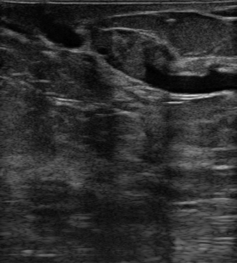

## 문제
63세 여자가 3주 전부터 오른쪽 유두에서 피 섞인 분비물이 저절로 묻어 나와 왔다. 분비물은 유두의 한 구멍에서만 나오고, 유두를 누르면 같은 구멍에서 다시 나온다. 유방에 만져지는 종괴는 없고 피부 변화나 유두 함몰도 없다. 겨드랑 림프절은 만져지지 않는다. 체온 36.7 ℃ 이다. 유방촬영술에서 종괴나 미세석회화는 없다. 유륜 아래 유방 초음파는 그림과 같다. 가장 가능성이 높은 진단은?

- A. 유방 농양
- B. 관내유두종
- C. 유관확장증
- D. 섬유샘종
- E. 단순 낭종

_유방 초음파 회색조 영상, 원본 그대로 (TCIA, CC BY 4.0 — 자르기·보정 없음)_

## 정답 및 해설
> 정답: B

- **정답 핵심**: 영상에서 무에코로 확장된 관 속을 등~고에코의 고형 성분이 채우고 있다. 한 유관에서 저절로 나오는 피 섞인 분비물과 관 안의 고형 종괴가 함께 있으면 가장 흔한 원인은 관내유두종이다. 다만 같은 양상을 관상피내암도 보일 수 있어 중심부 바늘생검이나 해당 유관 절제로 조직을 확인한다.
- **원리**: <b>왜 피 섞인 분비물이 나오는가</b>: 관내유두종은 큰 유관 안에서 섬유혈관 줄기를 가진 상피가 손가락처럼 자라는 양성 종양이다. 가는 혈관 줄기가 꼬이거나 끊어지면 관 안으로 피가 새어 유두로 나온다. 종괴가 관을 막으면 그 앞쪽 관이 늘어나 초음파에서 무에코 관 속의 고형 성분으로 보인다.  <b>병적 분비물과 생리적 분비물</b>: 병적 분비물은 <b>한쪽·한 구멍·저절로·피 섞임(또는 맑은 물)</b>의 특징을 가진다. 양쪽·여러 구멍·짜야 나오는 초록·갈색 분비물은 유관확장증이나 섬유낭성 변화 같은 생리적·양성 원인이 많다.  <b>처치</b>: 병적 분비물에서 악성은 약 5~15 % 이므로 유방촬영술·초음파 뒤 영상 유도 생검이나 원인 유관 절제로 확인한다. 이 환자는 63세로 나이가 많을수록 악성 비율이 올라가므로 조직 확인을 미루지 않는다.
- **비교**: <table><thead><tr><th style="width:22%">구분</th><th style="width:39%">관내유두종(정답)</th><th>유관확장증(가장 가까운 오답)</th></tr></thead><tbody> <tr><td>분비물</td><td><b>한쪽·한 구멍·저절로</b>, 피 섞이거나 맑음</td><td>양쪽·여러 구멍, 끈적한 초록·갈색</td></tr> <tr><td>초음파</td><td>확장된 관 <b>속에 고형 성분</b></td><td>여러 관이 늘어났으나 속은 무에코(또는 찌꺼기)</td></tr> <tr><td>나이</td><td>40~60대</td><td>폐경 전후, 흡연자에 흔함</td></tr> <tr><td>처치</td><td>생검 또는 원인 유관 절제</td><td>증상 조절, 감염되면 항생제</td></tr> </tbody></table> 두 질환 모두 관이 늘어나므로, 관 안에 고형 성분이 있는지와 분비물이 한 구멍에서 나오는지가 가른다.
- **오답 이유**:
  - ① 유방 농양은 수유 중이거나 흡연자에서 열·발적·압통과 함께 고름 같은 분비물, 초음파의 액체 고임이 있을 때 정답이 된다.
  - ③ 유관확장증은 폐경 전후 여성에서 여러 구멍의 끈적한 초록·갈색 분비물과 속이 빈 확장 유관이 보일 때 정답이 된다.
  - ④ 섬유샘종은 젊은 여성에게서 잘 움직이는 고무 같은 종괴가 만져지고 초음파에서 관 밖의 타원형 저에코 종괴일 때 정답이 된다.
  - ⑤ 단순 낭종은 초음파에서 둥글고 벽이 얇은 무에코 구조에 뒤쪽 증강이 있고 속에 고형 성분이 없을 때 정답이 된다.
- **함정**: 관이 늘어난 것만 보고 유관확장증으로 답하는 것 — 관 속에 고형 성분이 있고 분비물이 한 구멍에서 저절로 나오면 관내유두종을 먼저 생각한다.
- **학습목표**: 한 유관에서 저절로 나오는 피 섞인 유두 분비물과 유방 초음파의 확장된 관 속 고형 성분을 관내유두종으로 판단하고 유관확장증·낭종·섬유샘종과 구별한다
- **근거·출처**: Townsend CM, et al. Sabiston Textbook of Surgery, 21st ed. Ch. Diseases of the Breast — nipple discharge · ACR Appropriateness Criteria: Evaluation of Nipple Discharge. J Am Coll Radiol 2017;14:S138-S153 · TCIA Breast-Lesions-USG — 생검 확인 관내유두종(교사용) · 작성자 판독(2026-10-21): 무에코로 확장된 관 속을 채운 등~고에코 고형 성분, 뒤쪽 음향 변화 없음

## 출처
- BrEaST-Lesions-USG, The Cancer Imaging Archive (CC BY 4.0) · case036 · Creative Commons Attribution 4.0 International · https://www.cancerimagingarchive.net/data-usage-policies-and-restrictions/
