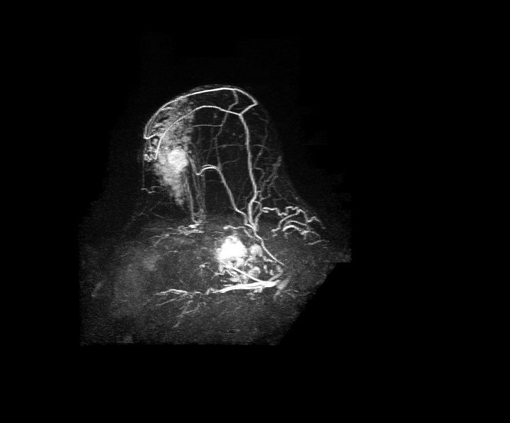

## 문제
49세 여자가 2개월 전부터 한쪽 유방에 단단한 멍울이 만져져 왔다. 어머니가 50대에 유방암을 앓았다. 진찰에서 경계가 불분명한 3 cm 종괴가 만져지고 겨드랑 림프절은 만져지지 않는다. 유방촬영술은 치밀유방이고, 초음파 유도 중심부 바늘생검에서 침윤성 유방암으로 확진되었다. 수술 범위를 정하려고 유방 동적 조영증강 MRI 를 시행하였다. 조영 전 영상을 뺀 감산 최대강도투사 영상은 그림과 같다. 이 영상에서 종괴가 주변 유방 조직보다 일찍 강하게 밝아지는 이유로 가장 적절한 것은?

- A. 종괴 안의 높은 지방 함량
- B. 종괴 안 낭성 변화로 늘어난 자유수
- C. 종양 신생혈관의 증가와 높은 혈관 투과성
- D. 종양 세포 밀도가 높아 생긴 물 분자 확산 제한
- E. 종괴 안의 미세석회화

_유방 동적 조영증강 MRI 감산 최대강도투사(MIP) 영상, 원본 그대로 (TCIA, CC BY — 자르기·보정 없음)_

## 정답 및 해설
> 정답: C

- **정답 핵심**: 영상에서 유방 안에 불규칙한 종괴가 밝게 증강되고, 굵어진 혈관이 여러 갈래로 종괴 쪽에 모여든다. 감산 영상은 조영 전 신호를 뺀 것이므로 밝은 부분은 조영제가 들어간 곳이다. 유방암은 VEGF 로 새 혈관을 많이 만들고 그 혈관은 내피 사이가 성기어 조영제가 빨리 들어가고 빨리 빠지므로 일찍 강하게 밝아진다.
- **원리**: <b>왜 암이 일찍 밝아지는가</b>: 지름 1~2 mm 를 넘는 종양은 산소 공급을 위해 VEGF 를 분비해 새 혈관을 만든다(혈관신생). 이 신생혈관은 수가 많고 벽이 미숙해 내피 사이 틈이 넓으므로, 가돌리늄 조영제가 혈관 밖 세포외 공간으로 빠르게 새어 나간다. 그래서 조영 직후 1~2분 안에 강하게 증강되고, 늦은 시기에는 다시 빠져나가 신호가 떨어지는 <b>세척(washout)</b> 곡선을 보인다.  <b>감산 영상의 뜻</b>: 조영 후 영상에서 조영 전 영상을 빼면 원래 밝던 지방·물·출혈 신호는 사라지고 <b>조영제가 들어간 곳만</b> 남는다. 이것을 한 방향으로 겹쳐 보인 것이 최대강도투사(MIP)이며, 종괴와 그 종괴로 모여드는 혈관이 함께 보인다.  <b>수술 전 MRI 의 쓰임</b>: 치밀유방이나 소엽암에서 같은 쪽의 다른 병소·반대쪽 병소를 찾아 수술 범위를 정한다. 다만 위양성이 있어 새 병소는 생검으로 확인한 뒤 계획을 바꾼다.
- **비교**: <table><thead><tr><th style="width:22%">구분</th><th style="width:39%">신생혈관·투과성(정답)</th><th>확산 제한(가장 가까운 오답)</th></tr></thead><tbody> <tr><td>보는 영상</td><td>동적 조영증강 T1 감산·MIP</td><td>확산강조영상(DWI)과 ADC 지도</td></tr> <tr><td>조영제</td><td><b>필요</b> — 조영제가 들어간 곳이 밝다</td><td>필요 없음 — 물 분자 움직임을 본다</td></tr> <tr><td>암에서 보이는 모양</td><td>일찍 강한 증강과 세척, 주변 혈관 증가</td><td>DWI 밝고 ADC 어두움</td></tr> </tbody></table> 두 소견 모두 암을 시사하지만, 그림이 조영 전 영상을 뺀 감산 영상이므로 밝기는 조영제 흡수, 곧 혈관 상태를 반영한다.
- **오답 이유**:
  - ① 높은 지방 함량은 지방억제 없는 T1 영상에서 과오종·지방 괴사가 밝을 때 설명이 되지만, 감산 영상에서는 지방 신호가 빠진다.
  - ② 자유수 증가는 T2 강조영상에서 낭종·점액성 병변이 밝을 때 설명이 되며, 조영 전 신호를 뺀 감산 영상에서는 남지 않는다.
  - ④ 확산 제한은 조영제 없이 얻는 확산강조영상과 ADC 지도에서 종괴가 밝고 ADC 가 낮게 보일 때 설명이 되며, 감산 영상의 밝기와는 다르다.
  - ⑤ 미세석회화는 유방촬영술에서 가늘고 갈래진 석회로 보일 때 의미가 있고, MRI 에서는 신호가 거의 없어 밝게 보이지 않는다.
- **함정**: 암이면 세포가 빽빽해 밝다고 생각해 확산 제한을 고르는 것 — 그림은 조영 전 신호를 뺀 감산 영상이라 밝기는 조영제가 들어간 혈관 상태를 뜻한다.
- **학습목표**: 유방 동적 조영증강 MRI 감산 영상에서 종괴가 일찍 강하게 증강되고 주변 혈관이 늘어난 소견을 종양 신생혈관의 증가와 높은 투과성으로 설명하고, 확산 제한·석회·지방·물 신호와 구별한다
- **근거·출처**: Morris EA, et al. ACR BI-RADS Atlas, 5th ed. Magnetic Resonance Imaging — kinetic curve assessment · Kuhl CK, et al. Dynamic breast MR imaging: are signal intensity time course data useful for differential diagnosis of enhancing lesions? Radiology 1999;211:101-110 · TCIA TCGA-BRCA — 조직 확진 침윤성 유방암 코호트(교사용) · 작성자 판독(2026-10-21): 감산 MIP 에서 불규칙 조영증강 종괴와 주변으로 모여드는 굵어진 혈관

## 출처
- The Cancer Imaging Archive (CC BY 3.0) · TCGA-BH-A0E2 · Creative Commons Attribution 3.0 Unported · https://www.cancerimagingarchive.net/data-usage-policies-and-restrictions/
