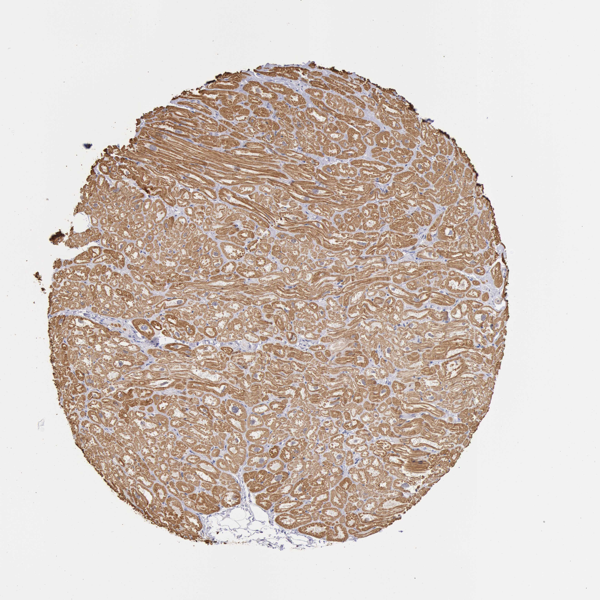

## 문제
A 49-year-old man dies in a motor vehicle collision. He had no history of cardiovascular disease, and an autopsy shows a heart of normal weight with no gross abnormalities and normal coronary arteries. Tissue from the left ventricular free wall is used as a normal control in a research study of inherited cardiomyopathies. A photomicrograph of a section of the heart stained by immunohistochemistry is shown. The antibody most likely recognizes which of the following antigens?

- A. Vimentin
- B. CD68 (macrosialin)
- C. Ki-67 (MIB-1)
- D. Beta-myosin heavy chain
- E. CD31 (PECAM-1)

_Immunohistochemical stain of a tissue microarray core (DAB brown chromogen, hematoxylin counterstain), original magnification (Human Protein Atlas, CC BY 4.0; no color adjustment)_

## 정답 및 해설
> 정답: D

- **정답 핵심**: The brown chromogen fills the cytoplasm of every branching, cross-striated muscle cell, and the striations themselves are accentuated, while the central nuclei, the interstitial fibroblasts, and the capillary endothelium are negative. A protein confined to the contractile apparatus of ventricular cardiomyocytes is beta-myosin heavy chain, the thick-filament motor encoded by MYH7.
- **원리**: <b>Why the stain looks striated</b>: the sarcomere is a repeating unit of thick filaments (myosin) interdigitating with thin filaments (actin, troponin, tropomyosin). Beta-myosin heavy chain is the head-and-rod protein of the thick filament in the human ventricle, so an antibody against it fills the myofibrils and reproduces their banding, leaving the nucleus and the non-muscle cells between the fibers unstained.  <b>Why location decides</b>: in a section of normal myocardium every candidate antigen is present somewhere, so the question is which cell and which compartment is brown — myocyte cytoplasm (sarcomeric proteins), capillary lining (CD31), interstitial spindle cells (vimentin), scattered round cells (CD68), or nuclei (Ki-67).  <b>Clinical connection</b>: missense mutations in MYH7 and in MYBPC3 (myosin-binding protein C) are the two most common causes of hypertrophic cardiomyopathy, an autosomal dominant sarcomere disease with myocyte disarray and asymmetric septal hypertrophy — the reason a normal ventricle is used as the control in such studies.
- **비교**: <table><thead><tr><th style="width:22%">Feature</th><th style="width:39%">Beta-myosin heavy chain (answer)</th><th>CD31 (closest distractor)</th></tr></thead><tbody> <tr><td>Cell</td><td>Cardiomyocyte</td><td>Endothelial cell of capillaries</td></tr> <tr><td>Pattern</td><td><b>Whole myocyte cytoplasm, banded like the striations</b></td><td>Thin rings and slits between the fibers</td></tr> <tr><td>Proportion of the field</td><td>Most of the tissue is brown</td><td>A fine network; myocytes stay blue-gray</td></tr> </tbody></table> Myocardium has roughly one capillary per myocyte, so an endothelial marker also covers the whole field — but as a lace between the fibers, never inside them.
- **오답 이유**:
  - (A) Vimentin would be correct if the stained cells were the thin spindle-shaped interstitial fibroblasts and endothelium, since mature cardiomyocytes express little vimentin.
  - (B) CD68 would be correct if only scattered round or oval interstitial macrophages were brown, as seen after infarction or in myocarditis.
  - (C) Ki-67 would be correct if a few nuclei were brown; adult cardiomyocytes hardly divide, so almost no nuclei would stain.
  - (E) CD31 would be correct if the brown signal outlined the small capillaries and slit-like vessels between the fibers while the myocytes themselves were unstained.
- **함정**: Choosing CD31 because myocardium is richly vascular — the brown material is inside the striated myocytes, not between them.
- **학습목표**: 심장 조직 면역조직화학에서 가로무늬가 보이는 분지형 심근세포의 세포질 전체가 물들고 간질·내피가 음성인 양상을 근절 단백(β-myosin heavy chain)으로 읽고, 내피·섬유모세포·대식세포 표지자와 세포 종류·위치로 구별한다
- **근거·출처**: Kumar V, Abbas AK, Aster JC. Robbins and Cotran Pathologic Basis of Disease, 10th ed. Ch. The Heart — cardiomyocyte structure and cardiomyopathies · Marian AJ, Braunwald E. Hypertrophic cardiomyopathy: genetics, pathogenesis, clinical manifestations, diagnosis, and therapy. Circ Res 2017;121:749-770 · Human Protein Atlas — MYH7, heart muscle (CC BY 4.0) (교사용) · 작성자 판독(2026-10-22): 가로무늬가 보이는 분지형 심근세포 세포질 전체가 강한 갈색, 중심 핵·간질 섬유모세포·모세혈관 내피 음성

## 출처
- Human Protein Atlas, MYH7 / Heart muscle (CC BY 4.0), https://images.proteinatlas.org/1239/3209_B_5_6.jpg · Creative Commons Attribution 4.0 International · https://www.proteinatlas.org/about/licence
