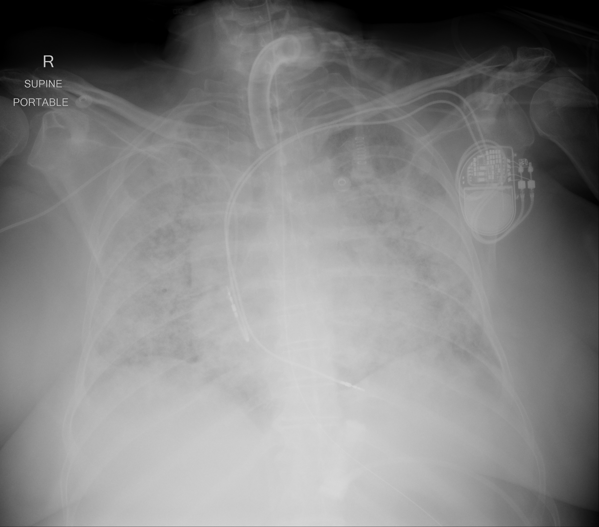

## 문제
A 57-year-old woman with viral pneumonia was intubated 30 hours ago because of worsening hypoxemia. She has a dual-chamber pacemaker for complete heart block. She is sedated and receiving volume-control ventilation with a tidal volume of 6 mL/kg of predicted body weight, PEEP of 14 cm H2O, and FiO2 of 0.8. Plateau pressure is 27 cm H2O. Her pulse is 96/min, and blood pressure is 118/70 mm Hg on a low dose of norepinephrine. Arterial blood gas analysis shows pH 7.31, PaCO2 52 mm Hg, and PaO2 68 mm Hg. Echocardiography shows a left ventricular ejection fraction of 60% and no valvular disease. A portable chest x-ray is shown. Which of the following is the most appropriate next step in management?

- A. Venovenous extracorporeal membrane oxygenation now
- B. High-frequency oscillatory ventilation
- C. Increase the tidal volume to 10 mL/kg of predicted body weight
- D. Intravenous furosemide infusion
- E. Prone positioning for at least 16 hours per day

_Portable anteroposterior chest radiograph, unaltered apart from scaling (The Cancer Imaging Archive, CC BY 4.0; no cropping or window adjustment)_

## 정답 및 해설
> 정답: E

- **정답 핵심**: Bilateral diffuse airspace opacities, onset within a week, and a normal ejection fraction meet the definition of ARDS. With lung-protective ventilation (6 mL/kg, plateau 27 cm H2O, PEEP 14) the PaO2/FiO2 ratio is 68/0.8 = 85 mm Hg — severe ARDS. Prone positioning for at least 16 hours a day lowers mortality when the ratio stays below 150 mm Hg and is the next step before rescue therapies.
- **원리**: <b>Why lying prone improves oxygenation</b>: in the supine position the heavy, edematous lung and the heart compress the dorsal lung, which collapses even though most pulmonary blood flow still goes there — a large shunt. Turning the patient prone recruits those dorsal regions, while perfusion stays dorsal, so ventilation-perfusion matching improves.  <b>Why it also protects the lung</b>: the chest wall is stiffer anteriorly when prone, so the inflation of the lung becomes more uniform; stress and strain are spread over more alveoli, reducing ventilator-induced lung injury. That, not the oxygen number, is why mortality falls.  <b>Order of escalation</b>: low tidal volume (6 mL/kg predicted body weight, plateau ≤ 30 cm H2O) and adequate PEEP → if PaO2/FiO2 &lt; 150 mm Hg, prone positioning (≥ 16 h/day, often with short-term neuromuscular blockade) → venovenous ECMO only if hypoxemia remains refractory despite these measures.
- **비교**: <table><thead><tr><th style="width:22%">Feature</th><th style="width:39%">Prone positioning (answer)</th><th>VV-ECMO (closest distractor)</th></tr></thead><tbody> <tr><td>Fits when</td><td>PaO2/FiO2 <b>&lt; 150 mm Hg</b> despite lung-protective ventilation</td><td>Refractory hypoxemia (e.g., PaO2/FiO2 &lt; 80 for &gt; 6 h) or pH &lt; 7.25 with high PaCO2 <b>after</b> proning has failed</td></tr> <tr><td>Evidence</td><td>Mortality benefit in a randomized trial (PROSEVA)</td><td>Rescue therapy; selected centers</td></tr> <tr><td>Cost</td><td>Nursing effort, pressure injury, tube displacement</td><td>Cannulation, anticoagulation, bleeding</td></tr> </tbody></table> The ratio of 85 alone could point toward ECMO, but proning has not been tried yet; the sequence decides.
- **오답 이유**:
  - (A) Venovenous ECMO would be appropriate if severe hypoxemia or hypercapnic acidosis persisted after several hours of prone positioning at an experienced center.
  - (B) High-frequency oscillatory ventilation would have been chosen in the past; randomized trials showed no benefit or increased mortality in adult ARDS.
  - (C) A larger tidal volume would raise plateau pressure and alveolar overdistension; 6 mL/kg is kept even if PaCO2 rises (permissive hypercapnia).
  - (D) Furosemide would be correct if hydrostatic pulmonary edema were the cause; here the ejection fraction is normal and she is on a vasopressor.
- **함정**: Jumping to ECMO because the PaO2/FiO2 ratio is very low — prone positioning comes first and itself lowers mortality.
- **학습목표**: 저일회호흡량·적정 PEEP 에도 PaO2/FiO2 150 mm Hg 미만인 중등도~중증 ARDS 에서 하루 16시간 이상 엎드린 자세 환기를 다음 단계로 선택한다
- **근거·출처**: Guérin C, et al. Prone positioning in severe acute respiratory distress syndrome (PROSEVA). N Engl J Med 2013;368:2159-2168 · Grasselli G, et al. ESICM guidelines on acute respiratory distress syndrome: definition, phenotyping and respiratory support strategies. Intensive Care Med 2023;49:727-759 · 작성자 판독(2026-10-22): AP 앙와위 이동촬영, 양측 미만성 간유리·경화 음영, 기관내관·비위관·좌측 흉벽 이중 리드 심장 장치

## 출처
- COVID-19-AR, The Cancer Imaging Archive (CC BY 4.0) · series …39553400 · Creative Commons Attribution 4.0 International · https://www.cancerimagingarchive.net/data-usage-policies-and-restrictions/
