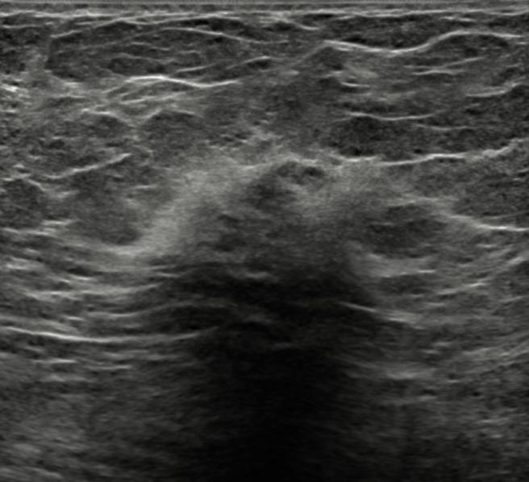

## 문제
56세 여자가 2주 전 오른쪽 유방에서 단단한 멍울을 만져 병원에 왔다. 2개월 전 자동차 사고로 안전벨트가 지나간 자리에 멍이 들었다. 유방암 가족력은 없다. 진찰에서 오른쪽 유방 위쪽 바깥에 지름 약 2 cm 의 단단하고 잘 움직이지 않는 종괴가 만져지고, 피부 변화나 유두 분비물은 없다. 겨드랑이 림프절은 만져지지 않는다. 유방촬영술에서 같은 자리에 경계가 불분명한 고밀도 음영이 있다. 유방 초음파 사진은 그림과 같다. 다음 처치로 가장 적절한 것은?

- A. 초음파 유도 중심부 바늘생검
- B. 6개월 뒤 추적 초음파
- C. 세침흡인으로 내용물 배액
- D. 변형 근치유방절제술
- E. 경구 항생제 2주 투여 뒤 재진찰

_유방 초음파 회색조 영상, 원본 그대로 (TCIA, CC BY 4.0 — 자르기·보정 없음)_

## 정답 및 해설
> 정답: A

- **정답 핵심**: 초음파에서 경계가 불분명한 불규칙 이질성 종괴, 둘레의 고에코 테두리와 뒤쪽 음향 그림자가 보인다. 악성을 강하게 의심하는 소견(BI-RADS 4~5)이므로 외상 병력이 있어 지방괴사가 그럴듯하더라도 조직으로 확인해야 하고, 다음 단계는 영상 유도 중심부 바늘생검이다.
- **원리**: <b>왜 지방괴사가 암처럼 보이는가</b>: 외상·수술·방사선으로 지방세포가 깨지면 흘러나온 중성지방을 대식세포가 먹어 거품세포가 되고, 둘레에 섬유화가 일어난다. 섬유화가 주변 조직을 당겨 경계가 불규칙해지고, 섬유 조직이 초음파를 흡수해 뒤쪽 그림자를 만든다 — 침윤성 관암종의 침상 변연·그림자와 겹친다.  <b>왜 병력으로 결론 내리지 않는가</b>: 외상 병력은 지방괴사 환자의 절반 정도에서만 확인되고, 외상을 계기로 원래 있던 암을 처음 만지는 일도 흔하다. 그래서 영상 분류가 처치를 정한다 — BI-RADS 3(양성 가능성 높음)이면 단기 추적, 4·5 이면 조직검사다.  <b>왜 중심부 바늘생검인가</b>: 세침흡인은 세포만 얻어 침윤 여부·수용체를 판정하지 못하고, 중심부 바늘생검은 조직 구조와 ER·PR·HER2 까지 확인한다. 지방괴사로 나오면 영상과 일치하는지(radiologic-pathologic concordance) 보고 경과 관찰로 돌린다.
- **비교**: <table><thead><tr><th style="width:22%">구분</th><th style="width:39%">중심부 바늘생검(정답)</th><th>6개월 뒤 추적 초음파(가장 가까운 오답)</th></tr></thead><tbody> <tr><td>맞는 영상 분류</td><td><b>BI-RADS 4·5</b> — 불규칙, 경계 불분명, 뒤쪽 그림자</td><td>BI-RADS 3 — 타원형, 외곽 명확, 평행, 그림자 없음</td></tr> <tr><td>악성 가능성</td><td>2 % 초과(5 는 95 % 이상)</td><td>2 % 이하</td></tr> <tr><td>병력의 역할</td><td>외상 병력이 있어도 조직 확인</td><td>전형적 지방괴사의 기름 낭종 모양일 때만</td></tr> </tbody></table> 같은 지방괴사라도 기름 낭종(무에코·외곽 명확)처럼 보이면 추적이 가능하지만, 이 사진처럼 암과 구별되지 않는 모양이면 병력과 관계없이 생검한다.
- **오답 이유**:
  - ② 6개월 추적은 외곽이 명확한 타원형 종괴나 무에코 기름 낭종처럼 BI-RADS 3 으로 분류될 때 정답이 된다.
  - ③ 세침흡인 배액은 무에코의 단순 낭이나 고름집처럼 액체가 차 있는 병변일 때 진단과 치료를 겸한다.
  - ④ 변형 근치유방절제술은 조직검사로 침윤성 유방암이 확진되고 유방 보존이 어려울 때의 수술로, 조직 진단 전에는 하지 않는다.
  - ⑤ 경구 항생제는 열·홍반·압통이 있는 유방염이나 수유부의 유방 고름집이 의심될 때 정답이 된다.
- **함정**: 안전벨트 외상 병력만 보고 지방괴사로 단정해 추적 관찰을 고르는 것 — 영상이 암과 구별되지 않으면 조직검사가 먼저다.
- **학습목표**: 외상 병력이 있어도 초음파에서 경계가 불분명하고 뒤쪽 그림자를 보이는 불규칙 종괴(BI-RADS 4~5)는 지방괴사로 추정해 관찰하지 않고 중심부 바늘생검으로 조직을 확인한다
- **근거·출처**: American College of Radiology. ACR BI-RADS Atlas, 5th ed. Ultrasound — assessment categories · Kerridge WD, et al. Fat necrosis of the breast: a pictorial review of the mammographic, ultrasound, CT, and MRI findings. Clin Radiol 2015;70:e43-e54 · Townsend CM, et al. Sabiston Textbook of Surgery, 21st ed. Ch. Diseases of the Breast · 작성자 판독(2026-10-22): 경계 불분명한 불규칙 이질성 병변, 둘레 고에코 테두리, 뒤쪽 음향 그림자

## 출처
- BrEaST-Lesions-USG, The Cancer Imaging Archive (CC BY 4.0) · case115 · Creative Commons Attribution 4.0 International · https://www.cancerimagingarchive.net/data-usage-policies-and-restrictions/
