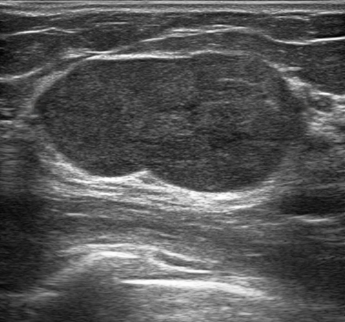

## 문제
23세 여자가 왼쪽 유방의 멍울이 석 달 사이 빠르게 커져 병원에 왔다. 통증은 없고 유두 분비물도 없다. 2년 전 같은 자리에 작은 멍울이 있다는 말을 들었으나 지켜보기로 했었다. 진찰에서 왼쪽 유방 위쪽 바깥에 지름 약 4 cm 의 단단하고 잘 움직이는 둥근 종괴가 만져지며, 위 피부는 정상이다. 겨드랑이 림프절은 만져지지 않는다. 유방 초음파 사진은 그림과 같다. 가장 가능성이 높은 진단은?

- A. 유방 고름집
- B. 엽상종양
- C. 섬유샘종
- D. 단순 낭
- E. 침윤성 관암종

_유방 초음파 회색조 영상, 원본 그대로 (TCIA, CC BY 4.0 — 자르기·보정 없음)_

## 정답 및 해설
> 정답: B

- **정답 핵심**: 초음파에서 외곽이 명확하고 완만하게 분엽된 큰 타원형 등에코 고형 종괴가 보인다. 섬유샘종과 같은 양성 모양이지만 지름 4 cm 로 크고 석 달 사이 빠르게 커졌다는 점이 엽상종양을 시사한다. 무에코가 아니어서 낭이 아니고, 외곽이 명확해 암의 침상·불규칙 변연과 다르다.
- **원리**: <b>왜 둘이 비슷하게 보이는가</b>: 섬유샘종과 엽상종양은 모두 유관 상피와 그 둘레 기질이 함께 자라는 섬유상피성 종양이다. 그래서 초음파에서 둘 다 외곽이 명확하고 피부와 평행한 타원형·분엽 고형 종괴로 보인다.  <b>무엇이 다른가</b>: 엽상종양은 <b>기질 세포</b>가 주인공이다 — 세포가 많고 빨리 자라 상피로 덮인 기질이 틈새 속으로 잎사귀처럼 밀고 들어간다(엽상 구조). 그래서 크기가 크고(흔히 3~4 cm 이상) 몇 달 사이 빠르게 자라며, 발병 나이는 섬유샘종보다 10~20년 늦은 40대가 많지만 젊은 여성에도 생긴다.  <b>왜 진단이 처치를 바꾸는가</b>: 섬유샘종은 관찰하거나 단순 적출하지만, 엽상종양은 단순 적출 뒤 국소 재발이 흔해 1 cm 이상 절제연의 광범위 절제를 한다. 림프절 전이는 드물어 겨드랑이 수술은 하지 않는다. 그래서 「크고 빨리 자라는 섬유샘종 모양 종괴」는 세침이 아닌 중심부 바늘생검으로 기질을 봐야 한다.
- **비교**: <table><thead><tr><th style="width:22%">구분</th><th style="width:39%">엽상종양(정답)</th><th>섬유샘종(가장 가까운 오답)</th></tr></thead><tbody> <tr><td>나이</td><td>40대가 많으나 범위가 넓다</td><td>10대 후반~30대</td></tr> <tr><td>크기·성장</td><td><b>크다(흔히 4 cm↑), 몇 달 사이 빠르게 커진다</b></td><td>대개 3 cm 미만, 자라다 멈춘다</td></tr> <tr><td>조직</td><td>기질 세포 증가, 잎사귀 모양 틈</td><td>기질과 상피가 고르게, 세포 적음</td></tr> <tr><td>치료</td><td>1 cm 이상 절제연 광범위 절제</td><td>관찰 또는 단순 적출</td></tr> </tbody></table> 초음파 모양만으로는 둘을 가르기 어렵다. 크기와 성장 속도가 엽상종양 쪽으로 기울게 하고, 확진은 중심부 바늘생검의 기질 소견이다.
- **오답 이유**:
  - ① 유방 고름집은 수유부에서 열·발적·압통과 함께 속이 불균일한 액체 저류로 보일 때 정답이 된다.
  - ③ 섬유샘종은 같은 모양이라도 크기가 3 cm 미만이고 수년간 크기 변화가 거의 없는 젊은 여성의 종괴일 때 정답이 된다.
  - ④ 단순 낭은 속이 무에코로 까맣고 벽이 얇으며 뒤쪽 음향 증강이 뚜렷할 때 정답이 되며, 이 종괴는 속이 차 있는 등에코다.
  - ⑤ 침윤성 관암종은 경계가 불분명하고 각지거나 침상 변연, 피부에 수직인 모양과 뒤쪽 그림자를 보일 때 의심한다.
- **함정**: 모양이 전형적인 섬유샘종이라 섬유샘종을 고르는 것 — 크기 4 cm·석 달 사이의 빠른 성장은 엽상종양을 생각하게 하는 단서다.
- **학습목표**: 외곽이 명확한 분엽 모양 고형 종괴라도 크기가 크고 몇 달 사이 빠르게 커졌으면 섬유샘종보다 엽상종양을 먼저 생각하고, 확진 뒤 1 cm 이상 절제연의 광범위 절제를 계획한다
- **근거·출처**: Townsend CM, et al. Sabiston Textbook of Surgery, 21st ed. Ch. Diseases of the Breast — fibroepithelial lesions · National Comprehensive Cancer Network. NCCN Guidelines: Breast Cancer — Phyllodes tumor (2024) · Kumar V, Abbas AK, Aster JC. Robbins and Cotran Pathologic Basis of Disease, 10th ed. Ch. The Breast — stromal tumors · 작성자 판독(2026-10-22): 크고 타원형·완만히 분엽된 등에코 고형 종괴, 외곽 명확, 약한 후방 증강

## 출처
- BrEaST-Lesions-USG, The Cancer Imaging Archive (CC BY 4.0) · case078 · Creative Commons Attribution 4.0 International · https://www.cancerimagingarchive.net/data-usage-policies-and-restrictions/
