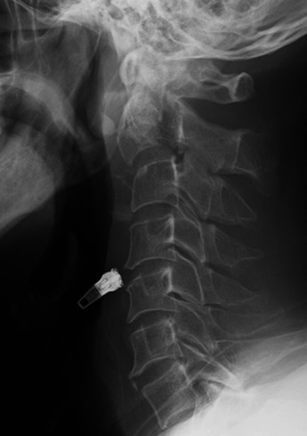

## 문제
54세 남자가 승용차를 운전하다 앞차를 들이받으며 이마를 앞유리에 부딪친 뒤 목 통증으로 응급실에 실려 왔다. 구급대원이 경추 보조기와 척추 고정판으로 고정해 왔다. 혈압 138/84 mmHg, 맥박 92회/분, 호흡 18회/분이다. 의식은 명료하고 이마에 찰과상이 있으며 뒤목 정중선에 압통이 있다. 사지 근력과 감각, 항문 괄약근 긴장도는 정상이다. 경추 측면 단순 X선 사진은 그림과 같다. 가장 적절한 다음 처치는?

- A. 고용량 메틸프레드니솔론을 정맥 투여한다
- B. 영상 추가 없이 응급 후방 고정술을 한다
- C. 경추 고정을 유지하고 경추 CT를 시행한다
- D. 보조기를 벗기고 굴곡·신전 X선을 찍는다
- E. 보조기를 벗기고 진통제를 주어 귀가시킨다

_경추 측면 단순 X선 — 출판된 증례 그림 한 컷 그대로 (PMC Open Access Subset, CC BY — 자르기·보정 없음)_

## 정답 및 해설
> 정답: C

- **정답 핵심**: 측면 X선에서 C2 몸통이 C3 위로 앞쪽으로 밀리고 C2-3 사이가 각지게 꺾여 있으며 C2 몸통 뒤 신경궁에 단절이 보인다 — 이마를 부딪친 과신전·축성 부하로 생긴 C2 외상성 척추전방전위증(Hangman 골절)이다. 신경 결손이 없어도 불안정 손상이므로 고정을 유지한 채 경추 CT 로 골절선·전위 정도와 척추동맥 경로(횡돌기공)를 평가한 뒤 치료를 정한다.
- **원리**: <b>왜 C2 가 앞으로 밀리는가</b>: 이마가 부딪치면 머리가 뒤로 젖혀지며(과신전) 위에서 아래로 힘이 실린다. 그 힘이 C2 의 가장 가는 부분인 양쪽 관절간부(신경궁)에 모여 부러지면, 몸통은 앞쪽 C3 위로 미끄러지고 뒤쪽 요소는 제자리에 남는다.  <b>왜 신경 손상이 드문가</b>: 몸통과 뒤쪽 고리가 서로 벌어지며 오히려 척주관이 넓어지기 때문이다. 그래서 신경 진찰이 정상이어도 불안정성은 남는다.  <b>왜 CT 가 다음인가</b>: 단순 X선은 골절선 일부만 보이고 C1·후두-경추 이음부나 다른 높이의 동반 골절을 놓친다. CT 로 Levine-Edwards 분류(전위·각형성 정도)를 정하고 횡돌기공을 지나는 골절이면 CT 혈관조영으로 척추동맥 손상을 확인한다. 전위·각형성이 크거나 C2-3 디스크가 찢어진 형(II형 이상)은 수술·halo 고정을 검토한다.  <b>금기</b>: 불안정 손상이 보이는 환자를 움직여 굴곡·신전 촬영하는 것은 척수를 다치게 할 수 있다.
- **비교**: <table><thead><tr><th style="width:22%">구분</th><th style="width:39%">고정 유지 + 경추 CT(정답)</th><th>굴곡·신전 X선(가장 가까운 오답)</th></tr></thead><tbody> <tr><td>쓰는 때</td><td><b>X선·임상에서 골절·전위가 보이거나 의심될 때</b></td><td>CT 가 정상인데 인대 손상이 의심되는 의식 있는 환자(현재는 MRI 가 대체)</td></tr> <tr><td>위험</td><td>방사선 노출 외에 거의 없다</td><td>불안정 골절에서 전위를 키워 척수 손상</td></tr> <tr><td>얻는 정보</td><td>골절선·분류·횡돌기공 침범</td><td>움직일 때의 이동 정도뿐</td></tr> </tbody></table> 동적 촬영은 「골절이 없다」가 확인된 뒤의 검사다. 사진에서 이미 전위가 보이면 고정을 풀지 않는다.
- **오답 이유**:
  - ① 고용량 메틸프레드니솔론은 이득보다 감염·위장관 출혈 위험이 커 급성 척수 손상에서도 일상적으로 권고되지 않는다.
  - ② 응급 수술은 진행하는 신경 결손이나 정복되지 않는 탈구가 있을 때 고려하지만, 그때도 CT 로 골절 형태를 확인한 뒤 계획한다.
  - ④ 굴곡·신전 X선은 CT 에 골절이 없는데도 목 통증이 남아 인대 손상을 확인해야 하는 신경학적으로 정상인 환자에서나 고려된다.
  - ⑤ 귀가는 NEXUS·캐나다 경추 규칙상 영상이 필요 없거나 CT 가 정상이고 정중선 압통이 없는 환자에서 정답이 된다.
- **함정**: 신경 진찰이 정상이라 안정 손상으로 보고 보조기를 벗겨 동적 촬영을 하는 것 — C2 전위가 보이면 고정을 유지한 채 CT 다.
- **학습목표**: 둔상 환자의 측면 경추 X선에서 C2 몸통의 앞쪽 전위·각형성을 읽고, 불안정 손상이 보이면 고정을 유지한 채 CT 로 평가하며 굴곡·신전 촬영을 하지 않는다
- **근거·출처**: American College of Surgeons. ATLS Advanced Trauma Life Support, 10th ed. Ch. Spine and Spinal Cord Trauma · Rockwood and Green's Fractures in Adults, 9th ed. Ch. Cervical Spine Fractures — traumatic spondylolisthesis of the axis · 작성자 판독(2026-10-23): 측면 경추 X선, C2 몸통의 앞쪽 전위·C2-3 굴곡 각형성, C2 신경궁 투과성 단절

## 출처
- Postoperative Dysphagia Subsequent to Posterior Fixation of an Axis Fracture Without Cranial Fixation: A Case Report. Cureus. 2023 Mar 25;15(3):e36664. doi: 10.7759/cureus.36664 (CC BY) — Figure 1 · CC BY · https://creativecommons.org/licenses/
