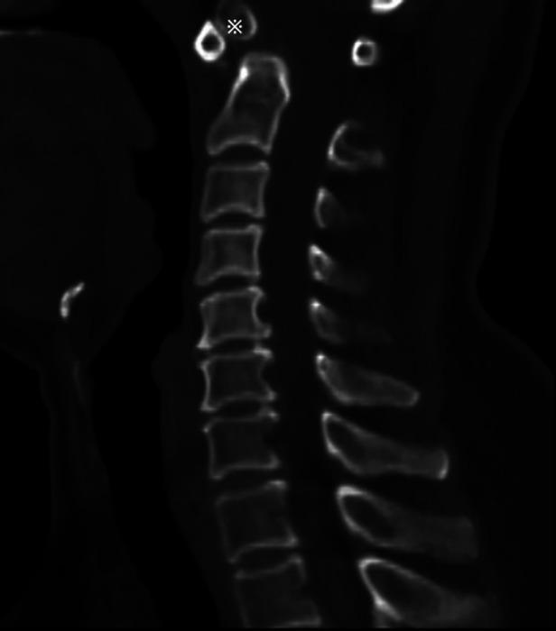

## 문제
A 52-year-old woman comes to the physician because of a 6-month history of neck pain radiating to the back of the head and intermittent tingling in both hands. She has had no trauma, fever, or weight loss. Her temperature is 36.7°C (98.1°F), pulse is 76/min, and blood pressure is 124/78 mm Hg. Examination shows mildly limited neck rotation. Deep tendon reflexes are brisk in the upper extremities, and the Hoffmann sign is present bilaterally. Muscle strength is normal. Erythrocyte sedimentation rate is 12 mm/h, and rheumatoid factor is negative. A sagittal CT image of the cervical spine is shown. Which of the following is the most likely diagnosis?

- A. Os odontoideum
- B. Type II odontoid fracture
- C. Rheumatoid atlantoaxial subluxation
- D. Jefferson fracture of the atlas
- E. Basilar invagination

_Midsagittal CT reconstruction of the cervical spine; the asterisk is the authors' original marker — single published case figure, unaltered (PMC Open Access Subset, CC BY)_

## 정답 및 해설
> 정답: A

- **정답 핵심**: The CT shows a separate, rounded ossicle surrounded by smooth corticated bone near the anterior arch of C1, while the top of the C2 body is rounded and smooth and no normal dens is present. Smooth cortical margins on both sides of the gap mean a long-standing developmental or remote-post-traumatic separation — os odontoideum — rather than an acute fracture. The upper motor neuron signs reflect atlantoaxial instability compressing the cord.
- **원리**: <b>Why the margins matter</b>: bone that has just broken shows sharp, irregular, noncorticated edges that fit together like puzzle pieces. When a gap has existed for years, both sides remodel and grow a smooth cortical rim, the ossicle becomes rounded, and the base of the dens becomes a smooth dome — the appearance of os odontoideum.  <b>Why it causes myelopathy</b>: the transverse ligament holds the dens against the anterior arch of C1. In os odontoideum the ossicle moves with C1, but the body of C2 below is not attached to it, so C1 can slide forward or backward on C2. Repeated motion narrows the canal and can produce a retro-odontoid soft-tissue mass, giving neck pain, brisk reflexes, and a Hoffmann sign.  <b>Origin</b>: many cases are thought to follow an unrecognized childhood dens fracture with disrupted blood supply, others are developmental (and associated with Down syndrome or skeletal dysplasias).  <b>Management</b>: flexion-extension radiographs and MRI assess instability and cord compression; symptomatic or unstable cases are treated with C1-C2 posterior fusion.
- **비교**: <table><thead><tr><th style="width:22%">Feature</th><th style="width:39%">Os odontoideum (answer)</th><th>Type II odontoid fracture (closest distractor)</th></tr></thead><tbody> <tr><td>History</td><td><b>No recent trauma</b>, months of symptoms</td><td>Recent fall or collision, acute pain</td></tr> <tr><td>Fragment</td><td>Round or oval, smooth cortex all around</td><td>Shape of the dens tip, sharp irregular edges</td></tr> <tr><td>Base of the dens</td><td>Smooth, rounded dome</td><td>Jagged fracture surface at the waist of the dens</td></tr> <tr><td>Gap</td><td>Often wide, above the level of the superior articular facets</td><td>Narrow line at the dens–body junction</td></tr> </tbody></table> Both can make C1-C2 unstable; the cortical rim tells chronic from acute.
- **오답 이유**:
  - (B) A type II odontoid fracture would be correct after recent trauma in an older adult if the gap at the dens waist had sharp, noncorticated edges.
  - (C) Rheumatoid atlantoaxial subluxation would be correct in long-standing seropositive rheumatoid arthritis with a widened atlantodental interval and an intact, eroded dens.
  - (D) A Jefferson fracture would be correct after axial loading on the vertex, with breaks in the C1 ring and lateral masses spreading beyond C2 on an open-mouth view.
  - (E) Basilar invagination would be correct if the tip of an intact dens projected above the line from the hard palate to the opisthion into the foramen magnum.
- **함정**: Calling any separated dens a type II fracture — smooth corticated margins and no trauma point to os odontoideum.
- **학습목표**: 외상 없이 상부 경추 통증·척수병증이 있는 성인의 시상 CT 에서 피질이 매끈한 둥근 소골과 둥근 C2 윗면을 os odontoideum 으로 읽고 II형 치돌기 골절과 구별한다
- **근거·출처**: Arvin B, Fournier-Gosselin MP, Fehlings MG. Os odontoideum: etiology and surgical management. Neurosurgery 2010;66(3 Suppl):22-31 · Rockwood and Green's Fractures in Adults, 9th ed. Ch. Cervical Spine Fractures — odontoid fractures · 작성자 판독(2026-10-23): 정중 시상 경추 CT, 피질이 매끈한 둥근 소골과 둥근 C2 윗면, 정상 치돌기 없음

## 출처
- Os odontoideum associated with a retro-odontoid cyst treated with posterior C1–C3 fixation: A case report and literature review. Front Surg. 2023 Jan 6;9:1006167. doi: 10.3389/fsurg.2022.1006167 (CC BY) — Figure 2 · CC BY · https://creativecommons.org/licenses/
