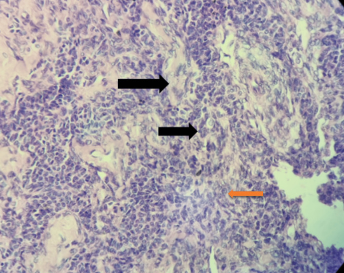

## 문제
65세 여자가 3개월 전부터 반복되는 질 출혈로 병원에 왔다. 15년 전 폐경되었고 호르몬 치료를 받은 적이 없다. 혈압 132/80 mmHg이다. 골반 진찰에서 오른쪽 부속기에 단단한 종괴가 만져진다. 질초음파에서 자궁내막 두께는 14 mm이고 오른쪽 난소에 9 cm 고형 종괴가 있다. 자궁내막 생검에서 자궁내막모양 선암이 나왔다. 전자궁절제술과 양쪽 부속기절제술로 떼어 낸 난소 종괴의 조직 절편(H&E 염색) 사진은 그림과 같다. 수술 뒤 재발 감시에 가장 유용한 혈청 표지자는?

- A. 인히빈 B
- B. CA-125
- C. α-태아단백
- D. β-hCG
- E. 암배아항원

_H&E 염색 조직 절편, 화살표는 원 그림의 것 — 출판된 증례 그림 한 컷 그대로 (PMC Open Access Subset, CC BY — 보정 없음)_

## 정답 및 해설
> 정답: A

- **정답 핵심**: 작고 균일한 세포가 판상으로 빽빽이 자라고, 호산성 물질을 둘러싼 작은 소포 모양 배열(Call-Exner 소체)과 커피콩처럼 홈이 팬 핵이 보인다 — 성인형 과립막세포종이다. 종양이 에스트로겐을 만들어 폐경 후 출혈과 자궁내막 증식·선암을 일으켰다. 과립막세포는 인히빈을 분비하므로 수술 뒤 재발 감시에는 혈청 인히빈 B(와 항뮐러관호르몬)를 본다.
- **원리**: <b>과립막세포가 하는 일</b>: 정상 난포에서 과립막세포는 난포막세포가 만든 안드로겐을 아로마타제로 에스트라디올로 바꾸고, FSH 를 억제하는 인히빈과 항뮐러관호르몬(AMH)을 분비한다. 종양이 된 과립막세포도 이 기능을 그대로 가진다.  <b>그래서 생기는 임상상</b>: 폐경 뒤에는 에스트로겐 공급원이 거의 없는데 종양이 에스트로겐을 계속 만들면 맞서는 프로게스테론 없이 자궁내막이 자극되어 증식증·자궁내막모양 선암이 생기고 출혈이 난다. 사춘기 전 아이라면 성조숙증으로 나타난다.  <b>조직에서 보는 것</b>: 작고 균일한 세포의 판상·소주상 성장, 호산성 기저막 물질을 둘러싼 장미꽃 모양의 Call-Exner 소체, 세로로 홈이 팬 「커피콩」 핵. 분자적으로는 FOXL2 돌연변이가 특징이다.  <b>왜 표지자가 중요한가</b>: 이 종양은 수술 뒤 10~20 년이 지나서도 재발할 수 있어 오래 추적해야 하고, 종양이 분비하는 인히빈·AMH 가 영상보다 먼저 오른다.
- **비교**: <table><thead><tr><th style="width:22%">구분</th><th style="width:39%">인히빈 B(정답)</th><th>CA-125(가장 가까운 오답)</th></tr></thead><tbody> <tr><td>나오는 곳</td><td><b>과립막세포</b>(성끈-간질 종양)</td><td>체강 상피 유래 — 장액성 상피성 난소암</td></tr> <tr><td>과립막세포종에서</td><td>대부분 상승, 재발 때 먼저 오른다</td><td>대개 정상 — 감시에 쓸모가 적다</td></tr> <tr><td>위양성</td><td>가임기 여성의 정상 주기</td><td>자궁내막증·골반염·월경·복수</td></tr> </tbody></table> 「난소암 = CA-125」 로 외우면 틀린다. 종양이 어느 세포에서 왔는지가 표지자를 정한다 — 상피는 CA-125, 생식세포는 AFP·hCG·LDH, 성끈-간질은 인히빈.
- **오답 이유**:
  - ② CA-125 는 고등급 장액성 암처럼 상피성 난소암의 치료 반응과 재발 감시에 쓸 때 정답이 된다.
  - ③ α-태아단백은 난황낭종(내배엽동종양)처럼 젊은 여성의 생식세포 종양을 추적할 때 정답이 된다.
  - ④ β-hCG 는 융모막암종이나 hCG 를 분비하는 생식세포 종양, 임신성 융모성 질환을 추적할 때 정답이 된다.
  - ⑤ 암배아항원은 점액성 난소 종양이나 위장관에서 난소로 전이한 Krukenberg 종양을 추적할 때 정답이 된다.
- **함정**: 난소 종양이라 습관적으로 CA-125 를 고르는 것 — 에스트로겐 증상을 내는 과립막세포종은 인히빈을 분비한다.
- **학습목표**: 난소 종괴 조직에서 Call-Exner 소체와 핵 홈이 있는 균일한 세포의 판상 성장을 성인형 과립막세포종으로 읽고, 재발 감시 표지자로 인히빈을 고른다
- **근거·출처**: Kurman RJ, et al. WHO Classification of Tumours of Female Reproductive Organs, 5th ed. Sex cord-stromal tumours — adult granulosa cell tumour · Berek JS, Novak's Gynecology, 16th ed. Ch. Ovarian, Fallopian Tube, and Peritoneal Cancer — sex cord-stromal tumors · 작성자 판독(2026-10-23): 난소 종괴 H&E, 균일한 작은 세포의 판상 성장, Call-Exner 소체(검은 화살표)·핵 홈(주황 화살표)

## 출처
- A Rare Case of Granulosa Cell Tumor Associated With Endometrial Carcinoma - A Case Report. Cureus. 2022 Nov 5;14(11):e31122. doi: 10.7759/cureus.31122 (CC BY) — Figure 8 · CC BY · https://creativecommons.org/licenses/
