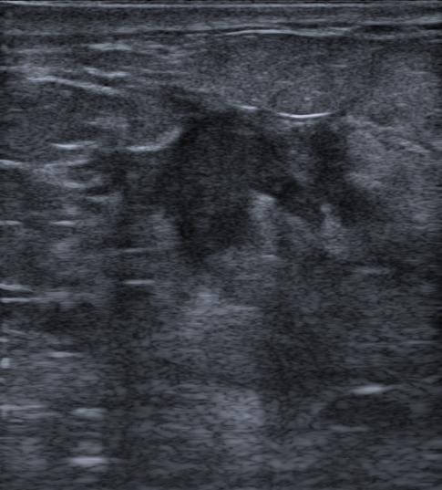

## 문제
A 52-year-old woman comes to the physician because of a painless lump in her left breast that she noticed 1 month ago. She has had no breast trauma, surgery, nipple discharge, or fever. Her last screening mammogram 3 years ago was normal. Her mother was diagnosed with breast cancer at the age of 71 years. Her vital signs are within normal limits. Examination shows a 2-cm firm, nontender, poorly mobile mass in the upper outer quadrant of the left breast; the overlying skin is normal, and there is no axillary lymphadenopathy. A gray-scale ultrasound image of the breast mass is shown. Which of the following is the most likely diagnosis?

- A. Intraductal papilloma
- B. Invasive ductal carcinoma
- C. Fibroadenoma
- D. Fat necrosis
- E. Simple cyst

_Gray-scale breast ultrasound, unaltered apart from scaling (The Cancer Imaging Archive, CC BY 4.0; no cropping or adjustment)_

## 정답 및 해설
> 정답: B

- **정답 핵심**: The ultrasound shows an irregular, hypoechoic solid mass with angular and spiculated margins and posterior acoustic shadowing. These are the features most predictive of malignancy (BI-RADS 5). In a 52-year-old woman with a new, firm, fixed mass and no trauma, the most likely diagnosis is invasive ductal carcinoma (invasive carcinoma of no special type); core needle biopsy would confirm it.
- **원리**: <b>Why cancer looks irregular and spiculated</b>: invasive carcinoma grows by sending cords of tumor cells into the surrounding fat and provoking a desmoplastic (fibrous) stroma. Those radiating extensions are the spicules, and the uneven growth makes the outline angular rather than smooth.  <b>Why it casts a shadow</b>: dense collagen in the desmoplastic stroma absorbs and scatters the sound beam, so less echo returns from behind the mass — posterior acoustic shadowing. A fibroadenoma, made of loose stroma and ducts, transmits sound and often shows slight posterior enhancement; a cyst transmits sound completely.  <b>Why the margins are graded</b>: the BI-RADS lexicon ranks margin features by malignancy risk — circumscribed is the most benign; indistinct, angular, microlobulated, and spiculated progressively more suspicious. A non-parallel or taller-than-wide orientation adds to suspicion because tumor grows across tissue planes.  <b>Clinical context</b>: age over 50, a new firm, fixed lump, and a first-degree relative with breast cancer raise the pretest probability; the absence of trauma makes fat necrosis less likely.
- **비교**: <table><thead><tr><th style="width:22%">Feature</th><th style="width:39%">Invasive ductal carcinoma (answer)</th><th>Fat necrosis (closest distractor)</th></tr></thead><tbody> <tr><td>History</td><td><b>No trauma</b>, older woman, new firm fixed mass</td><td>Prior trauma, surgery, or radiation in about half of cases</td></tr> <tr><td>Ultrasound</td><td>Irregular, hypoechoic, spiculated, posterior shadowing</td><td>Varies: oil cyst (anechoic, circumscribed) or irregular mass that can mimic cancer</td></tr> <tr><td>Course</td><td>Grows</td><td>Shrinks or calcifies over months</td></tr> </tbody></table> The images can be indistinguishable, which is why both go to biopsy; without a trauma history, carcinoma is far more likely.
- **오답 이유**:
  - (A) An intraductal papilloma would be correct with bloody nipple discharge and a small solid mass within a dilated duct near the nipple.
  - (C) A fibroadenoma would be correct in a young woman with an oval, circumscribed, parallel, homogeneous mass that does not cast a posterior shadow.
  - (D) Fat necrosis would be favored after recent breast trauma or surgery, especially if the lesion were an anechoic oil cyst or regressed on follow-up.
  - (E) A simple cyst would be correct if the lesion were round or oval, anechoic, with a thin wall and posterior acoustic enhancement.
- **함정**: Assuming a firm painless lump is benign because it is small and nontender — spiculated margins and shadowing are the ultrasound signs of invasive carcinoma.
- **학습목표**: 외상 병력이 없는 중년 여성의 만져지는 유방 종괴가 초음파에서 불규칙 모양·각지고 침상인 경계·뒤쪽 그림자를 보이면 침윤성 유방암을 가장 먼저 생각하고 섬유선종·지방괴사와 구별한다
- **근거·출처**: American College of Radiology. ACR BI-RADS Atlas, 5th ed. Ultrasound — masses: shape, margin, posterior features · Townsend CM, et al. Sabiston Textbook of Surgery, 21st ed. Ch. Diseases of the Breast — evaluation of a breast mass · 작성자 판독(2026-10-23): 불규칙 저에코 종괴, 각지고 침상인 경계, 뒤쪽 음향 그림자(생검 확인 침윤성 유방암 NST)

## 출처
- BrEaST-Lesions-USG, The Cancer Imaging Archive (CC BY 4.0) · case007 · Creative Commons Attribution 4.0 International · https://www.cancerimagingarchive.net/data-usage-policies-and-restrictions/
