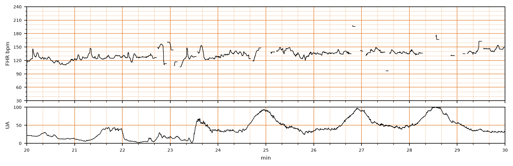

## 문제
A 30-year-old woman, gravida 1, para 0, at 39 weeks' gestation is admitted to the labor unit in spontaneous labor. Contractions began 8 hours ago, and her membranes ruptured spontaneously 2 hours ago, draining clear fluid. Her pregnancy has been uncomplicated. She has not received oxytocin or epidural analgesia. Her temperature is 36.9°C (98.4°F), pulse is 88/min, and blood pressure is 122/76 mm Hg. Pelvic examination shows the cervix is 6 cm dilated and 90% effaced, with the vertex at 0 station. Continuous electronic fetal monitoring is in place, and a 10-minute segment of the tracing is shown. Which of the following is the most appropriate next step in management?

- A. Continue labor with routine periodic review of the tracing
- B. Left lateral positioning, oxygen, and an intravenous fluid bolus
- C. Fetal scalp blood sampling for pH measurement
- D. Amnioinfusion through an intrauterine catheter
- E. Immediate cesarean delivery

_Intrapartum fetal heart rate (upper) and uterine activity (lower), minutes 20–30 of monitoring; 3 cm/min, vertical lines = 1 min; gaps are signal loss in the original record (CTU-UHB Intrapartum Cardiotocography Database, PhysioNet, ODC-BY 1.0; 4 Hz raw data, no smoothing)_

## 정답 및 해설
> 정답: A

- **정답 핵심**: The baseline fetal heart rate is about 130–140/min with moderate variability (amplitude roughly 6–15/min), and there are no late or variable decelerations with the contractions. This is a Category I (normal) tracing, which predicts a normal fetal acid–base status at that moment, so labor continues with routine periodic review of the tracing; no intrauterine resuscitation or intervention is needed.
- **원리**: <b>What a tracing tells you</b>: the fetal heart rate is set by the autonomic nervous system. <b>Moderate variability</b> means that the fetal brainstem is well oxygenated and actively adjusting the rate beat to beat — the single most reassuring feature, because it is lost when central acidemia develops.  <b>Reading in order</b>: baseline (110–160/min), variability (moderate = 6–25/min), accelerations, decelerations and their timing relative to contractions, then contraction frequency (normal ≤ 5 in 10 minutes averaged over 30 minutes).  <b>The three categories</b>: Category I has a normal baseline, moderate variability, and no late or variable decelerations — accelerations may or may not be present. Category II is everything in between and calls for evaluation and intrauterine resuscitation. Category III (absent variability with recurrent late or variable decelerations or bradycardia, or a sinusoidal pattern) calls for prompt delivery if resuscitation fails.  <b>Gaps in the line</b>: short breaks in an external tracing are signal loss, not fetal events, and do not change the category.
- **비교**: <table><thead><tr><th style="width:22%">Feature</th><th style="width:39%">Routine care — Category I (answer)</th><th>Intrauterine resuscitation — Category II (closest distractor)</th></tr></thead><tbody> <tr><td>Variability</td><td><b>Moderate (6–25/min)</b></td><td>Minimal, or moderate with decelerations</td></tr> <tr><td>Decelerations</td><td><b>None late or variable</b></td><td>Recurrent late or variable decelerations</td></tr> <tr><td>Baseline</td><td>110–160/min</td><td>Tachycardia or bradycardia possible</td></tr> </tbody></table> Repositioning, oxygen, and fluids treat a cause such as cord compression or reduced uteroplacental flow; a normal tracing has no such cause to treat.
- **오답 이유**:
  - (B) Repositioning, oxygen, and fluids become correct when a Category II tracing shows recurrent late or variable decelerations or minimal variability.
  - (C) Fetal scalp blood sampling is used in some settings to clarify an indeterminate Category II tracing; it is not needed when variability is moderate.
  - (D) Amnioinfusion is indicated for recurrent variable decelerations from cord compression, typically with oligohydramnios, which this tracing does not show.
  - (E) Immediate cesarean delivery is correct for a Category III tracing that does not improve, such as absent variability with recurrent late decelerations.
- **함정**: Treating the gaps in the line or the strong contractions as a warning — the tracing has moderate variability and no decelerations, so it is Category I.
- **학습목표**: 분만 중 태아심박동 기록에서 정상 기저 심박동·중등도 변이·감속 없음을 읽어 범주 I 로 판정하고 일상적 분만 관리를 이어 간다
- **근거·출처**: American College of Obstetricians and Gynecologists. Practice Bulletin No. 106: Intrapartum fetal heart rate monitoring. Obstet Gynecol 2009;114:192-202 · Macones GA, et al. The 2008 NICHD workshop report on electronic fetal monitoring. Obstet Gynecol 2008;112:661-666

## 출처
- CTU-UHB Intrapartum Cardiotocography Database (PhysioNet, ODC-BY 1.0) · record 1174 · Open Data Commons Attribution License v1.0 · https://opendatacommons.org/licenses/by/1-0/
