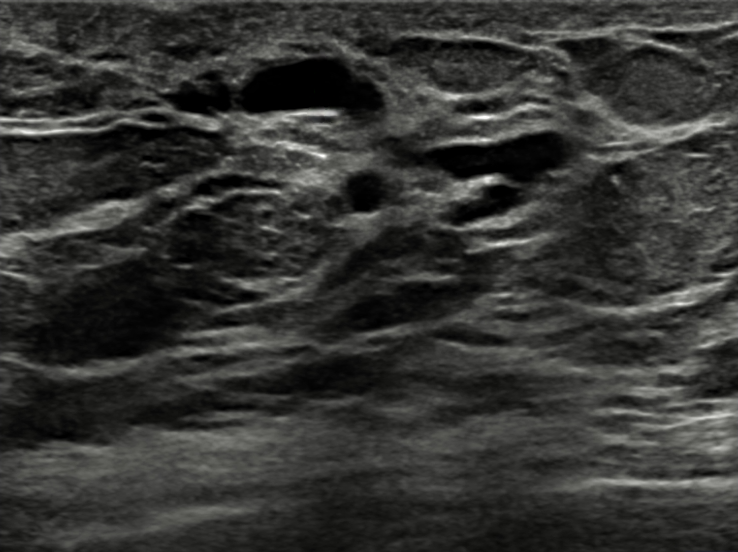

## 문제
57세 여자가 두 달 전부터 왼쪽 유두에서 끈적한 녹갈색 분비물이 나와 외래에 왔다. 분비물은 짜야 나오고, 유두 표면의 여러 유관 구멍에서 나온다. 폐경은 6년 전이고 호르몬 치료는 받지 않았으며 담배를 20년 피웠다. 유두는 갈라진 틈 모양으로 약간 들어가 있다. 유륜 아래가 반죽처럼 만져지지만 따로 구분되는 덩이는 없고, 겨드랑이 림프절은 만져지지 않는다. 분비물의 잠혈 검사는 음성이고, 유방촬영에서 덩이나 미세석회화는 없다. 왼쪽 유방 초음파 사진은 그림과 같다. 가장 가능성이 높은 진단은?

- A. 유관 확장증
- B. 유관내 유두종
- C. 침윤성 관암종
- D. 섬유선종
- E. 유관상피내암

_유방 초음파 회색조 영상, 원본 그대로 (TCIA, CC BY 4.0 — 자르기·보정 없음)_

## 정답 및 해설
> 정답: A

- **정답 핵심**: 초음파에서 무에코의 관 모양 구조가 여러 개 가지 치듯 늘어서 있고 관 안에 고형 결절이 없다. 폐경 후 흡연자에게 여러 유관에서 짜야 나오는 끈적한 녹갈색 분비물, 틈 모양 유두 함몰, 잠혈 음성, 유방촬영 정상이 함께 있으므로 유관 확장증이다.
- **원리**: <b>무엇이 늘어나나</b>: 유관 확장증은 유륜 아래 큰 유관이 넓어지고 그 안에 지질이 많은 분비물과 세포 찌꺼기가 고이는 양성 질환이다. 고인 분비물이 관벽 밖으로 새면 주변에 형질세포가 많은 만성 염증과 섬유화가 생기고(형질세포 유방염), 섬유화가 유관을 당겨 <b>틈 모양의 유두 함몰</b>을 만든다 — 그래서 암과 헷갈린다. 흡연이 위험인자다.  <b>분비물이 말해 주는 것</b>: 병리적 분비물의 경고 표지는 <b>한쪽 · 한 유관 · 저절로 · 혈성(또는 맑은 물)</b>이다. 여러 유관에서 짜야 나오는 끈적한 녹색·갈색·검은 분비물은 양성(유관 확장증·섬유낭성 변화)을 시사한다.  <b>초음파 읽는 법</b>: 관 모양 무에코 구조 안에 <b>고형 결절이 있는지</b>가 핵심이다. 관 안 결절이나 벽에 붙은 덩이가 보이면 유관내 유두종이나 암을 배제하기 위해 생검·절제가 필요하다.
- **비교**: <table><thead><tr><th style="width:22%">구분</th><th style="width:39%">유관 확장증(정답)</th><th>유관내 유두종(가장 가까운 오답)</th></tr></thead><tbody> <tr><td>나이</td><td>폐경 전후·흡연자</td><td>35~55세</td></tr> <tr><td>분비물</td><td><b>여러 유관, 짜야 나옴, 녹갈색·끈적</b></td><td><b>한 유관, 저절로, 혈성·장액성</b></td></tr> <tr><td>초음파</td><td>여러 확장 유관, 관 안 고형 성분 없음</td><td>확장 유관 안의 고형 결절</td></tr> <tr><td>처치</td><td>증상 조절·금연, 심하면 중심 유관 절제</td><td>병변 유관 절제로 조직 확인</td></tr> </tbody></table> 분비물이 '몇 개의 구멍에서, 어떤 색으로, 저절로인가'를 먼저 묻고, 초음파에서 관 안을 본다.
- **오답 이유**:
  - ② 유관내 유두종은 한 유관에서 저절로 나오는 혈성·장액성 분비물이 있고 초음파에서 확장 유관 안에 고형 결절이 보일 때 정답이다.
  - ③ 침윤성 관암종은 초음파에서 경계가 불규칙하고 비평행이며 뒤쪽 음향 그림자를 보이는 저에코 덩이가 있을 때 정답이 된다.
  - ④ 섬유선종은 젊은 여성에서 잘 움직이는 고무 같은 덩이로, 초음파에서 경계가 매끈한 타원형 저에코 고형 덩이일 때 정답이다.
  - ⑤ 유관상피내암은 유방촬영의 가는 선형·분지형 미세석회화로 발견되는 경우가 많고, 혈성 분비물과 함께 오면 정답이 될 수 있다.
- **함정**: 유두 함몰과 폐경 후 나이만 보고 암을 고르는 것 — 여러 유관의 끈적한 녹갈색 분비물과 고형 성분 없는 확장 유관은 유관 확장증이다.
- **학습목표**: 여러 유관에서 나오는 끈적한 녹갈색 유두 분비물과 초음파의 무에코 관 모양 구조를 유관 확장증으로 판단하고, 한 유관의 혈성 분비물·관내 종괴를 보이는 유관내 유두종과 구별한다
- **근거·출처**: Townsend CM, et al. Sabiston Textbook of Surgery, 21st ed. Ch. Diseases of the Breast — nipple discharge and duct ectasia · Expert Panel on Breast Imaging; Lee SJ, et al. ACR Appropriateness Criteria® Evaluation of Nipple Discharge. J Am Coll Radiol 2017;14:S138-S153

## 출처
- BrEaST-Lesions-USG, The Cancer Imaging Archive (CC BY 4.0) · case140 · Creative Commons Attribution 4.0 International · https://www.cancerimagingarchive.net/data-usage-policies-and-restrictions/
