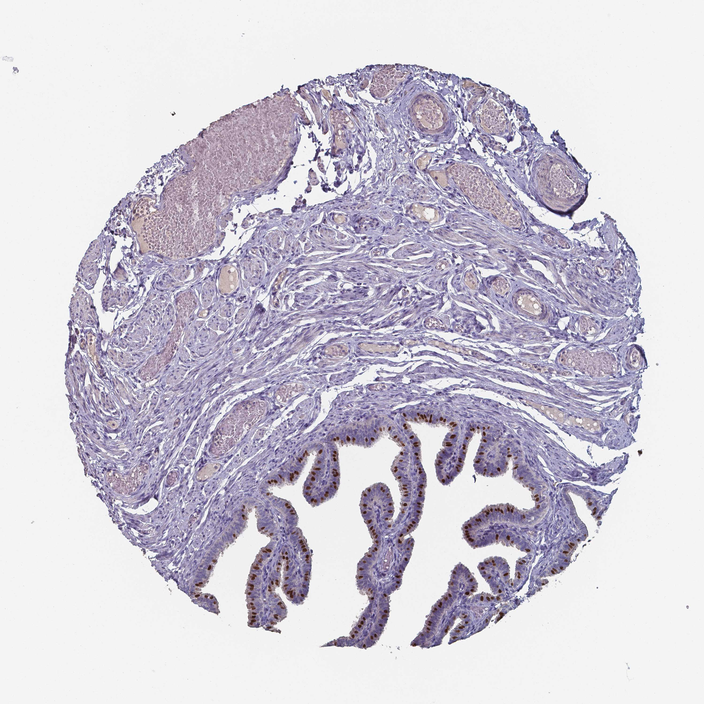

## 문제
A 26-year-old woman undergoes laparoscopic salpingectomy for a ruptured ampullary ectopic pregnancy. She had pelvic inflammatory disease 4 years ago. Her blood pressure stabilizes after surgery, and serum β-hCG becomes undetectable 3 weeks later. To study the mucosa of the removed tube, a section taken away from the implantation site is stained by immunohistochemistry with an antibody against a nuclear transcription factor that switches on the genes needed to build motile microtubule-based surface projections. A photomicrograph of the stained section is shown. Which of the following best describes the cells with brown-stained nuclei?

- A. Lining epithelial cells that sweep the embryo toward the uterus
- B. Lining epithelial cells that secrete nutrient fluid into the lumen
- C. Smooth muscle cells whose peristalsis moves the embryo
- D. Stromal cells of the folds that form decidua after implantation
- E. Endothelial cells of the vessels supplying the mucosal folds

_Immunohistochemical stain of a tissue microarray core (DAB brown chromogen, hematoxylin counterstain), resized only (Human Protein Atlas, CC BY 4.0; no cropping or color adjustment)_

## 정답 및 해설
> 정답: A

- **정답 핵심**: Brown nuclei are confined to a subset of the columnar cells lining the mucosal folds; the neighboring lining cells, the stroma, the smooth muscle wall, and the vessels are unstained. A transcription factor that drives formation of motile cilia marks the ciliated cells, whose coordinated beating (with muscular peristalsis) carries the embryo toward the uterus. Loss of these cells after salpingitis is a major cause of tubal ectopic pregnancy.
- **원리**: <b>The tubal lining has two cell types</b>: ciliated cells (most numerous toward the fimbria and ampulla) and secretory (peg) cells that produce tubal fluid nourishing the gametes and early embryo. The muscularis below contracts in peristaltic waves.  <b>How to read this stain</b>: the antibody marks a transcription factor, so the signal is <b>nuclear</b>. Only some lining cells are positive, in an alternating pattern with negative neighbors — that is what a marker for one of two intermixed epithelial cell types looks like. The muscle wall, stroma, and vessels are negative.  <b>Why it matters clinically</b>: embryo transport depends mostly on ciliary beating toward the uterus. Pelvic inflammatory disease (chlamydia, gonorrhea) destroys ciliated cells and scars the folds; smoking and the luteal hormone milieu also slow ciliary beat. A delayed embryo implants in the tube — usually the ampulla — producing ectopic pregnancy. Primary ciliary dyskinesia similarly reduces fertility and raises ectopic risk.
- **비교**: <table><thead><tr><th style="width:22%">Feature</th><th style="width:39%">Ciliated cell (answer)</th><th>Secretory (peg) cell (closest distractor)</th></tr></thead><tbody> <tr><td>Marker program</td><td><b>Motile-cilia transcription factor (nuclear)</b></td><td>Secretory proteins; PAX8</td></tr> <tr><td>Surface</td><td>Many motile cilia</td><td>Microvilli, apical bulge</td></tr> <tr><td>Function</td><td>Moves gametes and embryo</td><td>Produces nourishing tubal fluid</td></tr> <tr><td>Lost in</td><td>Salpingitis, smoking → ectopic pregnancy</td><td>Proportion rises after the menopause</td></tr> </tbody></table> Both line the same folds, so location alone cannot separate them — the marker program does.
- **오답 이유**:
  - (B) Secretory (peg) cells would be the answer if the antibody marked a secretory program such as PAX8; they lie beside the stained cells but are negative here.
  - (C) Smooth muscle cells would be correct if brown nuclei filled the muscular wall around the folds; in this section the wall is unstained.
  - (D) Stromal cells would be the answer for a marker of decidualized stroma; the fold cores here are negative and decidua forms at implantation sites.
  - (E) Endothelial cells would be stained by a vascular marker such as CD31, outlining vessel lumens; the vessels in this section are negative.
- **함정**: Assuming the muscular wall moves the embryo and choosing smooth muscle — the stain is in the lining epithelium, where ciliary beating does most of the transport.
- **학습목표**: 난관 면역조직화학에서 점막 주름 상피의 일부 세포 핵만 염색된 것을 읽고, 섬모 형성 전사인자가 표시하는 섬모세포의 역할(배아 수송)과 연결한다
- **근거·출처**: Kumar V, et al. Robbins and Cotran Pathologic Basis of Disease, 10th ed. Ch. The Female Genital Tract — fallopian tubes; ectopic pregnancy · Lyons RA, et al. The reproductive significance of human Fallopian tube cilia. Hum Reprod Update 2006;12:363-372

## 출처
- Human Protein Atlas, FOXJ1 / Fallopian tube (CC BY 4.0), https://images.proteinatlas.org/5714/153422_A_8_7.jpg · Creative Commons Attribution 4.0 International · https://www.proteinatlas.org/about/licence
