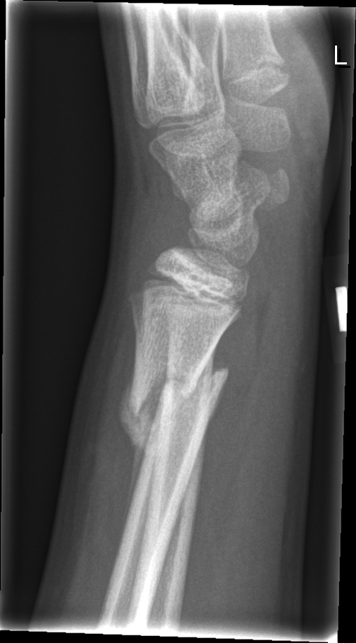

## 문제
10세 남아가 왼쪽 손목 위가 튀어나와 보여 어머니와 함께 외래에 왔다. 12일 전 자전거에서 넘어지며 왼손을 짚었고, 부모는 삔 줄 알고 파스만 붙였다. 처음 사흘은 많이 아팠지만 지금은 통증이 줄었다. 열은 없었다. 체온 36.7℃ 이고, 원위 전완이 약간 휘어 보이며 그 부위에 가벼운 압통이 있다. 피부 발적이나 열감은 없고 손가락 감각·운동과 요골 동맥 맥박은 정상이다. 백혈구 7,800/μL, C-반응단백 0.3 mg/dL, 알칼리인산분해효소는 나이에 맞는 범위다. 왼쪽 손목 측면 X선 사진은 그림과 같다. 골절 부위 피질을 따라 보이는 희뿌연 새 뼈 음영으로 가장 적절한 것은?

- A. 유잉육종의 양파껍질 골막 반응
- B. 골육종의 Codman 삼각
- C. 괴혈병의 골막하 출혈 석회화
- D. 치유 중인 골절의 골막 가골
- E. 급성 골수염의 골막 반응

_왼쪽 손목·원위 전완 측면 X선, 위치 표지는 원본의 것, 크기 조정만 (GRAZPEDWRI-DX, figshare, CC BY 4.0)_

## 정답 및 해설
> 정답: D

- **정답 핵심**: X선에서 원위 요골 골간단을 가로지르는 골절과 원위 골편의 각형성이 있고, 골절 부위 한쪽 피질을 따라 희뿌연 골막 새뼈가 붙어 있다. 넘어진 지 12일이 지났고 열·발적이 없으며 백혈구·C-반응단백이 정상이므로, 이 새 뼈는 골절이 아물며 생긴 골막 가골이다.
- **원리**: <b>왜 소아 골절에서 골막 새뼈가 빨리 보이나</b>: 소아의 골막은 두껍고 혈관이 많으며 뼈모세포를 만드는 능력이 크다. 골절 때 들뜬 골막 아래 혈종 속으로 골막의 전구세포가 들어가 연골·섬유 가골을 만들고, 이것이 무기질화되면 X선에서 골절 부위를 감싸는 <b>희뿌연 새 뼈</b>로 보인다 — 소아에서는 대개 <b>7~14일</b>에 나타난다. 그래서 골막 새뼈는 '골절이 며칠 됐는지'를 알려 주는 시계가 된다(아동학대 평가에서도 쓰인다).  <b>같은 골막 반응, 다른 원인</b>: 골막은 무엇이든 들어 올리면 새 뼈를 만든다 — 피(외상·괴혈병), 고름(골수염), 종양(유잉육종·골육종). 그래서 모양보다 <b>맥락</b>이 먼저다: 외상력과 시점, 골절선이 있는지, 열·염증 수치, 뼈 파괴가 있는지를 함께 본다.  <b>위험 신호</b>: 외상력 없이, 골절선 없이, 뼈속질 파괴나 골막 반응이 끊기는 모양(Codman 삼각)·햇살 모양이 보이거나, 열과 염증 수치가 높으면 골수염·종양을 의심해 MRI 와 생검을 한다.
- **비교**: <table><thead><tr><th style="width:22%">구분</th><th style="width:39%">골막 가골(정답)</th><th>급성 골수염의 골막 반응(가장 가까운 오답)</th></tr></thead><tbody> <tr><td>계기</td><td><b>외상 뒤 7~14일</b></td><td>열·국소 통증으로 시작, 외상은 우연</td></tr> <tr><td>골절선</td><td><b>있다</b> — 새 뼈가 골절을 감싼다</td><td>없다, 골간단 투과성 파괴</td></tr> <tr><td>전신 소견</td><td>열 없음, 백혈구·CRP 정상</td><td>발열, CRP·적혈구침강속도 상승</td></tr> <tr><td>경과</td><td>통증이 줄어든다</td><td>통증이 심해진다</td></tr> </tbody></table> 골막 반응을 보면 먼저 '그 안에 골절선이 있는가, 아이가 아파 보이는가'를 묻는다.
- **오답 이유**:
  - ① 유잉육종은 외상과 무관하게 통증·열이 이어지고 골간에 침투성 뼈 파괴와 겹겹의 양파껍질 골막 반응이 보일 때 정답이다.
  - ② 골육종의 Codman 삼각은 골간단의 뼈 파괴·종양 뼈 형성과 함께 골막이 들려 끊긴 삼각형으로 보일 때 정답이 된다.
  - ③ 괴혈병의 골막하 출혈 석회화는 비타민 C 결핍 식이, 잇몸 출혈, 골간단의 투명대·고리 모양 골단이 함께 있을 때 정답이다.
  - ⑤ 급성 골수염의 골막 반응은 열과 국소 발적이 있고 C-반응단백이 오르며 골절선 없이 골간단 파괴가 보일 때 정답이 된다.
- **함정**: 새 뼈가 보이면 골수염이나 종양부터 떠올리는 것 — 외상 12일 뒤 골절선을 감싸는 새 뼈에 열·염증 수치가 정상이면 치유 가골이다.
- **학습목표**: 외상 12일 뒤 소아 원위 요골 골절의 골막 새뼈를 치유 가골로 읽고, 열·염증 수치가 정상이면 골수염·골종양의 골막 반응과 구별한다
- **근거·출처**: Kliegman RM, et al. Nelson Textbook of Pediatrics, 21st ed. Ch. Common Fractures — healing and remodeling in children · Prosser I, et al. A timetable for the radiologic features of fracture healing in young children. AJR Am J Roentgenol 2012;198:1014-1020

## 출처
- GRAZPEDWRI-DX (figshare, CC BY 4.0) · Creative Commons Attribution 4.0 International · https://creativecommons.org/licenses/by/4.0/
