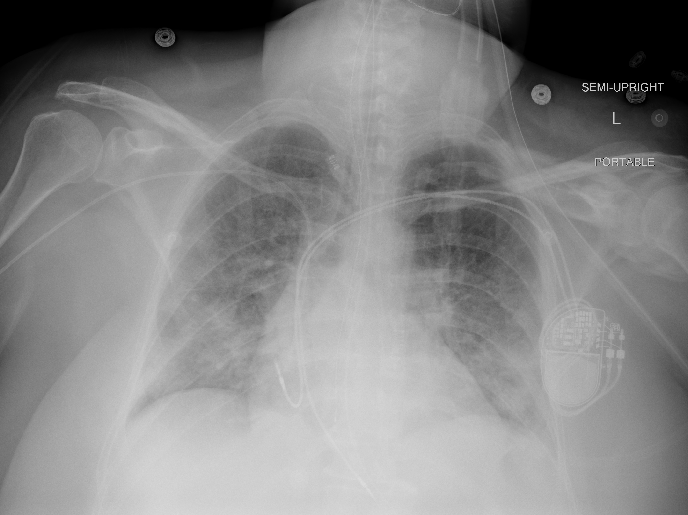

## 문제
57세 여자가 중환자실에서 기관삽관 6일째이다. 열과 기침으로 입원해 SARS-CoV-2 PCR 양성을 확인했고, 저산소혈증이 악화되어 기관삽관한 뒤 덱사메타손과 일회호흡량 6 mL/kg(예측체중)의 기계환기를 받고 있다. 입원 초기에 쓰던 노르에피네프린은 48시간 전에 끊었다. 동결절 기능부전으로 영구 심박조율기를 가지고 있다. 혈압 128/72 mmHg, 맥박 84회/분, 체온 37.4℃이다. 흡입산소분율 0.4, 호기말양압 8 cmH2O 에서 동맥혈 PaO2 는 84 mmHg 이다. 입원 뒤 누적 수분 균형은 +6.2 L 이고, 소변량은 시간당 60 mL, 혈청 크레아티닌은 0.8 mg/dL 이다. 심장초음파에서 좌심실 박출률은 60 % 이다. 오늘 아침 휴대용 흉부 X선 사진은 그림과 같다. 가장 적절한 처치는?

- A. 엎드린 자세 환기 시작
- B. 일회호흡량을 10 mL/kg 로 증량
- C. 고빈도 진동 환기로 전환
- D. 푸로세미드 정맥 투여로 음성 수분 균형 유도
- E. 생리식염수 1 L 정맥 급속 주입

_휴대용 반좌위 전후 흉부 X선, 위치·방향 글자는 원본의 것 (TCIA, CC BY 4.0 — DICOM 을 표준 창으로 변환, 크롭·보정 없음)_

## 정답 및 해설
> 정답: D

- **정답 핵심**: 양쪽 폐야의 퍼진 음영, PaO2/FiO2 = 84/0.4 = 210, 정상 좌심실 기능 — 심장성 폐부종이 아닌 급성호흡곤란증후군(ARDS)이다. 승압제를 48시간 전에 끊어 쇼크가 풀렸고, 누적 수분이 +6.2 L 이며 소변량·크레아티닌이 정상이므로 이뇨제로 음성 수분 균형을 만드는 보존적 수분 전략이 가장 적절하다.
- **원리**: <b>ARDS 의 부종은 「새는 모세혈관」이다</b>: 폐포-모세혈관 장벽이 염증으로 손상되어 정수압이 정상이어도 단백질이 많은 액체가 간질·폐포로 샌다. 그래서 같은 양의 수액이라도 정상 폐보다 훨씬 많이 폐로 빠져나가고, 폐 안 물의 양이 산소화와 폐 탄성을 직접 나쁘게 한다.  <b>왜 쇼크가 풀린 뒤에 말리나</b>: 소생기(쇼크)에는 장기 관류가 먼저라 수액을 주지만, 승압제를 끊은 뒤에도 남은 양성 수분 균형은 폐부종만 늘린다. FACTT 시험에서 쇼크가 없는 ARDS 환자에게 이뇨제로 수분을 줄인 군은 사망률 차이 없이 <b>기계환기 없는 날</b>과 중환자실 밖 날이 늘었고 투석은 늘지 않았다.  <b>조건</b>: 소변량과 크레아티닌이 유지되고 승압제가 필요 없을 때 한다 — 이 환자는 세 가지를 모두 갖추었다.
- **비교**: <table><thead><tr><th style="width:22%">구분</th><th style="width:39%">보존적 수분 전략(정답)</th><th>엎드린 자세 환기(가장 가까운 오답)</th></tr></thead><tbody> <tr><td>적응</td><td><b>쇼크가 풀린 ARDS + 양성 수분 균형</b></td><td>PaO2/FiO2 &lt; 150 인 중등도~중증 ARDS</td></tr> <tr><td>이 환자</td><td>승압제 중단 48시간, +6.2 L, 소변량·크레아티닌 정상</td><td>PaO2/FiO2 210 — 기준 미달</td></tr> <tr><td>근거</td><td>FACTT — 기계환기 없는 날 증가</td><td>PROSEVA — P/F &lt; 150 에서 사망률 감소</td></tr> </tbody></table> 산소화가 P/F 150 아래로 나빠지면 엎드린 자세가 먼저이고, 그 위에서는 저일회호흡량을 유지하며 수분을 줄인다.
- **오답 이유**:
  - ① 엎드린 자세 환기는 PaO2/FiO2 가 150 미만인 중등도~중증 ARDS 에서 정답이 되며, 이 환자의 값은 210 이다.
  - ② 일회호흡량 증량은 ARDS 에서 폐 과팽창 손상을 늘려 사망률을 높인다 — 어떤 조건에서도 6 mL/kg 근처를 유지하는 것이 원칙이다.
  - ③ 고빈도 진동 환기는 대규모 시험에서 사망률을 줄이지 못하거나 늘렸으며, 일반 환기로 버틸 수 없는 구조 상황에서만 고려한다.
  - ⑤ 생리식염수 급속 주입은 승압제가 필요한 쇼크나 소변량 감소를 동반한 저혈량이 있을 때 정답이 되며, 이 환자에게는 폐부종을 늘린다.
- **함정**: 양쪽 폐 음영이 심하니 산소화를 위해 엎드린 자세부터 하려는 것 — P/F 210 은 기준 밖이고, 이 단계의 문제는 쌓인 수분이다.
- **학습목표**: 쇼크가 풀린 급성호흡곤란증후군 환자에서 누적 수분이 많고 콩팥 기능이 유지되면 이뇨제로 보존적 수분 전략을 쓰고, 엎드린 자세 환기의 적응(P/F < 150)과 구별한다
- **근거·출처**: National Heart, Lung, and Blood Institute ARDS Clinical Trials Network. Comparison of two fluid-management strategies in acute lung injury. N Engl J Med 2006;354:2564-2575 · Guérin C, et al. Prone positioning in severe acute respiratory distress syndrome. N Engl J Med 2013;368:2159-2168 · Qadir N, et al. An update on management of adult patients with ARDS: an official ATS clinical practice guideline. Am J Respir Crit Care Med 2024;209:24-36

## 출처
- COVID-19-AR, The Cancer Imaging Archive (CC BY 4.0) · series …32539920 · Creative Commons Attribution 4.0 International · https://www.cancerimagingarchive.net/data-usage-policies-and-restrictions/
