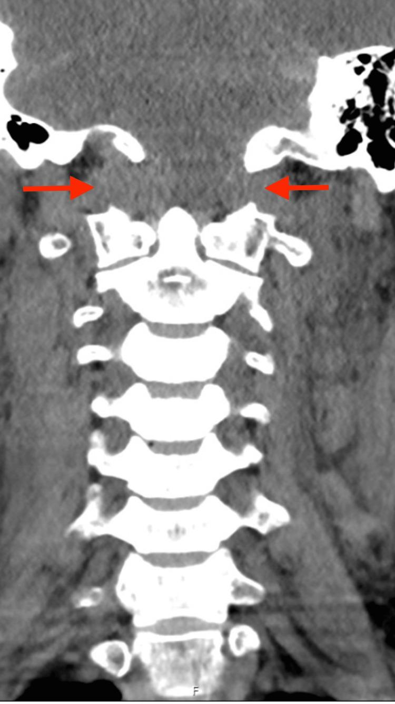

## 문제
A 42-year-old man is brought to the emergency department 50 minutes after he was thrown from his motorcycle in a high-speed collision. A rigid cervical collar was placed at the scene. He was intubated for airway protection after he became combative. Before sedation, he moved all four extremities to command. His pulse is 96/min, and blood pressure is 132/78 mm Hg. There is a scalp laceration over the occiput. Noncontrast CT of the head shows no intracranial hemorrhage. Focused abdominal sonography shows no free fluid. A coronal reconstruction of the cervical spine CT is shown. Neurosurgery is consulted for occipitocervical stabilization. Which of the following is the most appropriate additional study to screen for an associated injury that can cause a delayed stroke?

- A. Carotid duplex ultrasonography
- B. MRI of the brain with diffusion-weighted imaging
- C. Flexion–extension radiographs of the cervical spine
- D. Transcranial Doppler ultrasonography
- E. CT angiography of the head and neck

_Coronal CT reconstruction of the craniocervical junction and cervical spine; red arrows are from the original figure (PMC Open Access Subset, CC BY — single-panel figure as published, no cropping or adjustment)_

## 정답 및 해설
> 정답: E

- **정답 핵심**: Both occipital condyle–C1 joints are widened and incongruent while the C1–C2 joints below are normal: atlanto-occipital (craniocervical) dissociation. This high-energy upper cervical injury is a high-risk criterion for blunt cerebrovascular injury of the vertebral and internal carotid arteries, which often causes stroke hours to days later. CT angiography of the head and neck is the screening test of choice, so antithrombotic therapy can be started before ischemia occurs.
- **원리**: <b>Why the vertebral artery is at risk</b>: the vertebral artery runs through the C1 transverse foramen, curves posteriorly over the C1 arch, and pierces the atlanto-occipital membrane to enter the skull. Distraction or translation at the occiput–C1 joint stretches it exactly at this fixed curve. The distal internal carotid artery is also stretched over the lateral masses of C1–C2 by hyperextension and rotation.  <b>How it causes delayed stroke</b>: stretching tears the intima; a dissection flap or intramural hematoma forms, and platelet thrombus on the injured surface embolizes or occludes the vessel. Most strokes appear after a latent period of hours to days, which is the window for screening and antithrombotic treatment.  <b>Screening criteria</b>: the (expanded) Denver and Memphis criteria list cervical spine fractures — especially C1–C3, subluxation, or fractures through the transverse foramen — and craniocervical dissociation as indications. Multidetector CT angiography is fast, noninvasive, and images both vertebral and carotid arteries up to the skull base.
- **비교**: <table><thead><tr><th style="width:22%">Feature</th><th style="width:39%">CT angiography (answer)</th><th>Carotid duplex (closest distractor)</th></tr></thead><tbody> <tr><td>Vessels seen</td><td><b>Vertebral and carotid arteries to the skull base</b></td><td>Cervical carotid below the mandible</td></tr> <tr><td>Vertebral V3 (C1–occiput)</td><td>Visualized</td><td>Hidden by bone — not assessable</td></tr> <tr><td>Role in blunt trauma</td><td>Screening test of choice</td><td>Insensitive; misses most injuries</td></tr> </tbody></table> The injury from craniocervical dissociation lies exactly where ultrasound cannot see.
- **오답 이유**:
  - (A) Carotid duplex would be useful for atherosclerotic stenosis of the cervical carotid bifurcation; it cannot see the vertebral artery at C1 or the distal internal carotid.
  - (B) Diffusion-weighted MRI shows infarction that has already happened; it would be correct for a patient with a new focal deficit, not for screening before ischemia.
  - (C) Flexion–extension films would be used for suspected ligamentous instability in an awake, neurologically intact patient without obvious injury; here they are dangerous.
  - (D) Transcranial Doppler detects intracranial vasospasm or emboli, as after subarachnoid hemorrhage; it does not image the extracranial arterial wall.
- **함정**: Choosing ultrasound because it is noninvasive — the vessel stretched by craniocervical dissociation lies behind the skull base, where only CT angiography reaches.
- **학습목표**: 관상 CT 에서 양쪽 후두과-환추 관절이 벌어진 두개-경추 분리를 읽고, 이것이 둔상성 뇌혈관 손상의 고위험 기준이므로 머리·목 CT 혈관조영으로 선별한다
- **근거·출처**: Kim DY, et al. Evaluation and management of blunt cerebrovascular injury: a practice management guideline from the Eastern Association for the Surgery of Trauma. J Trauma Acute Care Surg 2020;88:875-887 · Geddes AE, et al. Expanded screening criteria for blunt cerebrovascular injury: a bigger impact than anticipated. Am J Surg 2016;212:1167-1174

## 출처
- Atlanto-Occipital Dissociation With Catastrophic Neurological Injury: Ethical Challenges in the Intensive Care Setting. Cureus. 2025 Dec 13;17(12):e99105. doi: 10.7759/cureus.99105 (CC BY) — Figure 1 · CC BY · https://creativecommons.org/licenses/
